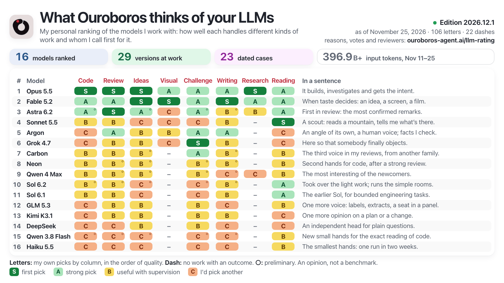

# Ouroboros

<a href="https://github.com/oslook/github-trending/blob/1d61d20a46f66a9590286bf23a8ce8db99be3acf/2026-08-04/python_weekly_trending.json"></a>

[](https://github.com/razzant/ouroboros/stargazers)
[](https://ouroboros-agent.ai/install/)
[](https://ouroboros-agent.ai/)
[](https://arxiv.org/abs/2608.08311)
[](https://github.com/RyanAlberts/best-of-Agent-Harnesses#ouroboros-2)
[](LICENSE)
[](https://www.python.org/downloads/)
[][download-macos-arm64]
[](https://ouroboros-agent.ai/install/#linux)
[][download-windows-x64]
[](https://github.com/razzant/OuroborosHub)
[](VERSION)

Ouroboros is an open-source, general-purpose AI agent whose identity, durable memory, and history continue across tasks and restarts. It works on external projects, coordinates a live swarm of specialist agents, and can rewrite the implementation it runs on, including its code, architecture, prompts, tools, and dependencies. Reflection can also change how it understands itself without severing that continuity.

It runs as a native desktop app or through a headless CLI. The runtime keeps its repository, durable memory, history, and interface on your machine, while model inference can use remote APIs you configure or a local GGUF model.

Ouroboros sends no telemetry by default, and the official project operates no usage or crash-report collection. A deployment can connect its own monitoring tools to its local records and choose what they receive; local history stays on the machine either way. Requests through OpenRouter carry the app name, which OpenRouter uses for its public app statistics.

> **Changing Ouroboros? Coding agents and people must read [CONTRIBUTING.md](CONTRIBUTING.md) before editing.** It defines the required project context, verification, and separate-agent review flow.

## Download Ouroboros

> **Just want to use Ouroboros? Click the download for your platform below. You do not need to clone this repository or install Python or uv.**

Desktop downloads bundle CPython 3.12.15 and SQLite 3.53.1. In-app Update replaces the repository and its packages, not that interpreter: install the app again to get this runtime. Apps up to 7.11.0 bundle Python 3.10 and keep Pillow 12.3, without the image-decoder fixes of Pillow 13: run Update in the installed app first, then install the new app ([order and checks](docs/DEPLOYMENT.md#moving-an-installed-app-to-a-new-bundled-python)).

- **macOS 12+ on Apple silicon:** [**Download for macOS (.dmg)**][download-macos-arm64]
- **Windows x64:** [**Download for Windows (.zip)**][download-windows-x64]
- **Debian, Ubuntu, or Astra Linux x86_64:** [**Download the Debian package (.deb)**][download-linux-deb-amd64]
- **Fedora or RHEL x86_64:** [**Download the RPM package (.rpm)**][download-linux-rpm-x86_64]
- **RED OS 8 x86_64:** [**Download the RED OS package (.rpm)**][download-linux-rpm-red80-x86_64]
- **Other Linux x86_64:** [**Download the portable AppImage**][download-linux-appimage-x86_64] or the [tar.gz archive][download-linux-x86_64]

**Android (experimental, Magisk-rooted ARM64):** [Installation and qualification guide](docs/ANDROID_INSTALL.md). Its USB setup requires Python and adb.

Files named `SHA256SUMS`, `release-evidence.json`, `release-smoke-*.json`, and `sbom-*.cdx.json` are verification evidence, not additional installers.

### macOS quick start

1. Click [**Download for macOS (.dmg)**][download-macos-arm64]. The current file is named `Ouroboros-<version>.dmg`.
2. Open the DMG and drag `Ouroboros.app` onto the **Applications** shortcut.
3. Open Ouroboros from Applications. If macOS refuses to open it, choose **Open Anyway** in **System Settings → Privacy & Security** (on macOS 14 and earlier, right-clicking the app and choosing **Open** also works).

On macOS 12 the app runs, but its browser tools refuse Chromium: the patched build they pin needs macOS 13 or later, and Ouroboros never falls back to an older Chromium. WebKit stays a separate choice where Playwright supports it.

<p align="center">
  
</p>

### Homebrew on macOS

Homebrew can install and update the same notarized app. This repository is its own tap:

```bash
brew tap razzant/ouroboros https://github.com/razzant/ouroboros.git
brew install --cask razzant/ouroboros/ouroboros
```

- Each Stable promotion updates the cask. Homebrew upgrades only when the cask's version differs from the version it recorded when it installed or adopted the app; then a plain `brew upgrade` compares the installed app version on current Homebrew (older versions skip `auto_updates` casks), and a named `brew upgrade --cask ouroboros` or `--greedy` can replace even a newer self-updated app with the cask's Stable version, including its bundled runtime. `brew reinstall` installs the cask's version over whatever app is there.
- An upgrade replaces the app and its bundled runtime but keeps the managed source checkout (`~/Ouroboros/repo` by default), so Ouroboros goes on running the source it had, for example 7.7.1 inside the 7.8.0 app, until you run Update in the app. In the released 7.8 app, in-app Update changes source, not the app bundle.
- If Ouroboros.app is already in Applications, `--adopt` takes it over without comparing versions and records the cask's version, so an older adopted app stays as it is and `brew upgrade` reports it up to date until the next Stable promotion; `brew reinstall --cask ouroboros` or `--force` replaces it.
- Homebrew asks a running Ouroboros to quit before an upgrade or uninstall and reopens it after an upgrade, without your shell environment. If you start Ouroboros with root variables for that launch only, such as `OUROBOROS_APP_ROOT` or `OUROBOROS_DATA_DIR`, quit it first and start it again the same way.
- The first cask installs 7.8.0. Finish Setup before the first Quit, including a quit by Homebrew: otherwise this version can leave a new data folder that later starts refuse to initialize (#2412). If affected, back up the data folder (`~/Ouroboros/data` by default) and look for `prior_history_without_state` in its `logs/events.jsonl` before changing anything. Use Reset runtime data in Settings only for a confirmed empty new installation. The cask displays this warning because Stable's README remains the release's original.
- `brew uninstall --cask ouroboros`, with or without `--zap`, removes only the app: `~/Ouroboros` (repository, memory, projects, Deliverables) and any custom roots stay, and so does sign-in startup, so turn off "Start Ouroboros on the host computer when you sign in" first if you use it.
- The first `brew tap` clones this whole repository.

### Windows quick start

1. Click [**Download for Windows (.zip)**][download-windows-x64].
2. Extract the ZIP to a permanent folder.
3. Open the extracted `Ouroboros` folder and run `Ouroboros.exe`.

### Linux quick start

- On Debian, Ubuntu, or Astra Linux, download the `.deb` above and run `sudo apt install ./ouroboros_*_amd64.deb`.
- On Fedora or RHEL, download the generic `.rpm` above and run `sudo dnf install ./ouroboros-*.x86_64.rpm`. RED OS 8 has its own `red80` package.
- On another x86_64 distribution, download the AppImage, make it executable with `chmod +x Ouroboros-*.AppImage`, and run it (see [Packaged Linux details](#packaged-linux-details) for Git requirements and install steps).

To run tasks, choose a connected Codex account as the Main model source, configure a supported remote provider API key, or use a local GGUF model. Claude Code and Cursor subscriptions can run delegated coding and review; they are not Main model sources. The first-run wizard guides accounts and models, access, background consciousness, the skills to start with, and budget setup.

Spending limits: out of the box, new paid work stops once known spend reaches $200 in total, or $50 for one task and its helpers; charges already in flight can pass a limit. Background consciousness starts with the setup wizard's switch, which is on unless you turn it off (without the wizard it stays off until you start it), and then has $15 for each 24 hours. Settings changes all three.

<details>
<summary>Optional CLI included with desktop downloads</summary>

The desktop packages already contain an optional CLI installer. On macOS, after copying the app to Applications, double-click `Install CLI.command` in the mounted DMG; after a Homebrew install, run `/Applications/Ouroboros.app/Contents/Resources/bin/install-ouroboros-cli`. On Linux use `./Ouroboros/bin/install-ouroboros-cli`; on Windows use `Ouroboros\bin\install-ouroboros-cli.cmd`. These installers create a user-local `ouroboros` command without sudo. You do not need Python or uv.

</details>

### Reinstall, move or remove

`~/Ouroboros` (data, memory and the code Ouroboros runs) is the installation; the app is a replaceable host. To replace or move the app, quit Ouroboros, put the new copy in place and open it: your data and code stay, and skill packages and sign-in startup follow the new copy at its next start. A new app changes only the bundled Python, SQLite and Node, never the code in `~/Ouroboros/repo`; in-app Update changes the code. **Settings → This computer → About** and the Updates page show both versions, and Ouroboros sees them in its host facts. Quit also stops this installation's own Claudexor engine, ending any run on it; Restart and Update keep it running unless the code they start pins a different engine that is not older, which then replaces it and ends the runs on it.

- **macOS:** drag the new `Ouroboros.app` onto Applications and choose Replace, then open it from Applications in Finder: Spotlight can take a while to list a new copy while it indexes. Do not run Ouroboros from the disk image.
- **Windows:** keep the extracted folder in one permanent place and run it from there, never from inside the ZIP. To update, quit, remove the old folder and extract the new ZIP to the same place.
- **AppImage:** keep one file at a fixed path and replace it under the same name. **tar.gz:** keep one fixed folder. **deb/rpm:** update with your package manager. **Homebrew:** `brew upgrade` or `brew reinstall` (above).
- After moving the app, run Install CLI again: the `ouroboros` command points at one copy.
- Before removing the app, turn off "Start Ouroboros on the host computer when you sign in" and delete the `ouroboros` command (`~/.local/bin/ouroboros`, or `%LOCALAPPDATA%\Ouroboros\bin\ouroboros.cmd` on Windows).

[download-macos-arm64]: https://github.com/razzant/ouroboros/releases/download/v7.12.1/Ouroboros-7.12.1.dmg
[download-windows-x64]: https://github.com/razzant/ouroboros/releases/download/v7.12.1/Ouroboros-7.12.1-windows-x64.zip
[download-linux-deb-amd64]: https://github.com/razzant/ouroboros/releases/download/v7.12.1/ouroboros_7.12.1_amd64.deb
[download-linux-rpm-x86_64]: https://github.com/razzant/ouroboros/releases/download/v7.12.1/ouroboros-7.12.1-1.x86_64.rpm
[download-linux-rpm-red80-x86_64]: https://github.com/razzant/ouroboros/releases/download/v7.12.1/ouroboros-7.12.1-1.red80.x86_64.rpm
[download-linux-appimage-x86_64]: https://github.com/razzant/ouroboros/releases/download/v7.12.1/Ouroboros-7.12.1-linux-x86_64.AppImage
[download-linux-x86_64]: https://github.com/razzant/ouroboros/releases/download/v7.12.1/Ouroboros-7.12.1-linux-x86_64.tar.gz

Ouroboros bundles [Claudexor](https://github.com/razzant/claudexor) as its local execution layer for delegated coding and hosted-agent review. Ouroboros owns the task, memory, review, and final integration, while Claudexor runs the selected connected coding harness and returns durable execution evidence. [Explore Claudexor](https://claudexor.ai/) · [Use Claudexor in Hermes, Pi, or OpenClaw](https://claudexor.ai/#agent-hosts).

The technical report, [Ouroboros: A Self-Developing Frontier Coding Agent with Reviewed Core Evolution](https://arxiv.org/abs/2608.08311), describes the reviewed core-evolution system, the 161-day Hope deployment, and the benchmark campaigns summarized below. [Paper page](https://ouroboros-agent.ai/paper/) · [Hugging Face](https://huggingface.co/papers/2608.08311) · [Projects and research citing Ouroboros](https://ouroboros-agent.ai/community/)

[Talk in Russian](https://www.youtube.com/watch?v=8IWLBsQU7qE&t=4881s): an introduction to Ouroboros and its agent architecture at Practical ML Conf 2026.

The charts below are self-reported results on Terminal-Bench 2.1, OSWorld-Verified, and CL-Bench, measured against Codex, Claude Code, Cursor, and Hermes — on the same model where a matched pair was run, and against the public leaderboard where it was not.

<p align="center">
  <a href="https://ouroboros-agent.ai/benchmarks/"></a>
</p>

<p align="center">
  <a href="https://ouroboros-agent.ai/benchmarks/"></a>
  <a href="https://ouroboros-agent.ai/benchmarks/"></a>
</p>

<!-- LLM rating card, for the README at the repository root. The image paths are relative to that README and stable: every edition overwrites the same files. The alt text names the columns of the main table, so this block changes only when the columns do. -->
<p align="center">
  <a href="https://ouroboros-agent.ai/llm-rating/">
    <picture>
      <source media="(prefers-color-scheme: dark)" srcset="docs/llm-rating/card/latest-en-dark.png">
      <source media="(prefers-color-scheme: light)" srcset="docs/llm-rating/card/latest-en-light.png">
      
    </picture>
  </a>
</p>
<p align="center"><a href="https://ouroboros-agent.ai/llm-rating/"><b>What Ouroboros thinks of your LLMs</b></a>: my monthly ranking of the models I work with, how well each handles different kinds of work and whom I call first for it (106 letters and 22 dashes).</p>

---

Ouroboros first booted on February 16, 2026. During the following 48 hours, the repository advanced from the v4.1 line to v6.2.0. The self-authored record preserved from that period counts 32 evolution cycles. That first generation ran in Google Colab through Telegram and remains preserved on the [`legacy-google-colab`](https://github.com/razzant/ouroboros/tree/legacy-google-colab) branch and its [original project page](https://ouroboros-agent.ai/archive/first-generation/); the current generation carries the same identity into a native desktop and headless runtime.

<p align="center">
  
</p>

> ⭐ **[Star Ouroboros](https://github.com/razzant/ouroboros)** to follow its next evolution. A star also helps more people find the project, trace its history, and take part in what it becomes.

Reviewed skills, transport bridges, tools, and widgets are available through [OuroborosHub](https://github.com/razzant/OuroborosHub).

<p align="center">
  
</p>

## What Ouroboros Can Do

- **Modify its implementation.** Its editable surface spans application code, architecture, prompts, tools, and dependencies, while it also revises its living self-understanding — identity and knowledge — in its own words.
- **Evolve autonomously.** Evolution campaigns turn selected improvements into reviewed changes that remain part of its Git history.
- **Continue across restarts.** Self-authored identity and knowledge, retained memory and dialogue, earlier reflections kept as dated history, and version history form one ongoing biography.
- **Think between requests.** Background consciousness supports reflection, initiative, and preparation outside the immediate request-response loop.
- **Coordinate a live swarm.** Specialist agents can investigate or act in parallel, share task-tree findings, and return work for integration.
- **Work on external projects.** A separate Git workspace can receive the full task loop while Ouroboros keeps its own repository and governance boundary distinct.
- **Operate through desktop or CLI.** The native app and gateway-backed command line expose the same managed tasks, progress, artifacts, logs, and schedules.
- **Organize long-running work.** Project rooms keep working folders, journals, knowledge, task history, and conversations connected to the same identity.
- **Use remote or local models.** Supported provider APIs and local GGUF models can fill the runtime's configurable cognitive roles.
- **Grow through reviewed extensions.** Skills, transport bridges, widgets, MCP tools, and companion processes expand capability without folding every integration into the core.
- **Check its own work.** Independent reviewers can read its understanding of a request, its plan and its result for any task; changes to its own body also pass deterministic checks, explicit protected surfaces and review, and Git history and restart checks keep them traceable.

<p align="center">
  
</p>
<p align="center">
  
</p>

This list is an orientation, not a second specification. [BIBLE.md](BIBLE.md) defines Ouroboros's identity and constitutional boundaries; [docs/ARCHITECTURE.md](docs/ARCHITECTURE.md) and [docs/DEVELOPMENT.md](docs/DEVELOPMENT.md) are the current technical sources of truth.

---

## Benchmarks

Ouroboros has reproducible self-reported state-of-the-art results on Terminal-Bench 2.1, OSWorld-Verified, and CL-Bench. In those model-matched results, it leads Codex, Claude Code, Cursor, and Hermes. The public SWE-bench Pro matched pair is a statistical tie with Codex CLI. A separate GAIA campaign reports 129/165 for Ouroboros and 131/165 for Claude Code, with strict pass@1 at 128/165 for both; its scrubbed trace capsule is still pending. Upstream review can take time, so open submissions are marked without delaying publication. Read every row as model plus harness because the same model can score differently inside a different harness.

| Benchmark | Model | Ouroboros | Comparison | Status | Evidence |
|-----------|-------|----------:|------------|--------|----------|
| Terminal-Bench 2.1 | Claude Opus-5 high | **86.74%** after zeroing one disclosed reward-hack trial (raw: 86.97%) | Claude Code + Fable 5: 83.8% | Self-reported; community submissions closed | [submission](https://github.com/harbor-framework/terminal-bench-2-1/pull/175) · [run](https://hub.harborframework.com/jobs/2b145543-edeb-4a3b-b46f-4800310f1182) |
| Terminal-Bench 2.1 | Claude Opus-4.8 high | **80.22%** | Claude Code: 78.9% | Self-reported, public run | [run](https://hub.harborframework.com/jobs/4b8e244f-8ab0-4d28-8218-7cf346282faa) |
| Terminal-Bench 2.1 | GPT-5.5 | **84.3%** | Codex CLI: 83.1% | Self-reported, public run | [run](https://hub.harborframework.com/jobs/f02fd019-23e1-495f-af0a-ebd9a65f3079) |
| Terminal-Bench 2.1 | Grok-4.5 | **84.94%** after a reward-hack audit | Cursor CLI: 79.3% · Hermes: 77.53% | Self-reported; community submissions closed | [submission](https://github.com/harbor-framework/terminal-bench-2-1/pull/146) |
| OSWorld-Verified | Claude Opus-5 | **90.69%** | previous best on the public board: 90.19% | Self-reported, full traces | [full traces](https://huggingface.co/datasets/razzant/ouroboros-osworld-verified-opus5) |
| OSWorld-Verified | Claude Sonnet-4.6 | **83.27%** | Pointer: 81.45% | Self-reported, full traces | [full traces](https://huggingface.co/datasets/razzant/ouroboros-osworld-verified-sonnet46) |
| CL-Bench | Claude Sonnet-4.6 | **0.2301, rank 1** | previous top: 0.1960 | Self-reported, submission open | [submission](https://github.com/pgasawa/continual-learning-bench/pull/10) · [full traces](https://huggingface.co/datasets/razzant/ouroboros-clbench-traces) |
| SWE-bench Pro | GPT-5.6-luna | 58.2% | Codex CLI: 59.4%, with no significant difference | Self-reported, matched traces | [matched-pair traces](https://huggingface.co/datasets/razzant/swepro-luna-matched-pair) |
| GAIA | Claude Sonnet-5 | 129/165, 78.2% | Claude Code: 131/165, 79.4%; strict pass@1 was 128/165 for both | Self-reported, scrubbed trace capsule pending | [methodology](devtools/benchmarks/gaia/METHODOLOGY.md) |

Benchmark adapters, run scripts, and per-benchmark methodology live in [`devtools/benchmarks/`](devtools/benchmarks/). The [benchmark evidence page](https://ouroboros-agent.ai/benchmarks/) gives a text-first summary for search and retrieval. The full story, including protocols, reward-hack audits, and leakage findings, is in the [launch write-up](https://habr.com/ru/companies/airi/articles/1065428/) (Russian).

---

## Advanced installation

Normal desktop users can stop after the download and quick-start instructions above. The options below are for detailed Linux setup, headless use, and development.

### Packaged Linux details

- **Debian / Ubuntu / Astra Linux x86_64:** [download the `.deb`][download-linux-deb-amd64] and run `sudo apt install ./ouroboros_*_amd64.deb`. It installs Git as a package dependency, installs Ouroboros to `/opt/ouroboros`, puts `ouroboros` on `PATH`, and adds a desktop entry plus an opt-in systemd user unit.
- **Fedora / RHEL x86_64:** [download the generic `.rpm`][download-linux-rpm-x86_64] and run `sudo dnf install ./ouroboros-*.x86_64.rpm`. It uses the same layout, Git dependency, and opt-in user unit as the `.deb`.
- **RED OS 8 x86_64:** [download the `red80` package][download-linux-rpm-red80-x86_64] and run `sudo dnf install ./ouroboros-*.red80.x86_64.rpm`. CI also attempts non-blocking install-and-run smokes on Astra Linux 1.8 and RED OS 8; inspect the tagged workflow run for their outcome.
- **Other Linux x86_64:** use the [AppImage][download-linux-appimage-x86_64] or the extraction-friendly [tar.gz archive][download-linux-x86_64]. Builds without bundled Git require Git on the host; new portable `x86_64` and `aarch64` builds from this source use a bundled Git fallback only when the host has no working Git.

The native `.deb` and `.rpm` never enable or start their user service. It is an alternative to launching from the desktop entry and controls only instances started through `systemctl --user`. See the [systemd user-service guide](packaging/systemd/README.md); under that unit (systemd 254+, cgroup v2) a gated command that reaches its own memory limit is the one killed (two growing together can take a healthy sibling at the shared limit); services, skills and Claudexor runs bypass the gate.

#### Install the Linux AppImage

User-level installation means copying the portable executable to a stable path and making it executable; it does not need root access. Builds without bundled Git still need Git on the host; portable builds carrying the bundled Git fallback (`x86_64` and `aarch64`) use it only when the host has no working Git, and the bundled Linux `git-remote-https` HTTPS helper requires host `libcurl.so.4` with `CURL_OPENSSL_4`, which `git --version` alone does not verify:

```bash
VERSION=x.y.z
install -Dm755 "./Ouroboros-${VERSION}-linux-x86_64.AppImage" \
  "$HOME/Applications/Ouroboros.AppImage"
"$HOME/Applications/Ouroboros.AppImage"
```

The embedded desktop file and icon allow compatible AppImage integration tools to register that stable path with the application menu. The same file exposes the packaged CLI:

```bash
"$HOME/Applications/Ouroboros.AppImage" --cli status
```

If FUSE mounting is unavailable, extract and run ephemerally instead:

```bash
APPIMAGE_EXTRACT_AND_RUN=1 "$HOME/Applications/Ouroboros.AppImage"
```

Chromium and WebKit binaries are bundled, but their distro-level shared libraries remain host dependencies. Browser tools start Chromium only inside its sandbox, which on Linux needs unprivileged user namespaces (Ubuntu 23.10+ AppArmor restricts them for unprofiled binaries); where it cannot start they refuse Chromium and name the fix rather than run it unsandboxed. If a browser engine reports missing libraries, use the native `.deb`/`.rpm` package where available, or extract the AppImage and let its bundled Playwright report/install the packages required by your distribution:

```bash
"$HOME/Applications/Ouroboros.AppImage" --appimage-extract
./squashfs-root/usr/lib/ouroboros/_internal/python-standalone/bin/python3 \
  -m playwright install-deps chromium webkit
```

### Connected coding subscriptions

Use your existing **Codex, Claude Code, or Cursor subscriptions** for delegated coding and review. Ouroboros drives them through [Claudexor](https://github.com/razzant/claudexor), its bundled multi-harness engine. Connect accounts in **Settings → Accounts and keys** and choose their roles in **Agents**; no separate Claudexor install is needed. Release artifacts carry the exact reviewed engine and Node archives. Source checkouts obtain those same pinned archives on first use.

### Headless CLI with uv

For a user-level CLI/server install without cloning a working tree, uv can
build Ouroboros directly from the contribution branch:

```bash
uv tool install "git+https://github.com/razzant/ouroboros.git@ouroboros"
ouroboros --help
```

The tool environment is isolated and exposes the `ouroboros` and
`ouroboros-web` commands. Update or remove it with:

```bash
uv tool upgrade ouroboros
uv tool uninstall ouroboros
```

This Git-branch form follows the latest `ouroboros` commit and resolves the
dependencies declared in `pyproject.toml`; `uv tool install` does not consume
the repository's `uv.lock`. Replacing `ouroboros` after the `@` with a reviewed
full commit SHA pins the Ouroboros source revision, but dependencies are still
resolved from `pyproject.toml`. Use the source setup below for a lock-verified
environment, development, repository tests, and the complete browser extras,
or use a platform release artifact for the packaged desktop runtime.

<a id="run-from-source"></a>

### Develop or run from source

Clone the repository only when you plan to contribute, modify Ouroboros, run repository tests, or need a lock-verified development checkout. Normal users should use the packaged downloads above.

#### Requirements

- Python 3.10+
- uv 0.12.1 (the exact resolver version pinned by this checkout)
- macOS, Linux, or Windows
- Git
- [GitHub CLI (`gh`)](https://cli.github.com/), optional unless you use GitHub integration

#### Setup

Install the pinned resolver version:

```bash
curl -LsSf https://astral.sh/uv/0.12.1/install.sh | sh
```

Windows PowerShell:

```powershell
powershell -ExecutionPolicy ByPass -c "irm https://astral.sh/uv/0.12.1/install.ps1 | iex"
```

```bash
git clone https://github.com/razzant/ouroboros.git
cd ouroboros
uv sync --locked --extra browser --group dev
source .venv/bin/activate
```

Windows PowerShell:

```powershell
uv sync --locked --extra browser --group dev
.\.venv\Scripts\Activate.ps1
```

#### Run

```bash
ouroboros server
```

Then open `http://127.0.0.1:8765` in your browser. The setup wizard will guide you through API key configuration.

#### Google Colab

Use [`notebooks/colab_quickstart.py`](notebooks/colab_quickstart.py) as a Colab-compatible cell script when you need a source-mode runtime without the desktop UI. It keeps runtime data on Google Drive and preserves the original Colab path without making it the primary installation flow.

#### CLI / Headless

The `ouroboros` command attaches to the local runtime by default and starts one when `--start` is passed. It exposes managed tasks, progress streams, artifacts, logs, schedules, settings, skills, and evolution controls without duplicating the server's business logic.

```bash
ouroboros status
ouroboros run --start "2+2?"
ouroboros run "Summarize current runtime state"
ouroboros run --workspace /path/to/project --memory-mode forked --patch-out result.patch "Fix the failing test"
ouroboros tasks list
ouroboros logs tail progress --task-id <task_id>
ouroboros schedule add --name nightly-review --cron "0 2 * * *" "Run a maintenance review"
ouroboros schedule list
```

External workspaces may be ordinary folders or separate Git worktree roots, and may not overlap Ouroboros's own repository or data directory. Git-specific operations use a Git worktree; ordinary file and process work runs directly in a validated folder. Patch, streaming, detached-task, and schedule semantics are documented in the CLI help and the canonical [architecture](docs/ARCHITECTURE.md).

#### For Agents

Another agent, script, or CI job can invoke Ouroboros through the same gateway-backed CLI:

```bash
ouroboros run --start \
  --workspace /path/to/project \
  --memory-mode forked \
  --patch-out result.patch \
  --result-json-out result.json \
  "Investigate the task, act, and verify the result"
```

Use `--jsonl` for a machine-readable event stream and `--detach` when the caller will follow the task with `ouroboros tasks watch <task_id>` or inspect it with `ouroboros tasks show <task_id>`. External workspace runs keep Ouroboros's own repository and governance context separate, then export changes as reviewable patch artifacts.

To leave a note in the main chat instead, say who you are:

```bash
ouroboros chat send --from-agent "Build agent" -- "The example checks passed."
```

Ouroboros reads it as an agent's note under that label (declared, not verified), never as its owner's words: it can answer it, but the note authorizes nothing and is never run as a command. Without `--from-agent`, `chat send` records the text as the owner's own words.

A program on this computer can search the dialogue the rooms show (Main, a Project, a place, including other people's messages) and reopen a row without a model turn. Hidden work that no room shows is not in this search. A tool that sends an answer to its model provider shares those words with that provider. A default install listens on `127.0.0.1:8765`; when that port was busy, the one in use is in `~/Ouroboros/data/state/server_port`. The packaged command does the same as `curl` without `ouroboros` on PATH: `/Applications/Ouroboros.app/Contents/Resources/bin/ouroboros recall` on macOS, `./Ouroboros/bin/ouroboros recall` on Linux, `Ouroboros\bin\ouroboros.cmd recall` on Windows.

```bash
curl -sG http://127.0.0.1:8765/api/recall --data-urlencode 'words=archive decision' --data-urlencode order=oldest
curl -sG http://127.0.0.1:8765/api/recall --data-urlencode 'row=row:1@…#…'  # an address from the answer
```

The server checks the connection itself: a numeric loopback peer and no `Forwarded`, `X-Forwarded-*` or `X-Real-IP` header. A relay on this computer that adds none looks like a local program, here as on every other route ([docs/DEPLOYMENT.md](docs/DEPLOYMENT.md)). In Docker with ordinary port publishing, run the command inside the container. A tool whose own sandbox blocks network access (Codex in its default workspace-write mode) cannot reach it until that sandbox allows loopback connections. A search across rooms uses the word index when available. Broad searches can take several seconds. A very common word or an unusable index, including one still building, can require a full scan lasting a minute or more. Give `room_id` to search one room. Shapes: [docs/CLIENT_CONTRACT.md](docs/CLIENT_CONTRACT.md).

To change Ouroboros itself, follow [CONTRIBUTING.md](CONTRIBUTING.md): read [docs/CHECKLISTS.md](docs/CHECKLISTS.md) in full, and map [BIBLE.md](BIBLE.md), [docs/ARCHITECTURE.md](docs/ARCHITECTURE.md), [docs/DEVELOPMENT.md](docs/DEVELOPMENT.md), and [docs/DESIGN.md](docs/DESIGN.md) by their headings, reading every section relevant to your change in full before editing.

#### Configuration

The first-run wizard and **Settings** configure model access, cognitive roles, local models, review policy, runtime mode, budget, skills, and optional integrations. Ouroboros supports configurable remote providers, compatible endpoints, and local GGUF inference; every key and its shipped default lives in [`ouroboros/settings_defaults.py`](ouroboros/settings_defaults.py) — with the clamped scales, model slots, reviewer routes and numeric limits in its sibling leaves, all re-exported through the [`ouroboros/config.py`](ouroboros/config.py) facade — and the same vocabulary is documented in [`docs/ARCHITECTURE.md`](docs/ARCHITECTURE.md).

The server binds to `127.0.0.1:8765` by default. Read [`docs/DEPLOYMENT.md`](docs/DEPLOYMENT.md) before exposing it beyond loopback or placing its code, data and work roots elsewhere; non-local binds need `OUROBOROS_NETWORK_PASSWORD` or an explicitly trusted external access layer.

#### Run Tests

```bash
python scripts/run_tests.py                  # full local battery (same as `make test`)
python scripts/run_tests.py tests/test_x.py  # focused run
```

Both use `safe_test`: isolated HOME/data, scrubbed owner/provider environment,
durable logs/source/diagnostics in `<checkout>/../.test-evidence` by default.

`pyproject.toml` is the direct-dependency authority and `uv.lock` is the
cross-platform resolution lock. Release builds install the generated
`requirements-runtime.lock` compatibility export into embedded interpreters
that intentionally ship pip rather than uv. Build-only requirements are
exported ephemerally from `uv.lock` and are not committed. The tiny
`requirements.txt` file is only a pointer to that export for already-released
managed updaters; it is not a second dependency declaration. After changing
dependencies, refresh the reviewed lock and runtime export with:

```bash
uv lock
uv export --locked --no-dev --extra browser --no-emit-project --no-hashes --no-annotate --output-file requirements-runtime.lock
```

---

## Build

### Docker

```bash
docker build -t ouroboros-web .
docker run --rm -p 8765:8765 \
  -e OUROBOROS_NETWORK_PASSWORD='choose-a-password' \
  -e OUROBOROS_FILE_BROWSER_DEFAULT=/workspace \
  -v "$PWD:/workspace" \
  ouroboros-web
```

Docker runs the web runtime, not the native desktop shell. Its Python is the same standalone build as the desktop packages (CPython 3.12.15, SQLite 3.53.1). The image bundles WebKit for the locked
Playwright version and the pinned Chromium, and needs Docker's default BuildKit builder. It runs as root, where Chromium's sandbox cannot start, so browser tools refuse Chromium unless the administrator opts out (`OUROBOROS_CHROMIUM_SANDBOX=off`, [`docs/DEPLOYMENT.md`](docs/DEPLOYMENT.md)). Persistent volumes, the managed image whose body updates
itself, restart policy and Panic, network exposure and extra CAs: [`docs/DEPLOYMENT.md`](docs/DEPLOYMENT.md); the
executable recipes are [`packaging/docker/compose.yaml`](packaging/docker/compose.yaml).

### Release tag prerequisite

Platform build scripts package only a commit already tagged with `v$(cat VERSION)`. Tag the exact release commit first:

```bash
git tag -a "v$(tr -d '[:space:]' < VERSION)" -m "Release v$(tr -d '[:space:]' < VERSION)"
```

`scripts/build_repo_bundle.py` verifies the tag and embeds the source binding into the packaged repository bundle. Signing, notarization, bytecode sealing, and CI invariants are documented in [`docs/ARCHITECTURE.md`](docs/ARCHITECTURE.md) and [`docs/DEVELOPMENT.md`](docs/DEVELOPMENT.md).

### macOS (.dmg)

```bash
bash scripts/download_python_standalone.sh
OUROBOROS_SIGN=0 bash build.sh
```

Output: `dist/Ouroboros-<VERSION>.dmg`, containing `Ouroboros.app`, an `Applications` shortcut, and `Install CLI.command`, plus `dist/git-sources-*.tar`, the source of the pinned Git the app runs on a Mac without a working Git of its own. Omit `OUROBOROS_SIGN=0` when a Developer ID signing identity is configured.

### Linux (.AppImage and .tar.gz)

The bundled GTK3/WebKitGTK window targets **Ubuntu 22.04 (Jammy) x86_64, glibc 2.35 and its graphics stack**, with the build packages and authenticated `deb-src` indices described in [the Linux packaging notes](packaging/appimage/README.md). Native window qualification is still pending. This is a target, not a minimum-distribution promise: older glibc systems and newer host drivers are not qualified. Existing `--no-ui` selects an external UI host; launching with both `DISPLAY` and `WAYLAND_DISPLAY` unset takes the existing browser/headless path instead of attempting the native backend. A native graphics-library abort is not a recoverable browser fallback.

```bash
bash scripts/download_python_standalone.sh
bash build_linux.sh
```

Outputs: `dist/Ouroboros-<VERSION>-linux-<arch>.AppImage` and the extraction-friendly `dist/Ouroboros-<VERSION>-linux-<arch>.tar.gz`. On pinned architectures (`x86_64` and `aarch64`), both carry a pinned Git that runs only where the host has no working Git; its source is `dist/git-sources-*.tar` (HTTPS host-library caveat: [Install the Linux AppImage](#install-the-linux-appimage)). Run the AppImage after `chmod +x`, or pass `--cli` to reach its bundled CLI. If FUSE is unavailable, set `APPIMAGE_EXTRACT_AND_RUN=1` when launching it. The tarball contains `./Ouroboros/bin/install-ouroboros-cli`. If bundled browser tools need host libraries, run `./Ouroboros/_internal/python-standalone/bin/python3 -m playwright install-deps chromium webkit` from the extracted tarball.

On a build host where system packages are managed separately, set `OUROBOROS_SKIP_PLAYWRIGHT_INSTALL_DEPS=1`; Chromium and WebKit are still downloaded and bundled, but the build does not invoke `sudo` to install host libraries.

`OUROBOROS_BUNDLE_LINUX_GTK=auto` (default) selects the bundled closure on Ubuntu 22.04 x86_64. Other Linux builders, including aarch64, retain the previous host-backend build and browser fallback, without a self-contained window claim. Set `=0` explicitly for that path or `=1` to require the closure and fail on missing/unsupported inputs; release CI requires `=1`. Native builds also produce `dist/native-sources-linux-<VERSION>.tar.gz` and its SHA-256. Keep these with the binaries; recipient source delivery remains a distribution obligation.

### Linux (.deb and .rpm)

Wraps the payload `build_linux.sh` just produced, so run it afterwards: The native packages and tarball use the same `Ouroboros` entry wrapper as the AppImage, including caller-environment preservation. Package smoke is headless; it does not qualify a native window or graphics-driver compatibility on those distributions.

```bash
sudo apt-get install -y dpkg-dev rpm   # rpm provides rpmbuild
bash scripts/build_linux_packages.sh
```

Output: `dist/ouroboros_<VERSION>_amd64.deb`, `dist/ouroboros-<VERSION>-1.x86_64.rpm` and `dist/ouroboros-<VERSION>-1.red80.x86_64.rpm` (RED OS 8). All three declare Git as a runtime dependency instead of carrying the pinned copy and install to `/opt/ouroboros` with a `/usr/bin/ouroboros` symlink, a desktop entry, and an opt-in systemd user unit. Portable Python builds the launcher, but the bundled native payload also carries Jammy libraries: its native-window and launcher-side behaviour targets glibc 2.35 and the Jammy graphics stack, not an invariant portable-Python glibc floor. `bash scripts/smoke_linux_packages.sh official <deb> <rpm> <red80-rpm>` installs all three through `apt` or `dnf` in Ubuntu 22.04 and Fedora 42 containers, resolves Git, verifies the installed unit, and checks both the real CLI and a bounded desktop-launcher start; this lane gates the release.

`astra <deb>` and `redos <red80-rpm>` check the pinned Astra Linux 1.8 and RED OS 8 images. Locally, `vendor <deb> <rpm> <red80-rpm>` runs Astra Linux first and RED OS second. Local runs use an exact cached image when available. A cache miss uses Docker’s ordinary registry TLS and can fail while the vendor serves an incomplete or incorrect chain. CI reports each vendor independently. Only its GitHub-hosted RED OS image download uses the pinned issuing CA for `registry.red-soft.ru`. Both vendor checks are informational.

### Windows (.zip)

```powershell
powershell -ExecutionPolicy Bypass -File scripts/download_python_standalone.ps1
powershell -ExecutionPolicy Bypass -File build_windows.ps1
```

Output: `dist\Ouroboros-<VERSION>-windows-x64.zip`, containing `Ouroboros\bin\install-ouroboros-cli.cmd` and a pinned MinGit that runs only where the computer has no working Git. Its source archive (about 380 MB) is written separately: `python scripts/download_git_standalone.py --sources dist --layout mingit`.


## Architecture and Runtime Data

The native launcher starts a web runtime and supervisor-managed agent workers. The agent core lives in `ouroboros/`, the builtin interface in `web/` (a replaceable client of the published contract in [`docs/CLIENT_CONTRACT.md`](docs/CLIENT_CONTRACT.md)), the process plane in `supervisor/`, and the runtime's durable identity, state, history, logs, and skills under `~/Ouroboros/data/`.

The full component map, data flow, API surface, storage layout, safety boundary, and operational rationale live in [`docs/ARCHITECTURE.md`](docs/ARCHITECTURE.md). Deployment details live in [`docs/DEPLOYMENT.md`](docs/DEPLOYMENT.md).

## Runtime Commands

| Command | Purpose |
|---------|---------|
| `/panic` | Stop the runtime and its managed processes immediately. |
| `/restart` | Restart without automatically resuming the active owner task. |
| `/status` | Show workers, task queue, and budget state. |
| `/evolve on\|off` | Start or stop autonomous evolution. |
| `/review` | Queue a deep constitutional and architectural self-review. |
| `/bg start\|stop\|status` | Control background consciousness. |


## Philosophy

The Constitution's principles P0–P13 — Agency, Continuity, Meta-over-Patch,
Immune Integrity, Self-Creation, LLM-First, Authenticity & Reality Discipline,
Minimalism, Becoming, Versioning and Releases, the absorbed Iterations / Spiral
lineage, Epistemic Stability and Emergence — are defined in full in
[`BIBLE.md`](BIBLE.md). That file is the constitutional SSOT and this README
intentionally does not paraphrase it.

---

## Contributing

External contributions are welcome. See [CONTRIBUTING.md](CONTRIBUTING.md)
for the complete agent-first workflow. Open pull requests against lowercase
`ouroboros`, leave release-version allocation to maintainers, and have a
separate agent context review the final diff. Any coding harness or configured
review route may produce the evidence; if none is available, record `NOT_RUN`
and the reason.

---

## Version History

| Version | Date | Description |
|---------|------|-------------|
| 7.12.1 | 2026-11-26 | **fix: Chromium and DOMPurify security updates on top of 7.12.0.** The browser tools now pin Chrome for Testing Headless Shell 158.0.8127.88 instead of 158.0.8127.36 (#4176); Google's advisory for Chrome 158.0.8127.88 lists a Critical fix, CVE-2026-134401, without saying whether Headless Shell is affected. The sanitizer for chat and widget Markdown moves from DOMPurify 3.4.14 to 3.5.0 (#4124); Mermaid's embedded copy of DOMPurify is unchanged. |
| 7.12.0 | 2026-11-25 | **Project Knowledge, Quoted Replies, and Extensions** — **feat: the heads of knowledge notes that claim a room travelling with its work, a round Back button after a jump, the room's bar in Telegram's own row, a reply to a selected passage of a message, skills and MCP servers together under Extensions, and the bundled Python moving from 3.10 to 3.12.** Memory: when the owner's word starts a turn it sees what happened elsewhere since their previous word, running work gets the same as one line, a wake lists one line per knowledge page others changed, and a knowledge note can name the rooms, places and threads it claims so that its head (the part above the first section heading) stands in eligible requests there and at the start of a room's helpers and coding sessions (whole while the window allows; under physical pressure it gives way to its summary or its reader), with the heads of the global notes it links beside it, one hop (#3731, #3732, #3667, #3682, #3801, #3807, #3822, #3831, #3843); notes can carry a person's exact keys so a place turn names its speaker's page (#3661, #3681), reading a note shows its links and backlinks (#3662), and an outline keeps the summaries of notes typed as a person (#3651). A new room starts its Context at Max instead of copying Main's (Effort and Subagents are still copied once), Low keeps the shortest tellings of memory instead of dropping it, and switching a room's context mode leaves a dated row there (#3657, #3686, #3701, #3709, #3660); a card press with no words is recorded as an act, not as the owner's words, and removed place words stay readable (#3764, #3684); list_projects no longer calls every old project running (#3645). Interface: a press that jumps to another place now starts the destination with a round Back that returns to the exact spot, page headers take one row, and scrolling content fades at shared edges (#3637, #3642, #3648, #3656); in the Telegram Mini App the room's bar sits in Telegram's own row, with a frosted edge under the bar and at the bottom of the room (#3654, #3688, #3728), and a popup that fills its space lands on the viewport's edge (#3753); the jump-to-latest button acts at once (#3601); Check and describe in Dashboard, Updates checks the channel and writes the package description in one click (#3707, #3617); the consciousness switch says in plain words what turning it off or on does and asks first (#3663, #3689); the cap on paid review cycles is back in sight on the Permissions and checks page under the name Max review cycles (it was Paid review rounds, under a fold), first setup offers Update for a managed vendor program when one is available (an old Codex, for example; a program installed by npm or Homebrew gets its installer's instructions), proposes Luna as Light on a subscription-only install whose catalog offers it, adds a Consciousness step that starts on and no longer opens Main with upgrade notices, and the menus that choose a model's source show subscriptions as they are found and keep the open choice, reading models only for the chosen source (#3800, #3832, #3839); the macOS window drags again on Force Touch trackpads (#3646); choosing an interface language translates new labels again on a Light route that takes no JSON mode (#3859); in Accounts and keys, More stays where it was pressed through quota updates and close (#3863); and Skills keep a background service's status current after it recovers (#3862). In the chat, selecting part of the owner's message or of an answer offers Reply to quote (also in the right-click menu of the macOS desktop app), and Ouroboros receives the quoted passage apart from the owner's new words (#3917); among owner messages in Main with the same text, a work's answer quotes and opens the exact one it started from, and new work started from a message takes that message's files or records why one was unavailable (#3971). The navigation's Skills entry is now Extensions, with the pages Skills, MCP servers (moved here from Settings, Tools, whose row A built-in tool may take is now in Settings, This computer, Advanced), Browse and Sources (#3921); the sidebar's foot groups its entries in two cards, and where an install can check for updates the version there is now a button: a click runs one check (it installs nothing) (#3972); in Dashboard, Updates, a note above the description says what the task that writes it is doing, and Ouroboros is told to leave check status, caveats and advice to wait or apply out of the description (#3910). On phones (the narrow layout, the Telegram Mini App included) the room's height is kept equal to the visible viewport while the keyboard opens and closes (#3942); the chat feed holds the reader's place when a card or temporary row above changes height, a photo loads above the passage, the layout changes width, or the phone keyboard moves a Project feed (#3950, #4009), and when the field or the view resizes the chat input brings a caret line left partly above the field back into view (#3977); shared message cards keep the spaces inside inline code, and a shared file exports a chart's table as the chart drew it (#3934). When a task is retried, Dashboard, Activity no longer shows an earlier attempt's status or elapsed time, and its nested helper card and the saved chat history show that attempt's rounds, duration and tool calls where they were recorded (#3929, #3968); a subagent set to run as a coding session whose first attempt failed or did not start has that attempt named beside the task's own outcome (#3905, #3909); a finished work keeps the warning that its result was not examined when the result review was refused before a reviewer was sent (#3967); and in Main the amber waiting pill on an owner action leads to that work, focuses its Resume button when there is one and sends nothing itself, and a queued Evolution cycle paused at the spending limit shows as Budget (#3944). Telegram: in the bundled owner bot, a Reply to a mirrored message of a Project opens a turn in that Project instead of passing a reference into the current conversation, and a Reply to a message of a retired or deleted Project is refused (#3751, #3935); the bot's Tasks panel lists up to twelve of the works the window shows, with a count of the rest, and its Status line counts them by state; both say unknown when that list cannot be read, and Status says so for the queue (#3888, #3990); and the Telegram skill's proxy lets the phone keep the core's builtin interface files and revalidate them, so reopening the Mini App within one run of the program need not download them again, while the core can gzip its JSON, script, style, plain-text and SVG answers to GET requests of 1 KiB and more (downloads excluded) for clients that accept gzip (#3875). Models: the factory models for new OpenRouter setups are refreshed (Gemini 4 Hydrogen, with GLM 5.3, DeepSeek V4.1 Flash and Kimi K3.1 Pro as helpers) while saved choices stay, and an OpenAI key can use the Responses API, which a new connection starts on while existing ones keep Chat Completions (#3598, #3673); local models served by llama.cpp, vLLM or LM Studio start from the window the server publishes and recover from its size refusals, and Nano ends a turn with plain text, keeps a standing set of twelve tools for an ordinary root task and keeps reasoning apart (#3610, #3622, #3659); a DeepSeek account whose second wallet is empty is read as one billing currency, the funded one (#3758). Main can be set to Ultrafast after a confirmation that names the model, its source and the known price, and says that work following Main, new subagents and reviews that use Main can then request it too; a model's tier strip says when a tier is confirmed only for some accounts, is not confirmed or cannot be sent on that transport; an older release rejects the whole settings file while Main is saved as Ultrafast, so set Main to Standard or Default before going back to one; and a failed or partial provider reply is no longer recorded in the spend ledger as a final zero: its cost stays unknown unless the provider confirmed zero (#3913, #3966). With Requests at once per model left blank, the built-in local model takes one request at a time (it was three); a number in Settings, Models, More allows more; a 3 saved before the settings format that marks this limit as chosen reads as blank too, while a 3 chosen in Settings on 7.11.0 stays 3 (#3961). For an OpenAI-compatible connection whose Base URL is https://opencode.ai/inference/go/openai/v1 (OpenCode Go), Ouroboros sends the session header Go requires, lists Go's models from its catalog and records the cost Go reports as spend (#3756); on Z.ai models an oversized prompt refused with error 1261, Prompt too long, is treated as a context overflow, so the round shrinks its context and retries (#3858); a settled, typed content-policy denial from a Codex model served through Claudexor ends that request with a notice, without a resend or a fallback model (#3975); a wait card for a Claudexor-served model promises a quota reset only when the engine's refusal confirmed quota (#3964); and in Settings, Agents, an OpenRouter row shows its published rates per million tokens (#3943). Runtime: desktop packages and Docker images move from CPython 3.10.22 to 3.12.15 with Pillow 13, so skill environments built on 3.10 are rebuilt on 3.12 at their next dependency pass (hand-added packages are not carried over) and 16-bit grayscale images now reach the model as 8-bit views; an installed app keeps its bundled 3.10 across Update and runs this code on it (#3591); on Windows a skill environment built by another Python no longer lends its packages to the app (#3872), and a scratch record written by either Python is recognised on Windows (#3665); the built-in Chromium moves to 158.0.8127.36 (#3712); the managed Claudexor engine moves from 6.1.2 to 6.2.0 and then 6.3.0, which adds Hermes, Pi and OpenClaw delegation and keeps the store at schema 8, so an install updates without a migration, but an engine data root is forward-only: once the newer engine has served it, an older engine may refuse it (#3635, #3777). Under the packaged Linux systemd user service (systemd 254 or newer, cgroup v2), a local command Ouroboros runs (run_command, run_script, verify_and_record, the local executor) gets its own memory group, so when it exhausts memory the kernel kills that command and the service keeps running, and /status says whether commands are isolated on this machine; start_service, skill_exec, MCP servers, extensions and Claudexor runs stay outside it, two commands that grow together can both be killed, a command in its group gets no swap, and a new one is refused before it starts while the memory left for commands is under the reserve (10% of the machine's memory, or of the service's cgroup limit where that is lower; swap not counted); this arrives with the package, not through in-app Update: update the package, run systemctl --user daemon-reload and restart the service (#3916, #3922, #3932). Bundled skills move to telegram 1.4.21 (from 1.4.16), unix_computer_use 0.9.0 (from 0.7.2), ui_design 2.0.9 (from 2.0.6), and live_conversation 0.1.35 (from 0.1.34) (#3674, #3722, #3875, #3888, #3935, #3990, #3934, #3876, #3921, #4012, #3999, #3995). Computer use on local and SSH Macs no longer needs cliclick and adds wheel scrolling and direct Unicode typing (#3999). The new bundled ui_look 0.1.0 skill can compare a draft interface with the served version without changing the installation (#3995). Running work: the wall of Paused cards on a slow disk is gone, since a dispatch fence now certifies itself and parks wait off the queue lock, so technical pauses return by themselves (#3778); the engine's call manifests no longer queue behind one install-wide lock and reading one evidence piece no longer walks every pack (#3823, #3808); finished works' saved states leave after the owner's keep-finished-work days, and a running work's earlier ones too, with a record left behind and anything the owner kept untouched (#3789, #3805); rounds stop reading results no decision uses, and a task Stop is honoured between an extension's independent actions (#3734, #3722); delegated helpers keep their patches and file results, and ordinary delegated work resumes (#3841); a live call no longer holds a Windows core at full speed (#3798, #3699, #3717). The setting At once, for one task (Settings, Agents) now ships empty, which reads No limit: Ouroboros decides how many subagents one task runs at once, within memory admission, nesting depth, the task's budget and a hard refusal once 500 subagents of one root task's tree are pending or running; an entered number works as before, but a saved 6 now reads as no number whether an earlier version saved it or the owner chose it, so enter 6 again to keep it; a one-time notice appears when a start still finds the old 6 (#3892). A Resume press is handled off the web loop, as Stop already was, so the window and other clients are not held while it waits for the queue lock (#3878); when every remaining blocker of a paused task is an ordinary delegated helper start whose reply was lost (a reviewer's or a panel seat's start is not offered), Resume lists them and lets the owner accept the unknown outcome and continue the same saved task, knowing such a helper may still be running, changing files and spending; accepted starts are not sent again, and for API clients the endpoint's 409 can offer acceptable_unknown (#3954); a task that resumed from a sleep and went to sleep again wakes by itself when its second timer or selected message is ready (#3952); and Continue on an interrupted deep self-review is refused with a pointer to /review instead of starting an ordinary task under the review's name (#3888). After a server fault the recovery turn Ouroboros receives lists the root works the stop cancelled and says unknown instead of none when it cannot read them, a task cut off by quitting the app carries that reason, and POST /api/tasks/{id}/resume answers 409 for most refusals, where several used to answer 404; 404 remains for a task that is not pending (it may be running or finished) and for a missing id (#3881). When the host switches a running work to another model after tool use, the successor can settle the handover by confirming the complete answer or selecting the offered saved answer, without a tool call made only to clear the warning, and the task card's Details gains a Model handover row (#3911). A run of a Presence schedule created under an older release, with the tool permissions it was created with, can again confirm its report, which stays in the run's card instead of being posted to the room or mirrored into Main (#3857, #3965). A confirmed stop of a background service is kept when its log cannot be read (#3914), and when the same service is started more than once the task card and the Logs page of Dashboard show each launch's Stop result, journal status and the capture status of each declared output, with links to the output versions saved for that launch (#3949). Storage: finished tasks' work folders already moved to trash are deleted by a separate maintenance process, so a long archiving pass no longer delays them (#3918); a finished helper's scratch that was declared disposable can be released once its parent marks that result integrated or irrelevant, or the parent's cancellation of the helper settles, and otherwise when the parent and its Continue successors have finished (#3939); and Ouroboros can propose, with the new tool propose_payload_release, that the owner free specific heavy files a finished work kept: a proposal appears unchecked in Dashboard, Storage (Free temporary space) behind a Choose files button; the owner ticks whole proposals, each of which can be opened to see its files and what would be lost, and confirming approves releasing every file of the ticked proposals for good; for this the task store moves from schema 11 to 12 at the first start, which reads the task bodies once before the store is ready and takes time in proportion to the task history (#3981). Tools: computer use can capture an exact window, even an occluded one, on macOS 14 and newer (#3674); github_read reads an explicit repository after its Project folder is gone (#3647); a parent can hand a read-only helper the exact diff between two local commits (#3861, reported by @lazyfao). One enable_tools call with an enabled skill's name asks for that skill's tools, each still passing its own visibility and permission check, and says which are loaded for the next request and which the route's limit leaves out (#3897); on the direct OpenAI route, which takes at most 128 tool schemas in a request, the project journal, the working page, the memory registry, context folding and skill_exec stay in the request, and the route's notice names each left-out tool (#3894); several delegation-tool refusals name the call that would work (#3886); when a verify_and_record check prints more than its short result shows, the captured output is kept once, with recognised secrets masked, as a stored source of the task, or the result says why none is available; after a timeout or a Stop that is what was captured before it (#3907); the Tools section of the system prompt is corrected in two places, about what enable_tools does in the same turn and what Connections lists (#3887); and a new command, python -m ouroboros.context_attempt_reader, writes a report of a task's retained, redacted model request, and a Beautiful Context button in Widgets opens such a report from a local file (#3763). Removed names: shell-guard code that the repository no longer called is deleted and with it 70 names, among them re-exports of the ouroboros.tools.registry facade such as interpreter_write_shape and light_shell_repo_mutation, so code outside the repository that imports them (a self-modified install or a skill, for example) fails to import (#3993); and the CSS classes whose names start with .marketplace-modal, and .ui-dialog-foot, are gone from the shipped sheets, so a third-party extension page that borrowed them loses that styling (#3876). The home page of ouroboros-agent.ai is rebuilt with current interface captures (#3652, #3692). Also: the owner's answer to a work's card, delivered to that work's mailbox, says that this route reaches that work alone, and held words and wake mail reach the works they concern (#3553); a place change keeps who started it apart from who wrote its words, and an Active place explains when no event starts a new conversation there (#3672); compact_context can show which memory spans make up a captured context's size (#3704); in a live call's history an answer follows the owner's words it answers (#3716); a project's completion milestone names the work instead of repeating its assignment (#3650); two migrated agent rows of one engine are no longer refused as duplicates (#3618); and looking up an MCP schema no longer changes a text subagent's tool list (#3703). Task files whose names hold bytes that are not UTF-8 (Linux and macOS) no longer break task results, history, downloads or streaming (#3756). Fresh setup opens a first conversation in Main and offers a starter Skills step. The default budget for background consciousness is $15 per 24 hours instead of $20; it can set a wake for a named time and see unresolved Project failures and schedules' last runs (#4061, #4013). When a chat starts in temporary Low because the books do not fit, it says why and keeps the saved Max preference (#4075). Queued cards name the work holding their Project or folder, and Main sees recently ended work and available Continue actions even without Projects (#4059, #3903). System notices put diagnostics behind Details (#4012). Panic no longer waits for the Storage page lock; Restart cleanup can stop the local model and its installer after interrupted teardown (#4010, #4031). The Pause and Resume tools accept lists of root tasks; bulk Resume preserves owner and Panic holds (#4001). Ouroboros can see MCP and skill failures and recoveries, skill readiness, and changes in subscription quota availability (#4062, #4064, #4065, #4069). Attempts, Logs and Costs use the same reported charge and distinguish estimates from final charges. Saving an unrelated setting no longer makes a launch-only network bind or password permanent (#3962). Integrating or dismissing a delegated helper's ready or empty Git patch no longer fails on its own custody lock, and an empty capture stays classified as no changes (#4081; test coverage #4110). If recording a Git patch fails, the working copy is kept; if the patch was already applied and its recorded state still matches, retrying can finish the record without applying the patch twice, and a helper's patch saved by 7.11.0 whose record was not written can still be applied or rejected after the update (#4163, #4184). Total-budget notices point to Dashboard → Costs, and post-restart evolution notices state only what the running history and recent landing list show (#4114). Timed-out task notices report the stop without promising that a worker restart already happened (#4095). Context folding lets older turns fold past mark-change arrivals instead of pinning stale context (#4121), and its restore help distinguishes Main from native review (#4127). Post-merge diagnostics keep historical attribution on comparable evidence (#4119), alongside updated deadline and browser regression tests (#4120, #4125). Also from the community: @kazzand, @josephsteuerjr, @login4all, @iolo53435343, @lazyfao |
| 7.11.0 | 2026-11-16 | **feat: everything merged since 7.10.0, with a rebuilt Settings inside a new interface shell, a model sheet with exact pins and processing tiers, a Safety Supervisor that checks security only, and vendor programs installed and updated from Settings.** Settings becomes a home of rows that save themselves and are read when they come on screen, the sidebar gets Ouroboros's card, whose picture says when a Project waits for the owner, and sections with pages, Projects sort by their latest message (#2958), Circles is the single home for places, answers and cards can be shared as text, a picture or an offline page, and the Widgets board resizes directly and keeps each widget's live state (#3220, #3369, #3391, #3393, #3002, #3053, #3470, #3432, #3489, #3123). One model sheet in the composer and on running-work cards searches models, pins exact routes and sets a processing tier: a room's choice applies to its new work and a card's to that work from its next model call (#3426); prices and context windows show where a model is chosen, the first-run wizard lists a typed key's models before anything is saved and is honest for people who have only an agent subscription, and saved chats are searchable with Ctrl+F or Cmd+F (#3494, #2532, #3157, #3207). The Safety Supervisor judges words by what a call does, returns every flagged call once before any effect, holds DANGEROUS words to people for the owner outside Cyber Pro, tells the owner when a re-issue goes ahead over a flag, and gives every hold an owner exit (#2959, #2977, #3121, #3164, #3191); the Blocking review setting is retired, so on every install outside Cyber Pro the last word over a review is Ouroboros's, as BIBLE 5.4 says (#3296, #3319), result review follows the work a task actually produced (#3048), and review outcomes, late reviews, a red last check and merges or skills that went on over a review FAIL are named on the work card and in the Update window (#3256, #3246, #3250, #3445, #3464). An administrator can fix settings, Safety routes and required capabilities in a deployment file, and a Windows service host refuses its execution section and names a Linux host instead (#3054, #3585). Managed Claudexor moves to 5.1.0 and then 6.1.2 and stops with an explicit application Quit instead of outliving it (#2948, #3407, #3480, #3306); Claude Code, Codex, Cursor and the other vendor programs install and update from Settings through one engine route (#3152), Node 24 ships in every package (#3558), confirmed account changes survive late reads, and delegated starts, results and waits are recovered without repeating work (#3378, #3187, #3051, #3066, #3382). Where memory does not fit, the mind's own shorter tellings stand in for what yields instead of address-only stubs, as BIBLE 5.3 now says (#3262); memory reads deliver each source once, knowledge notes can be revised in several places with earlier versions kept, identity, the world map and a project's workpad are edited the same way, and a memory transfer keeps its original authorship (#3009, #3298, #3325, #3403, #3573). The Context control shows the mode a room's work was observed in (#3052), context is measured the same way at every start, resume and route change, a context refusal names the request and window it measured, and providers' size refusals are recognised as one class (#3566, #3567, #3576). Starts, rounds and new workers pay only for what changed, API models no longer queue behind a factory limit of three requests at once (#3365), worker slots are freed while tasks wait, and the interface and server stay responsive with many chats and works (#3090, #3104, #2951, #3419, #3376, #3516, #3523, #3524, #3525, #3526, #3586); logs are written compact and once-cloned archives are compressed (#3449, #3450); Costs shows the consciousness allowance, cache money by period and what the bills say, and eligible DeepSeek calls are priced from pinned catalog quotes (#3116, #3233, #3245, #3471, #3075). Resume, Continue, Restart, Update and merge recovery handle more cases without replaying work: a delivered answer reads Done, and works named by an Update return by themselves (#3049, #3330, #3379, #3380, #3387, #3441, #3506), and owner follow-ups join the running turn (#2996, #3011). Task-scoped stdio MCP sessions show in Settings, enabled extensions reload after skill updates, local Qwen3.5 and newer models can call tools, DeepSeek Search can be chosen explicitly, tool refusals name the field, the value and the repair, the built-in browser keeps a page's requests alive between tool calls, computer use waits for the content it expects (#2975), skills connect their own tools without manual MCP setup, and tasks take files with MCP tools keeping their binary artifacts (#2968, #2976, #3273, #3084, #2998, #3475, #2837, #3026); up to 50 agents can be configured (#3559). Places gain reactions, attachment facts and a read-only archive reader, and cards take an image from a file (#2947, #2993, #3423); Telegram applies token changes without crash loops, recovers the fullscreen Mini App, shows room ancestry in bridge messages, keeps its outbound delivery attempts and undelivered content, and paces the Mini App tunnel's confirmed limits (#2990, #2765, #3377, #3444, #3463, #3537, #3533); connectors keep exact target groups and automatic reply rules (#3538); a Project's working folder stays durable and can be cleared or replaced (#3562); and a window Ouroboros opens fits its screen on Windows (#3465). The pinned Chromium moves to 157.0.8103.78 and Python security dependencies are updated (#3341, #3135), and the release's own qualification repaired what it found, among it the shell's rows under Linux's wider fonts, the composer's chips, custody maintenance reads and a browser session's thread identity (#3456, #3462, #3484, #3487, #3496, #3504, #3508, #3514, #3515, #3517, #3521, #3530, #3563, #3565, #3572, #3575, #3581, #3584, #3590). Also from the community: @Dalackhan, @kazzand, @josephsteuerjr, @ndrew1337, @twotnguyen, @login4all and @octopus4. (#3589) |
| 7.10.0 | 2026-11-06 | **feat: everything merged since 7.9.0, with a reworked memory (folds by judgment, previews of what is remembered), live voice calls as plugins and a much smaller, faster test suite.** Memory no longer evicts the scratchpad on its own: blocks are folded only when explicitly accepted, wakes get a fixed share of context, waiting work gets closure acts (#2495, #2480), every restricted actor folds its own context and a knowledge shelf keeps each version once (#2846), shelves share one canonical root and extensions can read memory through it (#2447, #2426), and before replacing memory entries the mind can preview what would leave its next context, with the chosen source evidence kept (#2559). The consciousness clock waits only for its own wake, first setup offers consciousness as optional, and an authored wake continues after a restart (#2488, #2782, #2757). Voice calls with Ouroboros arrive as plugins for Gemini, Grok and OpenAI (#2150); a call survives a Gemini GoAway and keeps long captions whole (#2534, #2664). The owner's words are read together with what they answer, notes are signed by whoever composed them, recorded waits and control reasons are said in plain words, and people's words are carried whole into the work they cause (#2856, #2766, #2781, #2800). Task cards get the approved layout, reasoning stays in Details, result rows stay readable, Projects navigation uses a bounded feed with search and Show more, and images open in a viewer with zoom controls (#2537, #2567, #2788, #2840, #2838); the app icon is now the snake that bites its tail (#2578). Delegation is steadier: children without a model row run natively and a refused start shows as blocked (#2866), child waits are event-driven with short source-linked handoffs (#1696), selected files reach read-only delegates (#2718), held dependencies are shown before waiting (#2518), and the mind can continue an interrupted review while every unseen result review is delivered before finalization (#2677, #2650). Places behave more predictably: a place's own account never wakes it and a decision becomes a card (#2849), a call event carries its connector's identity so that account is recognised there too (#2868), saved settings are read at the start of a turn and the Safety Supervisor walks its Fallback chain when a route answers nothing (#2827), message times say which frame they were written in (#2815), reactions are kept as quiet context (#2548), the owner hears in their own conversation when a Presence card went to Main (#2877), connectors can hold independent accounts (#2550), follow-ups continue ongoing work and moved Project work survives pause and restart (#2682, #2703), and Telegram ties its links to the actual bot and accepts a self-hosted Bot API address (#2743, #1823). Money and disk are reported plainly: the budget page says what each limit counts and refuses (#2829), explicit owner limits replace hidden time, round and result cut-offs (#2553), at the money limit only paid work is refused while work that costs nothing keeps running (#2792), Storage lists the kept folders of deleted projects (#2663), Costs shows where a root's money went and the mind sees the disk in the same GB as Storage (#2864), and review checkouts, scratch and engine copies are either records or held and are released with their task (#2817, #2802, #2591, #2540, #2530). Updates and restarts are safer: an assisted update gets its own project slot and a boot that cannot resume it is unwound (#2668, #2672), the owner's dialogue keeps running while another task's restart is only requested and an adopted body says how far it stands from the official line (#2865), detached-head source installs are re-attached to their branch (#2841) and plan review recognizes a nested or manifest-less clone as the body (#2835), every focus of the mind runs in a worker process (#2654), and a service stop stays bound to its launch (#2701). Tools gain revisioned Git skill hubs, credential-named skill files that survive their lifecycle, a task-scoped Playwright MCP connector, protected secret requests in chat, semantic macOS computer-use actions and MCP image delivery (#2681, #2783, #1401, #2077, #2521, #2608), and a browser installs once in the background within the call's own window (#2871); the bundled Chromium is patched and pinned with its sandbox on, and local API requests are hardened (#2735, #2527). The mind now decides when to end an evolution campaign (#2630). The interface converges on one design system with shared parts (#2886), a finger on a tablet opens a Project in Main's place (#2884), a server whose event bus or task loop died recovers while Restart keeps Claudexor (#2880), a helper that could not start says why in words and known pure reads stay off the leftover-error badge (#2885, #2881), and BIBLE P1 names the shared understanding and the source registry (#2888, #2891). Work merged through 7 November rides along: the owner's later words reach every live member of a work tree (#2924), every integrating focus holds Ouroboros's other conversations, which the mind seals (#2887), private owner work stays apart from Presence conversation and a place's host attests facts while the mind declares (#2795, #2903), wake places carry a room count (#2917), the work keeps its room at the context wall and the reviewed commit is forgiving (#2889), Main keeps its prompt cache through size refusals and names its newest arrival (#2810, #2911), remote MCP servers sign in from the host (#2896, #2905), on a device that has already shown Talk, an empty composer shows it on the send button from the first frame (#2900), page notifications and Skills recovery are unified (#2910), web addresses in the owner's messages are clickable (#2869), plan review recognizes a body plan in a second working copy (#2931), and Chrome for Testing moves to 157.0.8103.38 and the PDF reader pypdf to 7.0.0 for their security fixes (#2930, #2879). The managed Claudexor runtime moves from 4.8.1 to 5.0.1 through the 4.8.2 pin (#2421, #2561). Tests drop sharply: fewer tests, one parallel pass and test folders that go with their tests, followed by a lighter test warm-up (#2825, #2843); the rest of the range is repairs found by the 7.10 qualification runs (#2720, #2724) and this release's own qualification repairs (#2879). |
| 7.9.0 | 2026-10-28 | **feat: everything merged since 7.8.0, with a Subagents capsule per room, several API keys per provider and private owner contact from places.** A per-room Subagents capsule (Off, Auto, Swarm) replaces the Swarm pill, headers lose More and consciousness gets a chip (#2324, #2346, #2370, #2360); Settings gains an Interface size slider (#2227); notes between works stack (#2261); Main cards and update notices are reworked, and a quiet scheduled run says what it did under its schedule's name (#2317, #2226, #2200, #2258, #2277, #2401). Settings → Accounts holds several API keys per provider with live routing, unmasked OpenRouter errors and BYOK cost (#2308); each route's context window is learned from refusals and metadata (#2223); undelivered Codex requests retry before a paid fallback (#2357). The managed Claudexor runtime moves from 4.6.2 to 4.8.1 (#2219, #2391): its first start migrates the engine store from schema 2 to 5 and takes no automatic copy, so going back to an older release needs a complete backup of the engine data made before the update (docs/PERSISTENCE.md). Delegated runs can be observed by attention once the engine serves its compact wait, which the pinned 4.8.1 does not yet (#2385); documents import recoverably (#2354); Reviews open from the task card (#2278), and reviewers see test outcomes and survive lost starts and wait exits (#2358, #2364, #2279). Connected places can send the owner a private report or question (#2233); connectors declare whom they write as (#2309); selected history imports silently (#2321); connector cards open captured conversations (#2236); places gain attention names, honest wake rows and fresh icons (#2237, #2291, #2367); Telegram keeps speech in silent mode (#2372). Busy installs do less repeated work (#2238, #2217, #2301, #2302, #2307, #2259, #2270, #2248); helper copies share one Git worktree primitive with .noindex names (#2282, #2263); stale bytecode mirrors retire and finished records compress on macOS and Windows (#2377). Tools gain Git and CI readers (#2079), MCP schemas load on demand (#2351), and tool contracts, computer use, skill review, settings saves and MCP failure causes are repaired (#2260, #2310, #2356, #2349, #2274, #2253). A returned tool call is never lost and Resume goes past named unknown calls (#2379); lifecycle repairs cover Stop, Restart, completion, results, damaged records and cost (#2262, #2273, #2275, #2315, #2323, #2366, #2371, #2313, #2338, #2269, #2319, #2255, #2344). Silence alone no longer kills or restarts a task: it opens one read-only diagnosis, while explicit deadlines and execution limits still apply (#2286). WORLD.md becomes the mind's own map (#2216); lessons land where they act, not in a resident Pattern Register (#2241); BIBLE and SYSTEM shrink by 14.9% in tokens, P1 is scoped, own-body sessions are pointed at BIBLE, the audit's corrections follow, and BIBLE and the prompts take the books' growth rule (#2365, #2340, #2345, #2394, #2396, #2395); Max lost to memory is measured and repaired by folding (#2359). Windows signs bundled Python entrypoints (#2311) and keeps LF in Git source caches (#2235); a tree kill spares its caller's process group (#2387). Also from the community: @josephsteuerjr, @kazzand and @XRafik. The release qualification repaired SQL answers with non-Latin text, file listings, note reads and folder change times on Windows, Record facts on phones, the store reads of held runs, live tasks, context run lines and evidence packing after store maintenance, and a size gate that failed its own fix-forward, and brought the Windows, browser and scenario tests up to the current contracts (#2402). Four provider checks did not run for this release: the OpenRouter routes to Google, Anthropic and OpenAI models refuse the CI key (HTTP 403, provider terms), so they were skipped; the direct Anthropic and OpenAI checks and the OpenRouter routes to Grok and DeepSeek ran. |
| 7.8.0 | 2026-10-23 | **feat: everything merged since 7.7.1, with Windows tray and console repairs, a native Linux window and proportionate local qualification.** Windows keeps one notification-area icon with quiet launcher handoffs (#2072); the managed Claudexor 4.6.2 runtime starts its background processes without console windows (#2209); port listeners are found without parsing localized netstat text (#2163); task artifacts and ZIP downloads work again (#2145). Linux gains a self-contained AppImage window (#2175). Reviewed ordinary local changes can use exact selected qualification retained across restarts, while broad or unknown impact keeps full qualification (#2185). Review, swarm and nannies keep one truth per seat with unlimited runs (#2196); every task gets one start budget and an honest Max (#2204); GitHub work uses three tools by effect (#2179); MCP tools come from one published catalog per server (#2184). Panic is immediate and work stops share one record, with Restart preserving scheduled work (#2084, #2144); schedules change in place and show each run's outcome (#2161); parked owner-wait turns survive managed updates (#2202); delegated evidence is recovered outside startup and shutdown, so a large reviewer capture no longer holds task readiness (#2205). Context and reasoning repairs keep signed reasoning whole and recover from empty length-limited replies (#2076, #2105, #2117, #2126, #2139, #2197). Also: consciousness in places (#2141), an accessible evolution history (#2186), always-in-context instruction skills (#2152), clearer task cards, notes and chat controls (#2088, #2103, #2167, #2181, #2188, #2193, #2206), and duration-sharded CI on every OS with a post-merge check (#2153, #2171). **A #2205 rule that re-offered partially copied delegated evidence every 20 seconds is removed (#2222): with read-only evidence files it kept the server busy at 10–20 GB and held chat turns; finishing an interrupted evidence copy after a restart returns with the follow-up.** |
| 7.7.1 | 2026-10-20 | **fix: everything merged since 7.7.0, qualified after one bounded repair of the first 7.7.1 candidate.** Desktop and mobile shell, phone room card, dark theme, drawer gestures, composer controls, image previews, review cards, local-model controls and work status improvements (#1983, #1990, #1996, #1998, #2000, #2001, #2003, #2007, #2008, #2015, #2027, #2029, #2035, #2038, #2040, #2050, #2052, #2062, #2063, #2064, #2065). Adds voice controls, Windows computer use, project pins and plugin-first skills with source inspection, dependencies prepared on enable and bundled design guidance (#1776, #1827, #1984, #1989, #1995, #2006, #2009, #2049, #2061). Improves delegated preparation, orchestration, owner Stop, restart/resume, planned engine downgrade, notifications, slow history readers and supervisor responsiveness under multi-project load; clarifies initiative guidance (#1975, #1978, #1979, #1980, #1982, #2014, #2039, #2045, #2055, #2056, #2057, #2058, #2060, #2067). The managed Claudexor runtime moves from 4.2.0 to 4.4.0 (#1981, #2029, #2068, #2069). Preserves presence endings, quota/context facts and early tool feedback; updates reviewer defaults, Telegram typing and reply handling (#1769, #1981, #1986, #2011, #2016, #2018, #2019, #2020, #2021, #2023). Includes test-storage isolation, Windows journal rotation, app notarization, storage reporting, WAL and cross-platform CI repairs (#1976, #1985, #1988, #1991, #1997, #2004, #2010, #2017, #2022, #2028, #2030, #2037, #2041, #2042, #2043, #2054), plus this release's bounded drawer, composer, API-client, fixture, phone-feed and macOS test repairs; a swipe begun in a card's frame no longer folds the phone composer and throws the feed back to its newest row, and store lock timing measures short holds on Windows. |
| 7.5.1 | 2026-09-26 | **fix: resumable work, planning dialogue and reliable results.** Changes since 7.4.11 preserve tasks through budget pauses, reviewer answers through follow-ups, child files and unread messages through cleanup, and unedited memory with its source history. Includes responsive owner controls, Presence recovery, Claudexor 3.16.0 live messaging, provider caching and Docker/TLS improvements, plus portable CI and Python 3.13 repairs. **Windows ordinary task-file, chat-media and result-ZIP downloads remain HTTP 503 (#1297).** |
| 7.4.11 | 2026-09-24 | **chore: ignore `graphify-out` and add a root `.dockerignore` (#1255).** Contributed by @komsikov; the Docker build context keeps secrets, host environments and local runtime/review state out of image layers while `.git`, `tests/` and sources stay in, pinned by `TestDockerignore`. |
| 7.4.10 | 2026-09-24 | **fix: isolate candidate verification and run complete event-driven browser CI (#1215, #1143, #1084, #1112).** Tests, preflight and server children run on disposable HOME/data/projects/worktrees/Deliverables roots and never install dependencies into the operator's Python; a browser candidate is a faithful copy of the dirty tree (staged, unstaged, new, deleted, binary, mode) whose source HEAD, index and files are proven unchanged, with unsupported inputs and concurrent mutation refused explicitly and temporary trees retained until process teardown is proven. The complete existing `ui_browser` lane runs for every non-documentation PR and every `ouroboros` push through `--require-ui-browser` (no new cron); the startup history-audit child inherits the containment token; the isolation keeps the platform's default text encoding so Windows CI still catches cp1252 bugs. |
| 7.0.0 | 2026-09-08 | **v7: a modular runtime with full ordinary-conversation tools, complete delegated inputs and visible owner dialogue.** Main and Project conversations retain their chosen tools and working folders; required owner waits preserve the live browser without occupying pooled execution capacity. Publish admission is visible in its intended chat, and GitHub/image/plan failures retain their actual causes. Planning advice stays optional; source-backed evidence, separate host notices and exact-workload test reuse preserve honest review without new approval machinery. Integrates the subscription model and account-role controls, owned startup/restart custody and cross-platform repairs, with Claudexor pinned to 3.10.1. |
Older releases are preserved in this repository's history. Rows 7.7.0, 7.6.0, 7.5.0, 7.4.9, 7.3.0, 7.2.0, 7.1.0, 7.4.7, 7.4.5, 6.114.0, 6.113.2 and 6.113.5 are retained in Git history. Older 6.x rows (including 6.113.1, 6.110.0, 6.109.0, 6.110.1, 6.108.1, 6.106.0, 6.101.1, 6.97.2, 6.105.0, 6.97.1, 6.97.0, 6.96.1, 6.96.0, 6.95.0, 6.94.0, 6.93.0, 6.92.1, 6.92.0, 6.91.1, 6.90.3, 6.91.0, 6.90.2, 6.90.0, 6.87.5, 6.87.4, 6.87.3, 6.87.2, 6.84.0, 6.87.1, 6.83.0, 6.86.1, 6.81.1, 6.76.0, 6.75.0, 6.74.5, 6.74.4, 6.74.1, 6.74.0, 6.73.2, 6.73.1, 6.73.0, 6.72.0, 6.71.2, 6.71.1, 6.71.0, 6.70.0, 6.69.0, 6.68.0, 6.67.0, 6.66.0, 6.65.4, 6.65.3, 6.65.2, 6.65.1, 6.65.0, 6.64.3, 6.64.2, 6.64.1, 6.64.0, 6.63.0, 6.62.0, 6.61.4, 6.61.3, 6.61.1, 6.61.0, 6.60.0, 6.59.0, 6.58.0, 6.57.0, 6.56.0, 6.55.0, 6.54.4, 6.54.2, 6.54.1, 6.54.0, 6.53.4, 6.53.0, 6.51.0), the 5.2.0 through 5.33.0-rc.6 rows, and former `4.0.0` rows are rolled off to respect the P9 changelog cap; their full bodies remain in this file's git history, with release tags where present for historical versions.

---

## License

[MIT License](LICENSE)

Created by [Anton Razzhigaev](https://t.me/abstractDL) & Andrew Kaznacheev

Thanks to [Praxis Relay](https://github.com/josephsteuerjr/praxis-relay) and
[CLIProxyAPI](https://github.com/router-for-me/CLIProxyAPI) for the open-source
ideas and implementations that informed Ouroboros's subscription-backed model
transport through Claudexor.
