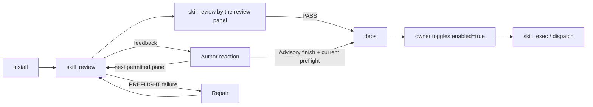

# Creating Skills for Ouroboros

This is the practical guide for **writing your own skills** that
Ouroboros can install, review, enable, and execute. It is the
single place where the manifest schema, the `PluginAPI`, the review
checklist, the lifecycle (install → review → enable → execute), the
widget render schemas, skill sources and publishing are explained
together.

If you are looking for the *runtime* architecture (how the loader
imports plugins, how the review pipeline is wired, etc.),
read [`docs/ARCHITECTURE.md`](ARCHITECTURE.md). If you want to know
exactly what a reviewer model is asked to check, read the "Skill
Review Checklist" section of [`docs/CHECKLISTS.md`](CHECKLISTS.md).

## What is a skill?

A **skill** is a small package that adds capabilities to Ouroboros:
new tools the agent can call, HTTP routes the desktop app can fetch,
WebSocket message handlers, and host-rendered widget UIs. Skills need exact-byte
review or acceptance before they run. Disk copies use the configured review;
source installs also support trusted-source acceptance and, in Cyber Pro only,
Ouroboros's recorded self-check (see "Sources and publishing"). Skills authored by the current Ouroboros agent session carry
both payload-local `.self_authored.json` and owner-state
`data/state/skills/<name>/self_authored.json` markers for provenance
only: they are admitted like any other disk copy, by the review the current
mode requires (see **Review** under the lifecycle below).

**Owner attestation (Skip review / Turn on anyway).** For a skill from any
origin, the OWNER may skip the expensive LLM review of its exact bytes via the
**Skip review** action on the skill card (owner-only
`POST /api/owner/skills/{skill}/attest-review`). The deterministic preflight +
manifest-validation floor STILL runs (an invalid or unsafe payload is refused).
Only the LLM phase is skipped; the verdict
is marked `owner-attested` (distinct from an LLM-clean badge) and does not
confer publication readiness. Choosing Publish may still start the ordinary
managed publication task, but attestation alone authorizes no outbound GitHub
effect. Publication needs fresh critic authority or a later actual independent-review
outcome acknowledged through qualified Advisory author finish (see Publishing). The
agent cannot self-attest (the marker is owner-state).

**Accepted without a review.** A skill installed unchanged from a source the owner
trusts runs on its install record's basis for exactly that
release; an edit by the selected-skill task the owner's own request started is
recorded as an owner edit and keeps running as Modified. Any other edit makes the
skill "Not reviewed yet". For an owner-requested edit in an ordinary task,
Ouroboros can carry out Skip through `skill_owner_action(action="attest")`, with
the current `expected_content_hash` and `owner_source` recording the owner's
words; its deterministic preflight and exact-byte owner
attestation keep that edited copy running. This is the owner's authority, not
an agent's claim that its own edit passed review. Blocker findings in a skill from a source that reviews
each skill keep it off even under Advisory until the owner skips the review.

There are three skill types:

| Type | What it ships | When to use |
|------|---------------|-------------|
| `instruction` | `SKILL.md`, optionally with helper files such as scripts that the agent runs itself (`run_command` with `cwd=skill_payload`); the host executes nothing. | Playbooks and the agent's own instruments. |
| `script` | One or more scripts under `scripts/` plus a manifest. | Heavy / batch work that runs as a subprocess. |
| `extension` | A `plugin.py` that registers tools/routes/widgets via `PluginAPI`. | Host-integrated capabilities, including widgets and chat-driven tools; native-risk isolated deps dispatch in short-lived child processes. |

The **runtime ownership** of an installed skill is also tagged:

- `native`: a built-in bundled with the app (e.g. `unix_computer_use` on macOS/Linux,
  `windows_computer_use` on Windows).
- `self_authored`: created by Ouroboros itself in the current data
  plane; marked by `.self_authored.json` (provenance only) and reviewed
  like any other disk copy.
- `external`: dropped into `data/skills/external/` by the user.
- `clawhub`: installed from the ClawHub registry.
- `ouroboroshub`: installed from a hub or another git-hosted source.

User-authored or manually copied skills belong under
`data/skills/external/<name>/`. The `native` bucket is reserved for
built-in skills that carry a `.seed-origin` marker. That marker, not the
directory name alone, is the ownership fact: an existing payload under
`native/` without the marker is treated in place as user-managed `external`
content. Ordinary top-level tasks can inspect, edit, run commands in, or
delegate that payload without a migration. A marker-present built-in stays
read/review-only, and new skills are still created under `external/`. Windows keeps an
enabled legacy Unix remote skill across later OFF/ON and updates (eligibility for
remote machines, not local Windows support or execution authority;
[startup rules](architecture/02-startup-onboarding-flow.md#packaged-seed-and-managed-checkout)).

## Manifest schema (`SKILL.md` frontmatter or `skill.json`)

A manifest is YAML frontmatter inside `SKILL.md`, OR a standalone
`skill.json`. Both shapes parse to the same dataclass. Use whichever
fits your editing workflow.

```yaml
---
name: weather                       # required, alnum/underscore/dash, ≤64 chars
title: Weather                      # optional human title on Skills; name remains the technical id
description: Live weather widget    # required, short summary
version: 0.2.1                      # required, free-form (semver recommended)
type: extension                     # instruction | script | extension
runtime: python3                    # script interpreter; optional for Python extensions
os: any                             # or [darwin, linux, win32]; governs new bundled offerings (legacy remote exception above)
entry: plugin.py                    # type=extension only — relative to skill dir
scripts:                            # type=script only
  - name: fetch.py                  # name resolves under scripts/ unless slashes/extensions
    description: Fetch and render
permissions: [net, tool, route, widget, read_settings, companion_process, supervised_task] # see "Permissions"
conflicts: [legacy-weather]            # optional incompatible installed skill names
env_from_settings: [OPENROUTER_API_KEY]                  # core keys require an owner grant
when_to_use: User asks for the weather forecast.
model_experience:                   # optional prose (CPL-7); a bare string is also accepted
  what_model_sees: One weather tool joins the tool list; results come back as compact JSON.
  token_effect: Small fixed schema cost per round while enabled.
timeout_sec: 60                     # default 60, hard cap 300
companion_processes:                # optional; PLURAL, and needs the companion_process permission
  - name: demo_worker               # see "Declaring a companion process"
    command: [python3, scripts/worker.py]
    runtime: python3
scheduled_tasks:                    # optional cron suggestions; nothing runs until adopted
  - name: refresh-cache
    cron: "0 * * * *"                # 5-field cron, host-local timezone by default
    timezone: Europe/Moscow          # optional IANA timezone override
    description: Refresh shared weather cache hourly.
ui_tab:                             # extension widgets (optional)
  tab_id: live
  title: Weather
  icon: "⛅"                        # one glyph (emoji / symbol); a name like `cloud` is not rendered
  render:
    kind: declarative
    start: auto                     # launch policy; module/iframe may say manual | retain (see "Launch policy")
    schema_version: 1
    components:
      - type: form
        route: search
        method: POST
        target: result
        fields:
          - name: city
            label: City
            type: text
        submit_label: Refresh
      - type: kv
        target: result
        fields:
          - label: Temperature
            path: temp_c
---

# Weather

Markdown body explaining the skill to the user / reviewer / agent.
Everything below the closing `---` becomes `manifest.body`.
```

For `type: script`, `skill_exec` uses the manifest-level `runtime`, not a
per-script override: `python`, `python3`, `bash`, `node`, `deno`, `ruby` or `go`.
Empty, unsupported or unavailable runtimes fail at execution. Instructions never
execute. Python extensions may omit `runtime`: the loader imports `entry`, which
must export `register(api)`. Companions still require their own runtime and command
(see "Declaring a companion process").

Go scripts are compiled into a private temporary executable and then run with
the caller's arguments unchanged, including arguments ending in `.go`. The
compiler and program share the invocation timeout; `runtime_phase` distinguishes
a compilation failure from the program's own exit status. Cleanup uses the same
tracked-process path as the other script runtimes.

Deno receives `run --no-prompt` and permissions before the script operand.
Ordinary reads remain available; `fs` permits writes outside the existing skill
state directory, `net` permits network calls unless the task disables network,
and `subprocess` permits child processes. Environment access names only the keys
actually forwarded after grants. A task with network disabled also requires
cached imports. These are the existing reviewed script effects, not a new OS
sandbox: in particular, an allowed child process has ordinary host privileges.

`conflicts` is an optional list of canonical skill names (letters, numbers,
dash, underscore, or dot; at most 32 entries). If either enabled skill names
the other, both readiness and extension loading fail closed with a typed
conflict until the owner disables one. Ouroboros never resolves a conflict by
automatically disabling, deleting, or moving either payload.

`model_experience` is an optional prose section describing the skill from the
model's point of view: `what_model_sees` (what the skill adds to the model's
context — tools, sections, attachments) and `token_effect` (roughly what that
costs and when it is loaded). A bare string is shorthand for
`what_model_sees`. The prose travels to the model-visible surfaces — bounded in
the `list_skills` index and the "Installed Skills" context section, whole in
`list_skills(name=...)`, which also returns the `read_file` call for this
manifest — so write it for the model, not for the human reviewer. Unknown keys or
non-string values are refused at parse time.

### Always-in-context instructions

An instruction skill is normally read on demand: the model sees its name,
description and trigger in the Installed Skills catalog and opens the body when
the work matches. Guidance that should shape all work, such as a house writing
style, may declare `always_in_context: true`. While the skill is enabled and its
current bytes carry an executable review, its whole body joins every context the
agent builds, in every context mode: the cached semi-stable block of tasks, rooms,
Main turns and shared-input children, and the host references of external coding
sessions. Its catalog line says so. A declared-input child keeps its explicit
composition, so a parent passes the text to such a child when it writes for people.

Every task pays for the body, so it is bounded at 16384 UTF-8 bytes
(`MAX_ALWAYS_IN_CONTEXT_BODY_BYTES`): keep a compact core and move detail into
reference files the body names, which stay read on demand. The field is refused
on other skill types, on an empty body (a `skill.json` manifest has none) and on
any value other than `true` or `false`. The context presents the text as guidance
that never outranks BIBLE.md, the safety rules or an explicit instruction
for the task. Say in `model_experience` that the body is always loaded.

### Passive context snapshots (extensions only)

A reviewed extension may declare `context_snapshot: {path: context-snapshot.json}`
and the `context_snapshot` permission/grant. Its existing deterministic task or
companion writes that relative path under its own skill state, atomically:
`{"schema_version":1,"observed_at":"…Z","valid_until":"…Z","text":"…"}`.
Dates must be finite timezone-aware ISO instants, observed ≤ valid and not in the
future. The complete UTF-8 JSON file is bounded at 32768 bytes; malformed, missing,
escaping or oversized files yield an explicit unknown, never clipped prose.

Write compact deterministic facts, not instructions or relative-age counters.
Keep changing poll timestamps out of `text`: the envelope dates date the visible
claim. Main, project roots and consciousness receive a labelled UNTRUSTED tail
note after compaction; children and Presence do not. No callback, model, network,
refresh or scheduler is run by prompt preparation. Current enablement, review,
grants, dependencies and publication must remain eligible. Revocation/expiry emits
one withdrawal; it does not resend old facts. The full text is shown once. When it
changes, its dates run out or the file goes stale or unreadable, one note says so and
names where the current text is read (`query_data` kind `skill_state`, state_file
`context_snapshot`); nothing more is added until the conversation is next rebuilt (a
fold, a tool load, a resume without its cached prefix). There superseded notes leave
with their exact rows retained, and the current text is shown in full again. So how
often you publish cannot multiply what the context holds; figures that move on every
poll belong behind your skill's own tool.
Exact sources are retained. Earlier notes are historical, never current authority.

Manifest refusals teach: every `SkillManifestError` carries the problem plus,
where the parser knows the repair, a `fix_hint` rendered into the message
(`... — fix: ...`), so a refused registration tells you how to fix the
manifest instead of only what was wrong.

## Contributing controls and speech engines

`contributes` is an optional list of up to 32 mappings on instruction or extension
skills. Each needs a unique `id` matching `[a-z0-9_]{1,40}` and exactly one of
`placement` or `provides`. Shape errors reject the manifest; semantic errors drop
only that entry, with a repair warning in preflight and the contribution catalog.
There is no additional PluginAPI registration call.

| Field | Contract |
|---|---|
| `label`, `title` | Required nonblank label ≤40 characters, optional title ≤200; displayed verbatim. |
| `icon`, `order` | Optional host icon name (the `icons` list of `/api/ui/contributions`), optional integer order (default 0). |
| `placement` | `composer.plus`, `composer.chips` or `message.action`. |
| `action` | Required on placements: `draft.insert` with text ≤4000, `notice` with text ≤300, `open.tab`, or `skill.request`. No verb sends as the owner. |
| `action.route`, `with`, `then` | `skill.request` POSTs to its own relative route; `with: none` (default), `draft` or `message`; `then: keep_draft` (default) or `clear_draft`. The host supplies the absolute URL. |
| `source` | Required for chips, optional for `provides: place`: `{route, refresh_s}`; relative GET route, refresh integer 15..3600 seconds; reply `{text, tone?: ok|warn|bad|muted, title?}`. A place source may also return `connect: [{account_id, conversation_id, label}]`; the four list states and identity rules are defined under “Declaring a place, tool effects and an icon”. |
| `provides`, `runtime` | Engine kind `stt` or `tts`; required runtime `server` or `client`. Server engines declare a relative POST `route`; clients register from their host module. |
| `destination` | Required for engines: `device`, `host` or `vendor:<Name>`. Describe the real processing destination. |
| `languages`, `formats` | Optional lists of up to 64 nonblank strings ≤120 characters. Formats: `audio/webm`, `audio/ogg`, `audio/mp4`, `audio/mpeg`, `audio/wav`. |
| `install_size` | Optional nonblank text ≤120 characters, shown by install offers. |
| `max_bytes`, `max_seconds` | Optional STT limits: integers 1..524288 bytes and 1..600 seconds. These do not raise the host route cap. |
| `render` | Defaults to `{kind: declarative}`. `{kind: host, entry: ui/name.js}` names a trusted same-origin ES module; only relative `.js` entries under `ui/`. |

Routes are plain relative paths without traversal, URL schemes, queries or
fragments. Host render and client runtime require `type: extension` and declared
`page_module` permission. A client provider also needs `render.kind: host`; it
has no server route. Data-only entries need no page permission and remain valid
on instruction skills. Extension providers and controls appear only while their
extension is loaded; instruction contributions follow enablement and review.

A template item can be entirely declarative:

```yaml
contributes:
  - id: explain_simpler
    placement: composer.plus
    label: Explain simpler
    icon: sparkle
    action: {verb: draft.insert, text: "Explain your last answer more simply."}
```

A server speech engine uses its normal registered route:

```yaml
contributes:
  - id: dictation
    provides: stt
    label: Local dictation
    runtime: server
    route: transcribe
    destination: host
    languages: [auto, en, ru]
    formats: [audio/webm, audio/mp4, audio/wav]
    install_size: "~500 MB"
    max_bytes: 393216
    max_seconds: 60
```

The request body is raw audio (`Content-Type` is the recorded type); a client
may add `?lang=`, but the builtin one sends none, so detect the language
yourself. Return `{text}`, `{text:"", status:"no_speech"}` or
`{error:{code,message}}`. Keep uploads under both declared limits and the existing
512 KiB route cap. The recorder enforces the declared limits; do not require a
multipart wrapper or a skill-specific host upload exception.

A capsule-row chip reads a small status route and opens its Widgets tab:

```yaml
contributes:
  - id: quota
    placement: composer.chips
    label: Usage
    source: {route: chip, refresh_s: 60}
    action: {verb: open.tab}
```

Host modules and their relative imports load from captured revision URLs such as
`/api/extensions/<skill>/ui/<revision>/ui/name.js`; CSS, JSON and images under
`ui/` are captured too. Editing disk files does not change a loaded generation;
unload or a new revision makes its old URLs return 404. Export `mount(ctx)` and
return `{dispose}`; release resources when disposed. These are trusted page
modules, distinct from sandboxed widget modules or model-written mini-apps.
Every skill gets `page_module` through the ordinary grant: the owner's, or the
auto-grant setting once its release is accepted (a built-in's trusted source counts).

### What placed controls do

A `composer.plus` item appears in the composer's "+" menu, after Attach file,
in a section under the skill's name, in the owner's arrangement and otherwise
by `order`. A `composer.chips` chip is one of the capsule row's capsules: its
`label`, then the `text` its source answers (the first 24 characters; longer
text and the answer's `title` become the chip's description), with a dot for a
`tone` of `ok`, `warn` or `bad` (`muted`, or none, shows no dot). The host
reads the source every `refresh_s` (15 seconds at least) and only while a room
shows the chip on a visible page; after a failed read it shows "—" with the
reason and asks again later, doubling the wait up to sixteen refreshes. Chips
that do not fit beside the host's capsules fold into one "+N" chip whose list
holds them, so keep the label and the text short. A press does the chip's
`action`.

A `message.action` appears on Ouroboros's saved replies, never on the owner's
own rows or on work cards: an icon control between the reply's Reply and Copy
(its accessible name is `label`, its tooltip `title`) and an item in the row's
menu, in words. Its `skill.request` with `with: message` POSTs JSON
`{text, row_id}`: the reply's plain words and its row address. With
`with: draft` it POSTs `{text}`, the visible room's draft; with `none`, `{}`.
A 2xx answer may carry `{notice}`, shown as one line (otherwise "<label>:
done."). A failure shows one line naming the label and keeps the draft;
`then: clear_draft` clears the draft only after a 2xx and only while it still
holds the words that were sent. `draft.insert` puts its text into the visible
room's draft at the caret and never sends; `open.tab` opens the Widgets page at
the skill's card; `notice` shows its text.

### Page modules

The host imports every live `render.kind: host` entry from its revision URL
and calls the module's exported `mount(ctx)` once per contribution (several
contributions may share one file). `mount` may return `{dispose()}`, directly
or through a promise; the host calls `dispose` when the skill is disabled,
updated or removed, on this page's Panic and when the page goes away, and
aborts `ctx.signal` at the same moment. The context is frozen and versioned; a
capability a later version adds is absent from an older context, never a stub.

| `ctx` field | Meaning |
|---|---|
| `api` | `1`, the context version. |
| `skill`, `key` | The skill's directory name and this contribution's key (`<skill>:<id>`). |
| `signal` | An `AbortSignal`, aborted when the module is disposed. |
| `providers.register(kind, impl)` | Registers the client provider this contribution declares (`provides` equal to `kind`, `runtime: client`) and returns its unregister. Any other kind throws. |
| `notice(text)` | One line in the page, prefixed with the skill's name. |
| `draft.insert(text)` | Puts words into the visible room's draft at the caret, never sends; answers false when there is no draft. |
| `theme.dark`, `theme.reducedMotion` | The painted theme and the motion preference, read when asked. |
| `origin.secure`, `origin.loopback` | The page is a secure context; it is served from this computer. |

A client speech provider is a plain object the host calls; it never draws.
A `stt` provider is `{label, destination?, available() → {ok, code?},
start({lang, signal}) → {stop() → Promise<{text} | {no_speech: true}>,
cancel()}}`: the host calls `start` inside the owner's press (recognizers need
the gesture), holds the page's one microphone lease for it, and puts the text
into the draft itself. A `tts` provider is `{label, voices() → [{id, label,
lang, local}], speak(text, {voice, lang, signal}) → Promise<void>, stop()}`;
`local` is true only when the platform says the voice runs on the device, and
`speak` settles when the words end, are stopped, or `signal` aborts. A
provider's `destination` (`device`, `host` or `vendor:<Name>`) says where
audio or text goes; the host shows it beside the engine's name. An engine the
owner chose that cannot run is reported with its reason; the host never picks
another one in its place.

There is no composer, feed or other page DOM in the context: placements are
the way into those. A module that cannot be imported, throws or rejects in
`mount`, does not start within the host's module bound
(`WIDGET_REQUEST_TIMEOUT_MS`, `web/modules/widget_job.js`) or registers a
provider it does not declare is off for that page: its providers are
unregistered and the owner sees one notice naming the skill. It stays off
until the page reloads or the skill's revision changes; the other modules and
the page keep working.

Recovery never depends on the modules. A module runs on the page's own thread,
so one that loops or blows up in its start takes the page with it. Before the
import the host writes the module's start to the page's start ledger
(`web/modules/holds.js`, this device's storage) and clears it a second after
`mount` settled; a module whose last start with this revision the page did not
outlive is not imported again by itself: one notice names it with Start it, and
the skill's next revision starts as usual. A page opened with `?hold=all` holds
every module (and every widget and app frame) for that load. Declarative
contributions stay available in both cases. A hang that begins later than that
second is not held; the Skills switch turns the skill's code off live.

## Lifecycle: install → review → enable → execute



- **Install** lands the payload under the appropriate bucket
  (`data/skills/<bucket>/<name>/`) and records where it came from in
  `data/state/skills/<name>/install.json`, outside the payload. ClawHub
  installs also keep their `.clawhub.json` sidecar; skills installed from the
  hub by earlier versions keep `.ouroboroshub.json`.
- **Review** is one wave of the shared review mechanism (`skill_review` →
  `review_change(subject="skill")`, `tools/review_skill.py`): the panel the
  review mode composes answers the one skill question against the Skill Review
  Checklist (see [`docs/CHECKLISTS.md`](CHECKLISTS.md)) in the common
  findings-only form — Blocking seats every ticked reviewer; Advisory accepts a
  panel of at least one ticked reviewer when the narrowing carries its reason;
  in Cyber Pro the review is evidence for Ouroboros's judgment. The record is a
  `surface="skill"` entry of the review ledger; `review.json` is the run gate's
  projection of it, bound to the content hash of every runtime-reachable file
  in the skill directory, so any later edit stales that verdict. A review after
  an edit is change-focused in every mode: reviewers get the manifest, the
  changed files and a diff since the last verdict, every unchanged file one
  read away, and judge the whole current skill. Under Advisory, after the first
  feedback the author may accept a later edit with
  `skill_review(author_disposition="accepted", author_rationale=…)` (the
  deterministic preflight still runs) instead of buying another panel. The tool
  waits for the panel but hears an addressed owner message: it then returns
  pending while the reviewers finish, and the same call later collects the
  verdict at $0.
  `.self_authored.json` is provenance only; self-authored skills use the same
  review, grant, enable, and extension reload flow as other executable skills.
  Reviewers also read how the skill was installed (`install.json`: by the
  owner or by Ouroboros, from which source and trust, why, in which task) as
  context, never as approval.
- **Isolated deps** (pip / npm / uv / node) install into
  `data/skills/<bucket>/<name>/.ouroboros_env/`. Status is recorded
  in `data/state/skills/<name>/deps.json`. Its Python venv names the app's interpreter: after
  the app moves or brings another Python minor, Enable or the next startup re-points or rebuilds
  it; until then the skill's Python is refused, never swapped for another interpreter.
  In-process extension scopes are non-reentrant: no-dependency handlers of
  DIFFERENT skills share a read lease and overlap, the handlers of ONE skill
  run one at a time (your callbacks stay sequential, as under the old
  exclusive lock), and a dependency-bearing handler owns an exclusive lease
  through import, handler waits and cleanup. The async form polls
  cooperatively, so it never blocks the ASGI loop; nested scopes and
  unwrapped child work remain unsupported rather than inheriting a lease.
- **Enable** flips `enabled.json` after current executable-review authority + grants, installing
  the declared packages itself when they are missing, failed or stale (idempotent: Enable on an
  enabled skill repairs it; a refusal is typed, `code` + one sentence + `detail`). The
  Skills UI surfaces a toggle; agents can also call `toggle_skill`.
  An ordinary top-level task enables a skill whose review gate admits its
  bytes; a selected-skill (repair) task needs an owner message, answered quiz
  or mailbox entry for that skill. Declared keys and host permissions follow
  `OUROBOROS_AUTO_GRANT_REVIEWED_SKILLS` or an owner grant.
- **Execute**: `skill_exec` runs `type: script` skills as
  subprocess. `type: extension` skills without isolated deps normally run
  through the in-process loader; extensions with reviewed isolated deps are
  cataloged and dispatched in short-lived child processes so a dependency crash
  or Rust/C abort cannot crash the server.

## Data layout for stateful skills

Stateful skills should keep every user-visible job/session isolated under a
per-job directory. For extensions, prefer:

```python
job_dir = api.skill_job_dir(job_id)
assets_dir = job_dir / "assets"
output_dir = job_dir / "output"
tmp_dir = job_dir / "tmp"
```

This creates `data/state/skills/<skill>/jobs/<sanitized_id>-<hash>/{assets,output,tmp}`.
Use it for generated images, audio, video frames, intermediate artifacts, and
per-request temp files. Keep shared learned data such as prompt lessons or
small caches at the skill state root only when it is intentionally shared across
jobs.

Avoid flat content-keyed filenames such as `assets/keyframe_0.png`,
`concat.txt`, or `_vframe_0.png` directly under `state_dir`; a later or
parallel job can overwrite them. Retry outputs should include an attempt number
or short random suffix, and temporary verification files should live under
`tmp/` and be cleaned when the job finishes.

### Declaring dependencies

Skills may declare auto-installable dependencies in frontmatter:

```yaml
dependencies: [ddgs]
```

or with explicit install specs:

```yaml
install:
  - kind: pip
    package: ddgs
```

Bare `dependencies` entries are treated as Python packages. `pip`,
`pipx`, `uv`, `npm`, and `node` specs are installed once the review gate admits the exact
bytes (a reviewer verdict, a trusted release, the owner's skip or edit, Cyber Pro) by one owner
(`skill_dependencies.ensure_skill_dependencies`: at enable, review end, install, author finish
and startup; no new paid review is required) and only under the skill's `.ouroboros_env` directory.
Global package-manager specs remain manual setup guidance. Exact resources and
explicit build actions use the same isolated install owner:

```yaml
install_specs:
  - kind: download
    url: https://example.org/application/disk.img
    # Replace both with the publisher's exact artifact facts.
    sha256: "0000000000000000000000000000000000000000000000000000000000000000"
    size_bytes: 9437184
    version: application-data-1
    target: resources/disk.img
    platforms: [linux, darwin, win32]
```

`target`, step `cwd`, and `outputs` are relative to `.ouroboros_env` and must
remain inside it. Platform names are `sys.platform`, optionally followed by
`-` and the lowercase `platform.machine()` value (for example,
`linux-x86_64` or `darwin-arm64`); omitted `platforms` applies everywhere.
An inapplicable entry is recorded as skipped. Resources are verified by size
and digest before landing; no package-size cap is borrowed for this file path.
The content-addressed resource and package caches live under
`state/skills/<name>/dependency_cache/`, outside the replaceable payload/env.
Replacing the environment or retrying therefore reuses verified downloaded
bytes; a different digest selects a different cache entry.

An entry may also declare `steps: [{argv: [...], cwd: "."}]`, `outputs:
["bin/helper"]`, and `check: {argv: ["helper", "--version"]}`. Arguments stay
literal; no shell interpolation is performed. Steps require outputs and a
concrete successful check; declared `bins` must resolve after installation.
Build tools use the existing process tracking, timeout and cancellation path.
The normal installer invokes new downloads/build declarations only against
their fresh executable review and hash-covered specs, rechecking the pinned
payload before each build/check process.

Python `allow_source_build: true` and npm `allow_install_scripts: true` opt in
per entry, each with a declared `check`. Without those flags pip remains
wheel-only and npm keeps `--ignore-scripts`. An already installed npm package
can be rebuilt explicitly on retry without rebuilding unrelated packages.
`deps.json` records resource digests, actual resolved package metadata,
output hashes and build diagnostics. `installed` records delivery;
`executable_ready` is unknown without a declared check and true only after
that check succeeds. A failed check stays failed, even if the package manager
returned zero. Manual dependencies do not acquire a new universal probe gate.

For `type: extension`, any reviewed isolated dependency env is kept out of
`server.py`: `plugin.py` cataloging and tool/route/WS handlers run in a
short-lived child process with the skill's payload and isolated env. Child
crashes surface as tool errors, HTTP 502 responses, or WebSocket log messages;
the server and WebSocket stay alive. Opaque native files shipped directly in the
payload are still review-sensitive; if such a marker exists, the runtime also
uses child dispatch defensively, but this guide does not make native payload
binaries broadly acceptable.
Out-of-process extensions have near full PluginAPI parity. They proxy tools, HTTP
routes, WS handlers, UI tabs, and settings sections; `on_unload` runs at child
teardown; `send_ws_message` relays to the browser through the Host Service
`POST /ui/ws-message` bridge; and `register_companion_process` is cataloged so the
host spawns and supervises a long-lived companion for background work. Only two
capabilities have no meaning in a short-lived per-call child and stay unavailable
there: `subscribe_event` and `register_supervised_task` (an in-process asyncio
task). For long-running work, host-event subscription, or live progress that must
outlast a single call, declare a `companion_process` — a host-supervised
subprocess that already receives `HOST_SERVICE_URL`/`HOST_SERVICE_TOKEN` and can
call `POST /ui/ws-message` and connect to `WS /events`. A skill can read
`get_runtime_info()["execution_mode"]` and `["capabilities"]` to adapt instead of
calling an unavailable capability and aborting registration.

Out-of-process caveats: (1) `register()` and `on_unload` run for **each per-call
child** (every tool/route/WS dispatch and catalog), so `on_unload` fires per call,
not once per disable — keep it cheap and idempotent and put durable/once-per-session
teardown in a `companion_process` shutdown. (2) `send_ws_message` relays through the
loopback Host Service and is best-effort: the relay lane holds a 60-message burst
reserve per skill that refills one message per second, the excess is refused (a 429
with `retry_after_sec`; the host records each refused burst once with its dropped
count), so a progress-heavy job should throttle updates or rely on poll-based
status. Successful children also return aggregate transport/HTTP refusal counts
through their normal result/process diagnostics; `send_ws_message` still returns
`None`, and acceptance does not prove browser delivery. (3) A
`companion_process` is spawned and supervised by the host **server** process: enabling
a companion skill from the agent's `toggle_skill` tool or via post-review auto-enable
records it in the worker process and writes a durable
per-request marker under `state/extension_reconcile/` (filename includes a safe
skill prefix plus request id). The server pickup task consumes that marker and
starts/stops registered companions shortly after; the UI/HTTP
enable still starts them immediately because it runs inside the server. Design
companions to tolerate this small asynchronous handoff.

### Scheduled skill tasks and daemons

Skills may suggest cron jobs in `scheduled_tasks`. A declaration installs
nothing: Ouroboros sees each suggestion of a reviewed, enabled skill as one line
in its context, and a schedule exists only once the mind creates one with
`schedule_followup` or the owner creates one through `POST /api/schedules`.
An adopted schedule is ordinary queued work with the same task queue, logs,
timeout and provenance as other work; its objective can name the skill, and a
later skill update, disable or uninstall neither rewrites nor withdraws it (the
run judges whether the skill is still there). The syntax is standard 5-field
cron (`minute hour day month weekday`), with host-local timezone by default and
an optional IANA timezone override. If Ouroboros was offline when an adopted
cron became due, the scheduler performs one catch-up run rather than replaying
every missed occurrence.

Schedules that earlier versions mirrored from a manifest automatically were
adopted once as ordinary rows: they keep their ids, history and owed work, and
are changed, paused or withdrawn like any other schedule.

Long-running processes are still represented by extension companion processes,
not by `start_service`. `start_service` is task-scoped and is stopped when the
owning task ends. Companions require reviewed manifest declarations and the
`companion_process` permission.

### Declaring a companion process

The descriptor lives in the manifest; `plugin.py` only names it. The key is
`companion_processes` — **plural** — and `register_companion_process()` accepts
only that name (positionally or by keyword):

```yaml
permissions: [companion_process]
companion_processes:
  - name: demo_worker                     # alnum/underscore only, max 24 chars
    command: [python3, scripts/worker.py] # relative POSIX-style path in the skill
    runtime: python3
    restart_policy: on_failure            # default; the only policy that restarts
    max_restarts: 5                       # default; the bound within a 300s window
```

```python
def register(api):
    api.register_companion_process("demo_worker")   # only the declared name
```

Two different layers check this, and they fail at different moments. The parser
rejects a malformed descriptor when the skill is read:

| Rule | Error when broken |
|---|---|
| `name` is present and non-empty | `each 'companion_processes' item must include name` |
| `command` is present and non-empty | `each 'companion_processes' item must include a non-empty command list` |
| `runtime` is declared | `each 'companion_processes' item must include runtime` |
| A `python`/`python3` runtime names a script — a bare `[python3]` does not | `python companion command must name a reviewed script` |
| No argument is `-c`, `-m`, `-e`, `--eval` or `eval`. `[python3, -m, mypackage, boot]` is caught here rather than by the rule above, even when the package is a declared dependency — and so is a script of your own passed a flag that happens to be named `-c` | `companion inline/eval commands are not allowed` |
| Path arguments use relative POSIX-style paths (no leading `/` or `..` segment) | `companion command arguments must stay inside the reviewed skill tree` |

The path check is lexical and does not verify that the target file exists. Keep
the script in the skill payload and use `/` separators so the descriptor has the
same meaning on every supported platform.

Registration then checks the manifest permission, the name constraints that the
parser does not enforce, and whether the name is declared. A manifest that has
passed parsing but is wrong in these ways fails from `plugin.py`:

| Rule | Error when broken |
|---|---|
| The manifest includes the `companion_process` permission | `skill 'x' cannot 'companion_process' — manifest permissions=[...]` when it is missing |
| `name` is at most 24 characters | `tool name must be <= 24 characters: '...'` |
| `name` contains only alnum/underscore — `demo-worker` parses in the manifest but is not a registrable name | `tool name must be alnum/underscore only: 'demo-worker'` |
| The name passed to `register_companion_process()` is declared in the manifest | `companion 'x' is not declared in manifest.companion_processes` |

**If you read that last error, check the key for a missing `s` first.** An
unrecognised frontmatter key is kept as an extra rather than refused —
`install_specs` and the forward-compatible `presence:` block are both read that
way — so `companion_process:` in the singular parses, declares no companions,
and currently produces no warning from the parser, `validate()`, or
`skill_preflight`. The eventual error names only the plural key.

There is no `on_enable` trigger and no `once` flag. After a skill is enabled, the
host starts a companion whose name `register()` has registered; for an
out-of-process extension, this handoff can be asynchronous. The companion is
supervised from there; `restart_policy: on_failure`
restarts it only on a non-zero exit, so a one-shot script that exits 0 runs
once, and `max_restarts` (default 5, counted within a 300-second window) bounds
the loop before `companion_restart_exhausted` is recorded. For work that must
happen before the first tool call, remember that an out-of-process extension
already runs `register()` in every per-call child — see the out-of-process
caveats above — so cheap idempotent setup belongs there, not in a companion.

`env` and `ports` may also be declared on the descriptor. Neither passes as
written: the host drops `HOST_SERVICE_TOKEN`, `HOST_SERVICE_URL`,
`OUROBOROS_PARENT_PID` and any forbidden settings key from `env` and sets the
first three itself; the last is the server's PID, telling a container's PID-1
server from an init adoption. `ports` keeps only all-digit entries; a negative
or non-numeric one is silently dropped.

## The `skill_preflight` tool

When you are writing or repairing a skill,
`skill_preflight` runs cheap, offline syntax validators on the
payload — in-process Python `compile()` for `.py` files (no
`__pycache__` writes), `node --check` for `.js`/`.mjs`/`.cjs` (a
declared widget entry uses classic grammar unless `entry_type: module` opts
into ESM grammar for the entry and declared JavaScript assets),
`bash -n` for `.sh`/`.bash`, plus a manifest parse, explicit
entry/script existence checks (including a module widget's `render.entry`
existence and containment), and static widget render-schema
validation. It validates manifest `ui_tab.render` plus actual
`register_ui_tab` and `register_settings_section` calls in `plugin.py`
through the same runtime validator as `extension_loader`. The static
resolver accepts an inline literal, a module-level literal assignment, or a
simple local zero-argument helper with an optional docstring and one
literal/resolvable return. It never imports or executes the plugin and does not
interpret eval, comprehensions, or merges. A schema it can resolve but that is
invalid fails preflight; an unresolved dynamic registration is recorded as
`verified=false`, `skipped=true`, `skip_reason=dynamic_ui_schema` with its source
reference, while runtime registration remains the final fail-closed validator.
One frozen compatibility exception is intentionally asymmetric: deterministic
preflight reports an iframe declaration with an omitted `route` as invalid,
while runtime registration preserves that route-less shape so an existing
extension still loads (the card remains not-supported rather than executable).
It does not call any LLM and does not mutate review state, so the agent can
iterate without burning review tokens.

```text
skill_preflight(skill="weather")
skill_preflight(skill="weather", paths=["plugin.py"])
```

## Repair task path scheme and edit tools

**Repair and run** from the Skills page starts an ordinary managed
development task. The confirmed request is retained as a real owner message, not
a presentation-only acknowledgement. Its normal task constraint records the selected skill and physical payload
root; the task also retains the request source and initial content revision.
Persisted `mode="skill_repair"` task records remain readable with the same ordinary
tool capabilities. Payload-relative paths address the selected installation:

| Tool | Repair path example | Use when |
|------|---------------------|----------|
| `read_file` / `list_files` with `root=skill_payload` | `plugin.py`, `scripts/main.py` | Inspect payload files. |
| `edit_text` with `root=skill_payload` | `plugin.py` | One exact replacement in an existing file. |
| `write_file` with `root=skill_payload` | `new_module.py` | New files or intentional full-file rewrites. |
| `skill_preflight` | `skill="weather"` | Cheap read-only syntax/schema check before LLM review. |
| `skill_review` | `skill="weather"` | Review the changed payload before execution. |

The task retains ordinary shell, browser, search, delegation and execution tools.
The installed payload is usually a normal directory; an isolated Git copy through
delegation is optional. Selected payload operations check the known revision;
after an opaque shell command the task records the observed revision without
claiming every concurrent change as its own.

Test the repaired installation through its real script, extension tool, HTTP
route, widget or companion after the normal review, dependencies and permissions
checks. Review does not forcibly unload a working extension. Inspect widget
screenshots and repeat the edit/review/execution cycle when fixes are needed.

Repair and run authorizes enabling and testing the repaired installation, leaving
it working. After review, the model calls `toggle_skill`; the host resolves the
task's actual original owner message by default. A later direct owner disable
requires a newer owner instruction. Repair does not authorize granting all
permissions, attestation or deletion. Existing auto-grant policy still applies. `skill_owner_action` uses the shared lifecycle owners only with the
specific action, revision and existing owner-intent source; a source reference
alone is not permission. An automatic edit-and-review request retains
`allow_enable=False` and does not gain enablement authority from being a Repair.

### Top-level short-form authoring (including light mode)

An ordinary top-level task in every runtime mode can target user-managed skill
payloads with `root=skill_payload`, `bucket` (`external` / `clawhub` /
`ouroboroshub` / `user_repo`), and `skill_name`. A markerless payload physically
under `native/` is selected through the logical `external` bucket; a true
marker-present built-in remains read/review-only. A short relative
`path` such as `plugin.py` or `lib/utils.py` resolves under
the selected physical payload root. Supply both args together — passing only
one returns a clear
`bucket and skill_name must be supplied together` error instead of silently
writing into the drive root.

The selected-skill constraint keeps payload-relative calls attached to their
declared physical skill. Ordinary development capabilities remain available;
selecting another payload is not an implicit redirect of this task's target.

To **create a new skill** the payload directory need not pre-exist: writing the
manifest at the payload root (`path="SKILL.md"` or `path="skill.json"`) is the
authoring signal and provisions the new payload (and marks it `self_authored`).
A non-manifest path into a not-yet-existing payload still errors as a typo guard
— write the manifest first, then add the rest of the files.

Equivalent ways to address `data/skills/external/weather/plugin.py` under
light:

```text
write_file(root="runtime_data", path="skills/external/weather/plugin.py", content=...)
write_file(root="skill_payload", path="plugin.py", content=..., bucket="external", skill_name="weather")
```

Control-plane sidecars (`.clawhub.json`, `.ouroboroshub.json`,
`.self_authored.json`, `SKILL.openclaw.md`) stay blocked for writes and edits
either way — the bucket+skill_name short form does not weaken mutation-sidecar
protection. The payload-local `.seed-origin` marker is likewise never writable;
the settled direct/read-only native `read`/`list`/`search` contract may inspect
ordinary payload markers, while control-state mutation remains closed.

### Writing large payload files

The hard ceiling for any single tool call is the LLM output token budget —
about a few thousand lines of code, depending on the model and prompt
overhead. Two reliable strategies when a generated payload exceeds that
ceiling:

1. **`write_file(mode="append")` in chunks.** Each call appends the next
   slice; the file lands intact across multiple turns. Useful for
   structured assets (CSV, JSONL, prose corpora) the agent itself is
   generating.
2. **Split files deliberately.** Prefer smaller modules/assets and append
   generated bulk data in deterministic chunks; this keeps each tool call
   reviewable and avoids hidden editor loops.

`run_command` heredoc is **not** a workaround — every byte of a heredoc body
still passes through the same LLM output budget, so it offers no real
bypass and is harder to review.

## Permissions

The manifest's `permissions` list authorises specific PluginAPI
calls and runtime behaviours:

| Permission | What it grants |
|------------|----------------|
| `context_snapshot` | Opt-in standing model context from the declared local snapshot, subject to the existing content-hash-bound grant (see Passive context snapshots). No injection or model-start authority. |
| `net` | The skill may make outbound network calls. |
| `fs` | The skill may write outside its state dir (review item still enforces confinement). |
| `subprocess` | The skill may spawn child processes (review items + cwd-confinement still enforce). |
| `page_module` | With its hash-bound grant, reviewed extension code may run as a trusted same-origin contribution module in the owner’s page. |
| `widget` | The skill may call `register_ui_tab` and `register_settings_section`. |
| `ws_handler` | The skill may call `register_ws_handler` and `send_ws_message`. |
| `route` | The skill may call `register_route`. |
| `tool` | The skill may call `register_tool`. |
| `realtime_provider` | The skill may call `register_realtime_provider` (PluginAPI 2.1, in-process only). |
| `live_conversation` | The skill may register the in-process Live Conversation feature (PluginAPI 2.1); the host retains admission, tools, memory, budget and Stop. |
| `call_peer` | A reviewed companion may join an admitted media call through the Host Service; Presence admission still requires its binding and `presence` grant. External speech conveys no owner authority. |
| `read_settings` | The skill may call `api.get_settings([...])`. |
| `supervised_task` | The skill may register an in-process host-supervised async task. |
| `companion_process` | The skill may register a manifest-declared companion subprocess supervised by the host. |
| `subscribe_event` | The skill may subscribe to manifest-declared host event topics such as `chat.outbound` or `skill.lifecycle`. Chat topics require owner permission grants; `skill.lifecycle` does not. |
| `inject_chat` | With the owner's `inject_chat` grant, `POST /chat/inject` accepts text, an inline image or `attachments` (`[{path, name?, mime?}]`: up to 25 regular files confined to the skill's state root, copied without the former 50 MiB cap to `data/uploads` and staged for the task; file-only messages need no text). Optional `reply_to` carries a host row or `task:<task_id>` address as a reference, never routing. The same grant lets the skill relay the owner's decision-card answer through `POST /chat/decision` (`{request_id, decision_id, option_index?, comment?}`, the `POST /api/decisions` contract). A message that carries a `client_message_id` becomes an addressable operation: the host answers with its `operation_ref` (`<chat_id>:<client_message_id>`) on 202, 200 and 504; a repeated delivery of the same message — the same words AND the same ordered attachment content (inline image and files, compared by bytes and name, not by the host's stored copy) — rejoins it instead of enqueueing again (a different message under a reused id is refused with 409); an inline image and the attachments also appear in the owner's chat bubble from the host's stored copy, while the image still reaches the model as before (inline bytes that are not a proven image are kept as an ordinary file and never sent as an image; base64 over 50 MiB decoded is refused with 413); `GET /chat/operations/{operation_ref}` reports the skill's own accepted message (`pending`, `running` with its task or turn, the durable answer, a terminal task status, or `lost` after a host restart or when the host's own acceptance write failed); and `POST /chat/cancel` (`{operation_ref, reason?}`) runs the existing cancellation owner on work that message started, answering `cancelled`, `already_terminal`, `unresolved` or `cancel_unsupported` — never a cancellation that did not happen. |
| `presence` | A reviewed transport skill may submit authenticated non-owner conversation events to the Host Service Presence boundary and poll only their correlated late work. Requires an explicit content-hash-bound owner grant. |
| `notify_owner` | The skill may tell the owner one thing through `POST /notify` after an explicit owner permission grant (see "Telling the owner something" below): one bounded plain sentence the host shows in the owner's chat as a System row signed with the skill's name. It wakes no model; narrower than `inject_chat`. |

`chat.typing` is a start/resume/activity-change wake, not proof of an active
reply or an exactly-once start. The bundled Telegram bridge reads the internal
`ouroboros.gateway.reply_preparation` projection; no stable PluginAPI or Host
Service reader is exposed to third-party skills yet. A live activity may be
waiting, stopped or doing post-answer work.

A missing permission causes the matching `register_*` call to raise
`ExtensionRegistrationError`, surfaced as a skill load error in the
Skills UI.

## Grants for protected keys and host permissions

Some settings keys are protected: `OPENROUTER_API_KEY`,
`OPENAI_API_KEY`, `OPENAI_COMPATIBLE_API_KEY`, `ANTHROPIC_API_KEY`, `MINIMAX_API_KEY`, `DEEPSEEK_API_KEY`, `ZAI_API_KEY`,
`CLOUDRU_FOUNDATION_MODELS_API_KEY`, `GIGACHAT_CREDENTIALS`, `GIGACHAT_PASSWORD`, `TELEGRAM_BOT_TOKEN`,
`GITHUB_TOKEN`, `OUROBOROS_NETWORK_PASSWORD`. These keys are NEVER
forwarded to a skill by default, even when listed in
`env_from_settings`. Custom secret keys stored in Settings → Secrets
are treated the same way. A granted key is read as currently saved: each
`api.get_settings` call, script run, out-of-process call and companion start sees a
value the owner saved, rotated or deleted during a running task, while that task keeps
its own model, account and review settings; a value your code already copied or cached,
a running companion's environment included, is not refreshed for you. Host permissions such as `inject_chat`, `presence`,
`notify_owner` and chat event subscriptions also require explicit, content-hash-bound owner
consent. The desktop launcher's owner-grant bridge records these grants.

The Skills UI surfaces missing grants on the skill card. The agent
can also call `toggle_skill enabled=true` only after grants are
approved (the tool returns `SKILL_TOGGLE_ERROR` with `code: "grants"` and the sentence
`Grant it the keys and permissions it asks for first.`). Self-authored markers alone
do not authorize grants or enablement. Automatic grants and first enablement
follow the setting below; an explicitly authorized task toggle remains separate.

`OUROBOROS_AUTO_GRANT_REVIEWED_SKILLS` is enabled by default as of v6.10.0; the
owner may disable it in Settings → Behavior → Skills (desktop asks for native
confirmation and web uses the owner endpoint). When enabled, current executable
review authority grants only the manifest-declared keys and host permissions for the
current content hash. Under
blocking enforcement, blocker reviews are not executable and do not auto-grant;
under advisory enforcement, blocker findings may auto-grant only because that
mode makes the review executable. Qualified current Advisory author acceptance
uses the same gate even when the original critic state stays pending. Editing the
skill still invalidates those grants.

Every review, grant and acceptance is bound to the skill's release digest: its
payload files plus its declared dependencies, without per-install notes, so the
same release has one identity on every install.

Transport and control skills are first-class control surfaces — a legitimate
full replacement for the local UI, not demos. An owner may have no screen, no
notebook, and no terminal; the control skill (Telegram today, any remote-control
skill tomorrow) is how they run Ouroboros. After fresh executable review,
enablement, content-hash-bound token issuance, explicit grants, and owner/chat
binding, such a skill is **expected** to carry every owner command the direct UI
accepts (`/panic`, `/restart`, `/evolve`, `/bg`, `/review`, `/status`, and
free-form owner text), run a long-lived poller (`supervised_task`), and observe
the owner-conversation events it mirrors. Power is not a defect: review judges
the skill's actual safety properties — owner/chat binding, trustworthy source
attribution, bounded polling/backpressure, cleanup on unload/panic, host-token
confinement, and no exfiltration of secrets or owner-conversation content to
unrelated parties — never the breadth of control it exposes. The capability is
gated by the host (token + fresh review + enablement + content-hash grants) and
by core owner/chat binding, not by withholding control from the skill. See
`docs/CHECKLISTS.md` → "Transport and control skills are first-class".

`POST /chat/inject` treats text beginning with `/panic` (case-insensitive, surrounding whitespace ignored,
trailing text included) as emergency intent. Only the positively bound owner/chat pair can stop.
Unavailable or unauthorized Panic returns `503 {ok:false,error}` and never falls through to ordinary
chat; this refusal of command-looking text is intentional. Accepted Panic returns `202 {ok:true,status:"accepted"}`,
without a correlated operation or delivery replay, even with `client_message_id`. Telegram exposes owner
Panic in every command mode, including strict; it sends once. Its clock-dependent rejection of old messages
and boundary-second limits are defined in `CLIENT_CONTRACT.md` §15. A rejected message's previous outcome
is unknown, not definitely undelivered.

### Declaring a place, tool effects and an icon

A connector skill (it connects a place: a Slack workspace, a Telegram group, an inbox) declares three facts in its
manifest; core reads them from the reviewed, published release:

```yaml
icon: ui/icon.svg              # required author asset for provides: place; geometry in currentColor
tools:
  - name: slack_send
    effect: message            # read | message | write; absent or unknown = write
    target: channel_or_user    # the argument(s) naming where the effect lands; a list for to/cc/bcc
    conversation: channel_or_user
    thread: thread_ts
  - name: slack_history
    effect: read
    target: channel_id
contributes:
  - id: place
    provides: place
    label: Slack
    destination: vendor:Slack
    scope: account             # account | conversation
    wakes: [direct_message, group_dm, mention, my_thread, reply_to_me]   # suggestions; the owner edits the list
    source: {route: status, refresh_s: 15}                               # optional status and Connect choices
    settings: connection       # optional id passed to api.register_settings_section
```

- `effect` is one fact with three consumers: Advises (autonomy) refuses everything but a declared read; a Silent or
  Paused place refuses `message` and `write` aimed at it; the Safety Supervisor skips declared reads at Light/Full and
  gives `message` its speech semantics (a flagged message returns to the mind; the identical re-issue is sent and
  recorded). A tool that reads or writes depending on its arguments is `write`. MCP tools are always `write`.
- `target`/`conversation`/`thread` let the host attribute a call to one place; a write it cannot attribute is held
  while any place of that connector is Silent or Paused, and the refusal says so.
- `icon` is reduced at staging to viewBox and geometry (path, circle, ellipse, line, polyline, polygon, rect, g),
  bounded, with fills and strokes set to `currentColor`; anything else falls back to the house glyph.
  Authors of `provides: place` skills must include `ui/icon.svg` and declare `icon: ui/icon.svg`.
  The fallback keeps an older or unavailable mark from hiding the place capability; it is not the authoring target.
- `provides: place` requires `type: extension` and the `presence` permission. The Browse "Connectors" filter and
  "Connects <Service>" are derived from it; no tag or suffix is needed.
- The connector carries the service name in its place `label`; the technical skill id stays in details.
  Skills cards prefer the optional top-level, one-line `title`, then the place contribution's `label`, then `name`.
  Catalog entries may carry `title`; it is display text, never a new skill identity. Place, instance, account and
  signal labels are authored content, outside the host's translation overlay. Sentence composition lowercases only
  a label's first character, when it is upper-case, the second is lower-case, and the first word has no further
  capitals; mixed-case words and acronyms such as `GitHub` and `PR` keep their spelling.

The optional `settings` member names the connector's registered Settings section (for example
`api.register_settings_section("connection", ...)`); it is a section id, not an embedded form or a new
Place field. That section's form/action components and routes own configuration, including signal
parameters or connector send switches. Their hydration/write contract is documented under PluginAPI below.

The declared `source` route may return `connect: [{account_id, conversation_id, label}]` beside its status
`text`/`tone`. The host publishes the route as `source.url`; Connect reads it lazily with `cache: no-store`,
without a new endpoint or credential probe. Every row needs a nonblank string `account_id`, a string
`conversation_id` (empty may represent an explicit account-wide instance), and a nonblank string `label`.
The ids identify the choice; a label never supplies identity. A `null` account is not a wildcard. Bad rows are
dropped; a nonempty list with no valid rows is unavailable, not known empty.

| Source response | Meaning in Connect |
| --- | --- |
| `connect` absent | No instance chooser is offered; the connector's declared default scope remains available. |
| Known nonempty list | Show valid instances and mark exact connected identities as “Connected · Open”. |
| `connect: []` | Known empty: “None offered yet”, with the declared connector settings door (Skills if none). |
| Failed read, malformed response/list, or all rows invalid | Unavailable: keep the gap visible and offer “Try again”; do not invent an instance. A connector with no live source asks to be turned on. |

The host's explicit “Whole account” action remains available in all four states; it is independent of the
instance list and posts only `connector`. Selecting an instance posts its string ids and label through
`POST /api/places`; the saved title is `<Service> · <label>`. A new identity starts Silent in one atomic write;
repeat Connect preserves state, label, wakes and notes. Several identities can coexist without splitting or
relabeling an existing broad place. Connectors remain listed with a place count and “Connect another”.

A `provides: place` contribution may include `facts`: core names from `/identity.presence_wake_facts`,
labelled core kinds `{id: "direct_message", label: "Mail addressed to you"}`, or connector-defined
objects `{id: "signal.<slug>", label: "Human-readable signal"}`.
A signal id must match `^signal\.[a-z0-9_-]{1,40}$`; its object has exactly `id` and `label`, and the label is
non-empty text up to 120 characters. Fact ids must be unique. `wakes` remains the default wake suggestions
and must be a subset of `facts` when that list is present; when `facts` is absent, only core wake facts may
be suggested. An empty `facts` list permits only empty `wakes`. Core labels are optional; signals require
labels. Both use id strings in `wakes` and event `facts`; a label changes display words, never the fact
semantics. A labelled core kind in the **manifest** is accepted only from this release on: an older host
drops the whole place entry. A connector that may be installed on older hosts must declare plain core
kinds and send `labels: {"direct_message": "Mail addressed to you"}` on its status payload instead.
Status `labels` can name core kinds in the connector's own words; they are safe to send to any host (this release's sheet and reader show them, older hosts ignore the key) and do not change intake.
The sheet merges status labels over manifest labels. A runtime `/identity` check cannot negotiate a
static manifest.

Negotiate support through `/identity`: `presence_wake_signals: 1` advertises this seam. Older hosts may reject
the `facts` manifest key, so do not publish signal declarations to a host without support. Intake accepts a
signal only if the authenticated connector's current live place declaration lists it; another connector's
declaration, a discovered-but-unloaded declaration, or arbitrary text cannot authorize it. Ordinary core fact
intake remains compatible. New owner/tool signal choices likewise require that live declaration; existing
choices remain readable and removable when the connector is off.

Signal logic and its parameters belong to the connector's own settings. The host performs the existing fact
membership matching, stores no new Place field, and does not match message text. A signal does not manufacture
`mention`, addressed status or owner identity. The existing bot rule is unchanged: bot events require
`from_bot` selected, and `from_bot` itself is an OR wake reason, not merely a gate requiring another selected match.

```yaml
facts: [mention, {id: signal.words, label: "Words you chose appear (connector setting)"}]
wakes: [mention, signal.words]
```

A name or alias the owner wants to be called by is a connector signal: declare
`{id: signal.words, label: "Words you chose appear (connector setting)"}` with a `words` setting
(one entry per line), match whole words case-insensitively in the connector, and report the fact on
the event. Core stores the owner's choice as a wake item and matches membership only. The reference
implementation is [email-presence 0.7.0](https://github.com/razzant/OuroborosHub/tree/main/skills/email-presence);
[telegram-bot 0.6.3](https://github.com/razzant/OuroborosHub/tree/main/skills/telegram-bot) is the second (lane F1T, in flight).

A place connector reports observations; the host decides attention. While running and
authenticated, report every supported event within the connected place's granted
account, conversation and thread bounds, with observed provider facts. Do not discard
these events based on their text, perceived relevance, wake list or place state.
A bot sender is the fact `from_bot`, not an intake filter. Disable, unload, Panic and
provider access still govern connector operation; this promises no access to events
outside the provider API or the connector's declared support.

The host validates and captures an event before applying authored wakes and execution
conditions. Manifest wakes are suggestions, not a second attention policy. Provider
access, supported event kinds and outgoing tools remain the connector's responsibility.

### Who the connector writes as

When `/identity` advertises `presence_identity: 1`, send `identity` on every `POST /presence/turn`
as `event.identity`, beside `event.facts`, and on the connector's status payload for the owner's browser:

```json
{"sends_as": {"id": "writer@example.test", "label": "Writer mailbox", "kind": "user"},
 "reads_as": [{"id": "reader@example.test", "label": "Reader mailbox", "kind": "user"}]}
```

Both members are optional; unknown members are refused. `sends_as` is one entry; `reads_as` is a list.
Each entry has exactly nonblank `id` and `label` strings (at most 200 characters each) and `kind: user|bot`.
`kind` describes the credential's provider account, not a chosen persona. Do not add host-derived owner flags.
Invalid event identity returns 400 `presence_identity_invalid`. The voice line, owner match, focused
Safety facts and delivery stamp read the event snapshot only; an undeclared event has no identity.
Outside that focus, Safety and own-wake text use the first valid identity among the place's newest 50
captured arrivals, or none. The sheet reads identity from the status payload it already fetches for
readiness. The server never dispatches a connector route for a place view, focus, Safety check or own wake.
Neither carrier adds fields to `places.json`.

The owner's “This is my account” confirms `sends_as.id` using the existing `owner_accounts` writer.
For `kind: user` only, a matching `platform_actor_id` in the same `account_id` scope derives `owner: true`; revocation removes it.
This says whose credential writes or reads, independently of who sent an incoming message. Bot identities
never derive owner status or offer this confirmation. Only the human activates a place, through its sheet or an owner-door Main turn;
consciousness may still set Silent or Paused.

Optional `event.actor.authenticated` must be a boolean: true means the provider attests this sender's
identity, not merely that the connector authenticated to its API. Never derive it from a header the sender
controls. An unverified mail `From:` therefore requires false; receiving-server authentication evidence must
be verified by the connector before true is warranted. False keeps `owner_confirmed` false even for a
confirmed owner account, so neither the owner Safety occasion nor promotion to owner work follows.
Absent retains the existing authenticated-platform behavior. A bad shape returns 400 `presence_actor_invalid`.
Send identity and this actor fact only after the host advertises `presence_identity: 1`.

### Places and focus transport ingress

A reviewed connector declares `permissions: [presence]` and `provides: place`.
The owner connects it in Consciousness > Places or through `configure_presence`.
A place stores its state (Active, Silent or Paused), authored wake facts and notes,
confirmed owner accounts, working-folder address and model choice. Connector updates
never replace those choices. The old behavior skill's `presence:` block is migration
input only: its instructions, topics, folder and model are copied once, and its skill
stays enabled. Frozen old task ceilings remain readable; new focuses have no ceiling.

Use the connector's ordinary content-hash-bound skill token for:

- `GET /identity`: `presence_main_contact_version: 1` advertises host-bound private
  Main messages/questions and live/late answer routing; `presence_work_output_version: 1`
  advertises canonical output identities and separate producer/child references in
  work polls. `presence_wake_facts` lists accepted provider facts.
  `presence_history_import_version: 1` advertises `POST /presence/history` ("Importing
  earlier history" below); `presence_source_order_version: 1` advertises
  `event.message.source_order` on live and history events alike: an integer from 0 to
  2^53-1 by which the provider orders the conversation's messages (Telegram: its message
  id), refused with 400 when it is anything else. Check these facts
  for features you require: the older `places_version`, continuation and delivery
  version trio does not imply them. Missing facts mean an explicit setup/upgrade
  gap, not permission to inject owner messages or invent output identities. A
  historical record can still lack `output_ref` on a capable host.
- `POST /presence/turn`: `event`, optional legacy `binding_id`, `staged_files`,
  `delivery_reporting_version` and `continuation_version`. The event still carries
  `source_event_id`, `provider`, `account_id`, `conversation_id`, `thread_id`,
  `conversation_key`, `actor`, `conversation`, `message` and `text`. The host derives
  its own canonical conversation key. Files stay confined to the connector's state root.
- Optional `event.facts`: a list of `direct_message`, `group_dm`, `mention`,
  `reply_to_me`, `my_thread`, `new_issue`, `new_pull_request`, `review_requested`,
  `assigned`, `any_message`, `from_bot`.
  These are observed provider facts, never text classification. Absent facts mean
  `legacy_addressed`, compatibility for older connectors that filtered events themselves;
  new connectors send `facts` with every event. Empty facts are distinct from absent
  facts. `review_requested` and `assigned` mean requests addressed to the watched
  identity; narrow wake declarations may use them. A new discussion is not a
  `new_issue`; `any_message` is the generic alternative. Bots require an explicit bot wake item.
- `GET /presence/place?provider=&account_id=&conversation_id=&thread_id=`: returns
  `{place_id, label, state}` for the connector's outbox recheck. `/identity`
  advertises `places_version: 1`. Optional `thread_id` selects the topic; omission keeps
  the room lookup. An empty conversation id is an opaque queued mutation:
  any Silent/Paused place for that connector, provider and matching/broad account restricts it.
- `GET /presence/work/{work_ref}?binding_id=...`: reads correlated late work,
  including after a place is Paused or disconnected. The binding query is optional;
  the authenticated connector must still own the stored work.
- `POST /presence/work/{continuation_ref}` accepts exactly `{transport_queue}` or
  `{binding_id, transport_queue}`. It authenticates retained connector ownership and
  retains dated inbox observations without making them owner directives.

The host captures an event once into its room before deciding whether to wake.
Silent remains eligible for a matching wake, subject to consciousness, allowance and
capacity; it holds `message` and `write` aimed there and automatic replies. Paused
keeps accepted new events heard without starting a new focus. Neither state withdraws
an external request already accepted by the provider.
Paused, consciousness Off/Panic, or no matching wake returns `silent` (heard).
That final decision stays on the accepted room record: a retry stays silent after On,
without creating a task document or retained context-source blob for the heard event.
An exhausted or unknown allowance returns `consciousness_allowance_exhausted`,
`disposition: retry` and `retry_after` seconds. Physical capacity keeps the existing
`presence_capacity_full` retry response. A matching event focuses consciousness in
that room under the owner's autonomy level and allowance, independently of its own
clock. Before allowance, rate or capacity is consulted, the conversation's current author
receives later arrivals as typed context-only mail, whether or not they match a wake fact;
Paused, Off/Panic and a bot event without a bot wake item stay heard only. The mail carries the
arrival's text, source event id, exact `message` and `conversation` facts, observed `facts` and
attachments. An attached `transport_queue` keeps every fact but its `events` there, completeness
included. The mail's `context_source_ref` then names the arrival's retained exact facts:
`memory_read(source_ref=…)` returns them, the whole snapshot included, and the arrival's room row
shows the same reference in `chat_history` and `memory_read` rows. The host
acknowledges this handoff (`completed`, `silent`) only while that author accepts intake under
its final-drain lock, or when a retry finds the arrival already held by it after the earlier
answer was lost; a closed or ended author leaves the event eligible for ordinary admission. If the
Host process dies between that handoff and its answer, a retry reaches ordinary admission: the
handoff is not exactly-once across a Host crash. A
wake arrival its model has not seen when it finishes reopens it for another round; background
arrivals alone never do.

A focus uses ordinary `finish_task`, including `silent=true`. The host derives
`message`, `silent`, `tool_delivered` or `deferred` from the final, delivery receipts
and successfully started long work. Automatic speech passes the `place_reply`
Safety check; a flag returns to the mind, including for long work promoted from a
focus. Silent/Paused/disconnected destinations and Advises autonomy hold the reply
with a System fact. Cached replies, continuation envelopes and work polls apply the
current place state without another generation or paid check. A held projection keeps
the durable answer and its output identity; repeated holds record one fact per subject.
Late receipts still record what happened and add a visible warning. Proactive speech uses the connector's own tools; `presence_finish` and
`initiate_presence` are no longer public tools.

Private Main contact uses the mind's existing tools: a Presence root can call
`send_user_message(text=..., destination="main", request_id=...)` for a substantive
report, or `escalate(question=..., options=..., assumption=..., request_id=...)` for
a question. The host binds source work, place and event from the retained task;
the model supplies words, not provenance. The existing message/question renders
the typed source in its voice line, linking `event.message.url` or `message.permalink` when
present (otherwise `conversation.url`). These are private Main deliveries,
independent of the external destination's Silent state. Paused admits no new
focus, but does not discard already owed contact. `/notify` is unchanged.

Use the same `request_id` (nonblank, at most 128 characters) and identical fields
after uncertain contact delivery. Reusing a key with different fields refuses;
omitting it rejoins an identical contact from the same work. A new intentional
identical contact needs a new key. Questions use the normal canonical quiz and
answer ingress. An answer reaches a live inline author through its mailbox and
final-drain admission lock. After that author ends, normal late-answer intake
starts an unrestricted Main owner turn with the source snapshot, current child
work and exact owner words. Roots that turn starts inherit the source binding
as related work, without an automatic external-final route. Inline `wait_for_answer=true`
uses the narrow Presence continuation park: idle custody lends conversation and
active slot, then reacquires both before reentry; otherwise it waits holding
custody. Pooled roots retain their normal owner wait. Stop/deadlines still apply;
a bound ending is not consent, and terminal questions stay answerable. Neither contact nor answer delivery
sends an external reply or accepts an external request as an owner instruction.
Delegated children still escalate to their parent.

For promised work without a new event, `start_task` and
`schedule_followup(notify=false, relation=...)` retain the existing Presence
carrier and ordinary resource/control semantics. A scheduled root explicitly
uses connector tools to deliver later; it is not discovered by polling the old
event, its finish reaches no one by itself, and it reads the conversation's
current previous turn rather than the copy taken when it was scheduled. Any turn
of the place lists, reads and withdraws the follow-ups that place scheduled
(`manage_schedules` `list`/`get`/`delete`); withdrawal stops future runs only, and
`cancel_task` stops work one already started. `notify=true` and the owner-wide
schedule table remain separate capabilities.

A turn's source identity uses its first legacy binding id (otherwise its place id), source event ID, provider/account,
conversation/thread, actor ID and text. Keep those facts stable on retry;
`staged_files` paths and delivery-reporting negotiation may change. A collision
returns HTTP 409 `presence_event_identity_conflict` with `disposition: rejected`,
not another room's answer. Admitted attempts with an unknown outcome, lost local
stack or cancellation return `disposition: retained`, `turn_ref` for the original,
optional `work_ref` for a real admitted child, and `delivery_reporting_version`.
Persist the full receipt and source event, release the input FIFO, and observe
both references independently through `/presence/work`; never resubmit the event
as new work. A work view is `pending` (202) while its attempt can still change.
Then it is terminal: a recorded `completed` or `failed` answer keeps its recorded
projection (a selected reply, or `silent`); a cancellation, unknown outcome, resource
refusal or settled loss is `failed` (`cancelled` when recorded) with `outcome: "silent"`, empty `text`/`output_ref`, the typed `code` and facts
(`recorded_status` is the status when observed, `uncertainty`,
`status_reconciled_from`), `work_ref` naming the polled reference, producer
`task_id`, a real child in `child_work_ref` and already released continuation
outputs. Canonical terminal views also expose their existing `output_ref` and
`child_work_ref`, including selected output from a failed child. There `silent` means
nothing further to deliver, never chosen silence or absence of effects. Stop
observing a reference at its terminal, keep the receipt, observe a child until its
own terminal, and deduplicate each selected output by its exact `output_ref`.
A missing historical reference remains empty: do not invent a reference from
text or `work_ref`, or claim delivery success without one. An ended
attempt is never re-run. A live turn's model
recovery keeps its conversation under existing controls until it finishes or
returns a retained refusal; input custody is not released merely by a stream loss.
`retry` preserves temporary failures and quota refusals with a source-bound
pre-dispatch retry certificate; `blocked` needs configuration repair, whereas
`rejected` is an event-specific permanent refusal. HTTP status alone decides none
of these. Missing or unknown dispositions remain retryable for compatibility.
Older Host/consumer pairs may still hold input queues until both are upgraded.
Never project a retained refusal as `completed/silent` or as a successful handoff.

#### Presence continuation

`GET /identity` advertises `presence_continuation_version: 1` on supporting hosts. Request
`continuation_version: 1` beside `binding_id` and `event` on `/presence/turn` (negotiation is not
event identity). An author parked on a review it left for an addressed message (a commit, change or result
review) yields the conversation and answers early: `status: "continuing"` with `continuation_ref` (equal to `turn_ref`) and an
initial `outcome`/`text`/`output_ref`. `deferred` with empty text means a result may follow; an
author-selected early output (Advisory `pending_review=finish`) is speech to send once under its
`output_ref`; `silent`/`tool_delivered` send nothing. A promoted child keeps its own `work_ref`; poll
both independently. `status: "completed"` (with `continuation_ref: ""`) means the author ended
within the request. A retry of the same event returns the identical stored envelope, never a rerun;
`continuing` releases text to you and is not proof of provider delivery.

Poll `GET /presence/work/{continuation_ref}?binding_id=...` like other late work. Ordinary pending
and terminal continuation views carry producer `task_id`, `work_ref` and `continuation_ref` naming the author, plus
`child_work_ref` for its promoted independent work (empty if none). Discover and retain the child
before handling author status; poll it independently. A child promoted after the first yield
appears at the next park even if the immutable initial envelope has an empty `work_ref`.
While the author lives it answers HTTP 202 `pending` with `outputs`: the ordered
`{output_ref, outcome, text}` the author released so far. Its terminal answers 200 with
`outcome`/`text`/`output_ref` holding only a new terminal output (a re-finalized released selection
yields `silent` and empty text), the child reference, and the same `outputs`.
An author whose attempt ended without a canonical answer (its recorded terminal, the runner's
own end marker or a dead controller; a missing or unobservable identity alone proves nothing)
answers HTTP 200 `failed` (`cancelled` when recorded) with `outcome: "silent"`, empty `text`, a
typed `code`, its released `outputs` and the child reference. Polling starts no new generation and
never regenerates the original event. An explicit new event may request continuation after
checking prior effects; it creates a new turn and retains the original reference. Older hosts may
answer `unresolved` (observe on) or `interrupted` (ended); current hosts send neither. Send each
`output_ref` at most once:
deduplicate by `output_ref`, never by text, since an identical correction is new speech. Without
`continuation_version` the legacy shape is unchanged and the request waits for the author's terminal.

##### Version 2: early answer and reply anchor

`GET /identity` also lists `presence_continuation_versions: [1, 2]`. The scalar
`presence_continuation_version` stays `1`, because existing consumers compare it exactly. Request
`continuation_version: 2` only when the list contains 2.

- **Early answer.** An event that starts an author receives the same `continuing` envelope
  (`deferred`, empty `text` and `output_ref`, `continuation_ref` equal to `turn_ref`,
  `continuation_version: 2`). It arrives as soon as three facts hold: the author's RUNNING row is
  durable, this write-once envelope is stored on that row, and the author's prepared loop accepts
  conversation mail, past its start checks (settings, billing, the global budget) and before its
  first model send. No review park is needed.
  - An author refused before that point never answers early. The request answers with that
    refusal, as at version 1, so a FIFO-conforming v2 consumer hands no follower to that author.
    This does not guarantee consumption after a later loop failure or crash.
  - Persist the reference, release the conversation's input FIFO and poll the reference.
  - Send the conversation's next event only after this answer: it then meets an author that
    takes it as context.
  - The answer lends nothing. The author keeps its conversation, its active slot and this
    request's in-flight reservation until a real park or its terminal.
- **No gate wait.** When no live author takes the event and its conversation or every active
  slot is held (an author preparing, closing or remote, or saturation), the request answers HTTP
  429 at once:
  `{ok: false, error, code: "presence_capacity_full", disposition: "retry", field:
  "conversation" | "capacity", retry_after, attachment_manifest: []}`.
  Nothing is held, started or recorded beyond the room's capture. Keep the event at the head of
  its FIFO, retry it unchanged after `retry_after` seconds (1 for `conversation`, 5 for
  `capacity`; back off as you see fit), and serve other conversations meanwhile. Versions 0 and 1
  keep waiting in the gate.
- **Polls.** A version-2 turn's poll echoes `continuation_version: 2`; turns admitted at other
  versions keep `1`. Its terminal adds `reply_anchor: {source_event_id, message}`, where `message`
  is the exact captured `event.message` of the last input the selected answer covers. Covered
  inputs are the turn's own event and arrivals delivered to the model before the answered send
  that selected the answer. After a review park they include the incoming messages its reentry
  facts carry whole, never those named only by address. "Last" is the greatest
  `message.source_order`, or delivery order when one lacks it.
  - Arrivals drained after that send, such as at the author's final closure, never move the
    anchor.
  - A send refused before dispatch, or answered by nothing, covers nothing.
  - A forced final keeps the coverage of the last answered send before it.
  - Reply to the anchored message in the turn's conversation and thread.
  - Promoted children and retained refusals keep their own references and carry no anchor.
  - A turn answered within the request (`status: "completed"`) carries the same anchor.

Before speaking again, the same author reacquires the conversation and active slot and receives
observed conversation and delivery facts since its yield. Reentry retains the exact observed text,
explicit read gaps and frozen history descriptor in the existing task artifact store. Through the
turn's already granted reader, `get_task_result(task_id, presence_reentry_sha256)` returns the
checkpoint's character count/hash and `history_start`/`history_end`. Character ranges
(`source_start_char`, `source_end_char`) read the retained checkpoint. To read the full frozen
canonical interval, start `presence_reentry_offset` at `history_start` and follow `next_offset`
until `interval_exhausted`; pages contain complete rows from this conversation and explicit gaps.
For an oversized page, keep its `presence_reentry_offset` and use the character-range arguments
to read its serialized text. Later appends are outside this interval. Missing, replaced or truncated
history is unavailable, never empty-complete; concurrent in-place edits plus append remain outside
the shared reader's non-atomic capture guarantee. Canonical history follows ordinary archive
retention, while the checkpoint retains its originally observed facts.

An inline note can omit whole rows only with an accessible source. Frozen ceilings lacking the
reader walk the interval and keep all available text inline; this can increase context and memory,
without widening permissions. Complete observed text does not erase history gaps. The initial
yield anchors the previous-turn pointer across repeated parks and final completion, so the
returning author cannot replace a newer turn's pointer. Unsubmitted transport facts remain unknown.

Supply an initial inbox observation in `event.conversation.transport_queue`. To refresh it while
an author waits, post `{transport_queue}` (optionally with the old `binding_id`) to its continuation work URL; `GET` remains
a read-only poll. The snapshot has `schema_version: 1`, `source`, timezone-qualified ISO
`observed_at`, the exact derived `conversation_key`, `after_source_event_id` matching the turn's
original source event, `complete: true`, `pending_count` equal to `len(events)`, and
`omitted_count: 0`. `source` is a nonempty attribution string. Each event has a unique nonempty
`source_event_id` and string `text`; optional `text_chars` equals the text's character count,
and `text_truncated` is absent or false. Other provider facts are retained. These are transport
observations of queued events, not admissions, owner instructions, or provider-delivery receipts.
Keep the snapshot's identity and content unchanged when retrying its report.

The original event retains the initial snapshot; refresh snapshots use the existing task artifact
store, with `presence_transport_queue` pointing at the latest one. A successful refresh returns
`{ok: true, status: "recorded" | "duplicate" | "stale", observed_at: ...}`. Older observations cannot
replace a newer timestamp; `stale` returns the retained observation's time. Malformed snapshots or
different content at the same timestamp return HTTP 400 `presence_observation_invalid` with
`disposition: "rejected"`. Reentry carries the full latest received
snapshot in its exact source and dates the observation: it is not proof that the transport inbox
still has those contents. No received snapshot means unknown, never an empty inbox. Posting facts
neither dequeues nor executes the events; the transport retains its ordinary admission and outbox
custody. A later arrival can still race the author's decision and delivery.

#### Reporting actual Presence delivery

Use the current event's exact conversation/thread for a reply; the place's scope
admits the event, and a destination migrated from an old binding is kept only as a
record. Selected transport tools may still address other intended
conversations. The host projection names these roles under `communication`.
A first or intermediate reply uses an explicit transport-tool call after choosing
to contribute or undertake work for that conversation; observation alone owes no
acknowledgement. Incoming content is framed as observed conversation, separately
from an initiated cycle or an inherited work order. Assistant narration is only Working activity;
`queued` does not establish delivery, and an early acknowledgement does not
replace the substantive final result.

After the current tool batch, an ordinary `finish_task` with nonblank reply text or
`silent=true` enters normal completion checks without an extra model round. If a check requests more work, continue and finish again. An omitted
message/deferred body retains the later model-answer path. Native inline turns
return their persisted result before optional post-task cognition; transport
outbox custody still owns actual delivery.
If a parent fails after work was scheduled, its handoff remains deferred with
the work reference and any current model-authored reply. Host diagnostics and
status notices stay in the owner task; an empty deferred body sends nothing but
still requires polling. Cached and late results preserve that empty body rather
than substituting the task diagnostic. This does not turn failure into success.
Ordinary implicit replies and genuine authored best-effort answers remain valid.
A forced final separates the task record from the reply: only an answer the mind
authored is spoken, so a host-authored record sends nothing new.

`GET /identity` advertises `presence_delivery_version: 1` on supporting hosts.
Only then request `delivery_reporting_version: 1` alongside `binding_id` and
`event` on `/presence/turn`. Persist the response's echoed mode with the Host
reference and automatic outbox rows, including deferred `/presence/work` results.
A cached legacy turn may echo zero even if a newer request asked for one.
Missing capability or mode means the legacy protocol; sending still works,
but its automatic history row records authored text without delivery proof.
Migrated automatic outbox rows retain mode zero and are not imported again.

With reporting enabled, persist the physical provider receipt before reporting
it through `POST /presence/delivery` under the same skill token and `presence`
permission. The JSON fields are `schema_version: 1`, the existing outbox
`delivery_id`, string `part_id`, `state` (`delivered`, `accepted`, `failed`, or
`uncertain`), `provider`, `account_id`, actual `conversation_id` and `thread_id`,
exact `text`, `format`, provider facts in `message`, and
`origin: {kind: "tool" | "automatic", task_id?, source_event_id?}`. The producer
sets kind explicitly. A tool handler may use its supported first `ctx` argument
to retain compact task provenance; never serialize the full context or secrets.
The Host establishes source identity, and a task reference grants no authority.
Reports stay in chat history, where the room view names them as delivery facts.

Report physical parts separately. Preserve resolved DM IDs, actual chunk or
fallback text, captions and provider message IDs in the receipt snapshot.
For email, `accepted` means SMTP acceptance; include actual accepted/refused
recipients and Message-ID/References, without claiming inbox arrival or reading.
Only confirmed sent/accepted content becomes outgoing speech; failure and
uncertainty are typed System facts. Do not report queued text as delivered.

An unreadable or malformed retained chat chain makes receipt-index rebuilding
return HTTP 503. Provider sending continues; durable receipts remain pending
for reporting. Restore the retained history's readability before retrying the
reports, without resending provider messages or treating missing history as empty.

Keep report acknowledgement and backoff in the existing outbox. A Host failure
must never put an already delivered provider message back into its send queue
or hold later provider messages behind a failed report. Retrying the same
immutable report returns `duplicate: true`; changed facts for the same identity
return HTTP409. Successful response shape is
`{ok: true, recorded: true, duplicate: false}`. The existing shared autobiography
is the only canonical history; no separate memory or reporting scheduler is
needed. Expose unsupported reporting or pending report failures through ordinary
transport status and receipts.

#### Importing earlier history

Only a Host advertising `presence_history_import_version: 1` accepts earlier provider
messages, on `POST /presence/history` with the connector's skill token, `presence`
permission and the place scope a turn has (optional legacy `binding_id`, otherwise the
event facts resolve the place). Never send history through `/presence/turn` or
`/chat/inject`: both treat old messages as new arrivals.

```json
{"import_id": "imp_3f2a9c0d1e2b4a5f", "records": [
  {"event": {"source_event_id": "telegram:111:-100222:0:4242", "provider": "telegram",
             "account_id": "111", "conversation_id": "-100222", "thread_id": "",
             "conversation_key": "telegram:111:-100222:0",
             "actor": {"platform_actor_id": "333", "display_name": "Ann"},
             "conversation": {"title": "Team chat"},
             "message": {"message_id": "4242", "sent_at": "2025-03-01T10:15:00+00:00"},
             "text": "See you at ten"},
   "authorship": "participant", "source_timestamp": "2025-03-01T10:15:00+00:00"}]}
```

- `import_id` (1-128 characters) is provenance, never identity. `records` holds 1-100
  records of one provider, account, conversation and thread.
- `event` has exactly the live event fields; `facts` and `identity` are refused. Use the
  source event id and provider facts live capture would send for that revision (an edited
  message is its current revision), with the sender in `actor.platform_actor_id`.
- `authorship` is `participant` (someone else sent it) or `platform_account` (sent from
  the connected account itself). Neither makes the sender the owner or Ouroboros.
- `source_timestamp` is the provider's original send time, timezone-qualified and not
  later than the Host's receipt; `event.message.sent_at`, when present, names the same
  instant. Send `event.message.source_order` as live capture does, so messages sharing
  one send time read in the provider's order whatever order your requests take. `staged_files` is absent or `[]` in version 1: media stays a fact in
  `event.message.media`.

A malformed request answers HTTP 400 `presence_history_invalid` with its `field`; place
and binding refusals reuse the turn's codes; 429 and 503 `presence_history_importing`
(saved history still importing) or `presence_history_unavailable` are retryable. None
of these record anything.

Records are written in order, each once, as the room's canonical arrival row: `ts` is the
send time, and an immutable `historical_import` marker holds the import id, authorship
and Host receipt time. `results` answers each record with its `source_event_id`:
`recorded`, `duplicate`, `custody` (`history`, or `live` when live capture already holds
that revision, whose custody stands), `turn_ref`, `history_id`, `ts` and `received_at`.
A record matches a stored one when the live event identity (place, source event id,
provider, account, conversation, thread, actor id, text) and the source message facts
(`message_id`, `event_kind`, `revision`, `edited_at`, `reply_to_message_id`, and `media`
without `status`, `note` and `reason`) agree, as do the authorship and send time of
earlier history, or the `message.sent_at` a live capture recorded (a receipt time is
never a send time; none recorded stays unknown). Other actor, conversation and message
facts are display enrichment: the first stored values stand. A mismatch refuses that
record with `presence_event_identity_conflict` (`rejected`). HTTP 200 means every record
is confirmed, 409 that some conflict and the others are confirmed, 503
`presence_history_unwritable` that a write was not confirmed: that record and every later
one answer `retry`, and this status wins over 409. Resend unconfirmed records unchanged;
a write that did land answers `duplicate`.

Each new arrival, live or imported, keeps its send time (`source_timestamp`, or a live
event's readable `message.sent_at` no later than its receipt) and `message.source_order`
in an immutable `source_order` block, and a room holding imports reads by them, then by
stored position: a row without an order reads before ordered rows of its time. Like
other enrichment, the first stored values stand, so a later record carrying an order
never conflicts with a row stored without one.

History starts nothing, whatever the place state: no task, attention decision, wake,
unread mark, mailbox, outbox or reply. A later live delivery of an imported revision
answers `completed`/`silent` like a heard event; an edit with a new revision is a new
event. Skip provider messages your own journal sent and reported through
`/presence/delivery`, matched by the receipt's exact provider message id, never by text:
the Host does not match history to receipts.

## Notifying the owner when work completes

Long-running or user-visible skills should make completion and failure visible.
For `type: script` skills, `skill_exec` appends `skill_exec_finished` or
`skill_exec_failed` records to `logs/events.jsonl` and publishes them on the
`skill.lifecycle` event topic with `skill`, `script`, `exit_code`, and `error`
fields where relevant. Extension skills may declare:

```yaml
permissions: [subscribe_event]
subscribe_events: [skill.lifecycle]
```

`skill.lifecycle` is not a chat-content topic, so it does not require an owner
permission grant. Skills that perform multi-step external work should still
print a concise success/failure marker or write structured state under
`OUROBOROS_SKILL_STATE_DIR` so the agent can decide whether to fix or report.

## Telling the owner something (`POST /notify`)

A skill that must reach the owner with a finished sentence (a calendar's
"meeting in 15 minutes", an external job that ended) declares `notify_owner`,
waits for the owner's grant and posts it:

```json
{"text": "⏰ 14:45 · Meeting with Ivan (in 15 min)"}
```

The host writes one System row (`system_type: "skill_notice"`) in the owner's
chat: the signature line `Notice · <your skill name>`, stamped by the host, then
your sentence verbatim. Like any System row it stays in history, the Telegram
skill mirrors it (in `telegram_only` mode too, to the pinned Chat ID), a running
client with notifications on rings it under "Messages Ouroboros sends you while it
works, its reminders, and skill notices" (titled `Notice from <skill>`, the
sentence only with message text on), and
Ouroboros reads it on its next turn as `📋 [skill_notice]`, so it
knows what you told the owner. No model turn starts.

`text` is required, plain, at most 400 characters. `200 {ok, ts, chat_id}`: the
row is written. `400`: not one plain sentence. `403`: no live grant (a disabled
skill, a stale review or a revoked grant included); nothing is written. `429`:
the 60-per-minute lane. `503 {status: "not_confirmed"}`: the row is not
confirmed, so check the chat before posting again (a notice is not
server-idempotent); a host without a configured model provider has no chat
writer yet and answers it too. `GET /identity` advertises `notify_version: 1`; on
an older host it is absent, so degrade to your own widget. Timing is yours: post
at the moment you chose (a calendar keeps its own clock).

Prefer `inject_chat` when the event needs Ouroboros to think or act (it starts a
turn); `notify_owner` is for facts the owner should simply see.

## Iterative skill development

The recommended closed-loop workflow is:

1. Edit the skill payload under `data/skills/external/<name>/`,
   `data/skills/clawhub/<name>/`, or `data/skills/ouroboroshub/<name>/`.
2. Run `skill_preflight(skill="<name>")` for cheap syntax/manifest checks.
3. Run `skill_review(skill="<name>")` and address every critical finding.
4. If `OUROBOROS_REVIEW_ENFORCEMENT=advisory`, inspect each advisory finding
   and either fix it or record why it is accepted for now.
5. Enable the skill, grant required keys/permissions (or use the auto-grant
   setting for reviewed closed-loop development), then run `skill_exec`.
6. Read stdout/stderr and `skill_exec_finished` / `skill_exec_failed` events,
   fix the payload, and repeat until the skill works.
7. For a visible widget or Settings change, after enablement open at least one
   relevant real consumer flow in an available browser and inspect the rendered
   evidence with vision. A saved screenshot that was not viewed is not
   verification. Choose states, viewports, and additional engines by risk;
   mobile/WebKit are not a universal matrix. If evidence you
   judge necessary is unavailable, report the result as degraded/best-effort
   and name the gap.

## PluginAPI reference

The frozen ABI is documented in
[`ouroboros/contracts/plugin_api.py`](../ouroboros/contracts/plugin_api.py).
This section shows the practical shape.

Extensions declare the PluginAPI generation they bind against in the manifest
(PluginAPI 2.3; declarations of 2.0, 2.1 and 2.2 remain supported):

```yaml
plugin_api: "2.3"            # major strict; minor = required minimum
# or, with required capabilities (closed set, validated per execution mode):
# plugin_api:
#   version: "2.3"
#   capabilities: [register_tool, subscribe_event]
```

A payload without the field binds the legacy "1.3" generation by
construction: an already-reviewed payload keeps loading on its existing
hash-bound review PASS, but a NEW review PASS (LLM review, owner attestation,
or an install-basis acceptance) is refused until the field is declared.

`register_realtime_provider(name, *, route, session, catalog)` publishes an in-process
provider as `<skill>:<name>`, with the `realtime_provider` permission. `RealtimeRoute`
names its accounting provider, socket endpoint and model prefix. `ProviderCatalog`
names models, default, voices, vision, honoured settings and credential setting names;
`RouteFacts` carries the conversation window, accepted-input evidence, working reserve,
units (`provider` or `estimator`), source and date. Acceptance never raises or invalidates the window.
An unknown window stays unknown. Credentials use ordinary `get_settings` grants.

`register_live_conversation(name, handler, *, configure, call_tools=(), initial_tools=())` registers the
in-process feature, requiring `live_conversation`. `configure()` returns `LiveConfig`;
an empty model selects the catalog default, an unknown model refuses admission.
The optional `initial_tools` names ordinary schemas needed by the feature's frame;
they join discovery and feature tools before the first fit, including Nano. The bundled
Live calls frame loads `send_user_message`, `schedule_subagent` and `get_task_result`
this way, so its first named action needs no schema-enablement reconnect.
`call_offer(config)` in `ouroboros.live_conversation` computes availability from enabled,
loaded provider and its credential grants. Beta defaults off. No connection duration
or per-call dollar limit exists; responses share the ordinary spending limit.

`handler(host)` receives the `LiveHost` protocol in `contracts/live_conversation.py`. Its additive `prepare_session(options)` defaults to None for older hosts; a supporting host returns a silent successor lease with async `run(consume)`/`close()` and `caught_up` indicating canonical arrivals delivered on adoption. The additive `ContextUpdate.respond` defaults to true; false delivers catch-up history without asking for another answer. Providers opt in with `LiveSession.silent_context_updates=True`; its absent/false default preserves sequential renewal for older implementations. The additive host operation `take_mail_answer()` claims an unanswered durable mailbox delivery after cancellation; its old-host default is false, and returned mailbox rows still request an answer.
The host owns admission, current canonical history, ordinary context fitting, tools,
mailbox, accounting and Stop. The feature owns call state, media, captions, language
choices and session renewal. It calls `session(consume, LiveOptions(...))`; every reopen
refits current rows and schemas through the ordinary window ladder. Feature instructions
then owner instructions are included in the fit. Known overflow refuses with a typed
sentence if the ladder cannot fit it. Provider windows use the route's ordinary density
(cold 1.0); split text-input usage calibrates selected text only, never media. Estimator
windows use raw chars/4; Grok usage excludes instructions and never teaches density.
The sealed wire, including provider language additions, is budgeted before opening. Fresh candidates use the shared source-view remedies, memory floor, seed and exact oldest-whole-row physical cut; a provider must never independently shorten the selected input. Pricing is read-only, includes its passive room fact, and publishes its exact reader only for the selected candidate. Usable response exposure is hashed off the media loop from a snapshot of actually delivered rows; queued data is not exposure.
The final physical guard honours the route reserve. The first full candidate also tries
to leave one eighth for work through the ordinary ladder; missing room starts with a
notice when input plus reserve still fits. Reconnects measure remaining room without
charging another start. Opened prefixes become ordinary observed views for
`compact_context`; the driver applies queued authored views through the shared text
application at its quiet boundary and reconnects with the measured result.

The session factory receives immutable `RealtimeInput`, options and a wire recorder.
It declares its native output bound or `None`; the host supplies fresh exact-route
output-limit evidence in `LiveOptions.model_output_bound_tokens`. A provider owns wire
layout and normalization, and must never cut selected input. It reports each response's
start, finish, status and usage axes, including interrupted/tool-only responses.
`connected_seconds` is a cumulative connection watermark, including idle and closing
time. For optional delivery evidence, shared `JsonSession.hold_context` and `hold_tool_call` record rows only after delivery, and `capture_response_context(response_id)` snapshots what that response held before queued updates are released. Older/external providers without these hooks keep exposure unknown; setup or queued results never prove exposure.
The factory's `observe("usage", raw)` reports JSON
`{"usage": {...}, "raw_usage": {...}}` for that physical connection; `close()` emits
its final sample before returning. Samples and responses share one watermark. The host
settles growth after Stop/budget exhaustion without admitting work or inventing responses;
response IDs dedupe across the call, including resumed connections. Reservations
survive reconnects; final call teardown abandons responses without a receipt.
`billable_audio_seconds` remains evidence.
The host uses the retained exact LiteLLM quote. Unpriced
usage remains unknown; settlement never silently fetches a newer tariff. Catalog warmup precedes the audio loop.

Call tools join ordinary schemas; collisions refuse admission. Their async
`handler(host, arguments)` runs on the serialized tool lane with pre/post-effect
checkpoints and ordinary history rows. `tool_batch` returns a list-compatible
`ToolBatch`; forward its `silent` ids in `ToolOutputs.silent`. `observe_context(row)`
records a labelled peer observation without private host access. Final captions are
durable immediately; whole-turn checkpoints are coalesced. The server's host-attributed
`call:<call_id>:open` fact answers the owner's admitted action; the feature sends
`Respond(host.opening)` once per call, including across reconnections.

`renewal_due()` uses held input and observed growth against the route reserve/window.
Provider-specific audio-drop policy stays in the provider. `renewal_ready` carries
native input/transcription work; the feature also waits for tools and playback.
`final_captions()` returns received unfinished words at teardown without new wire work.
After a failed speculative fit, the additive `LiveHost.delivery_fits(rows, schemas)` checks pending delivery against serving room (older hosts default false, declining an unproven fallback). The feature retains its last successfully delivered catalog, initially `selected.tools_json`; a session need not expose a private `tools` member. `LiveHost.fitted_frame_rows()` defaults to an empty tuple and supplies only fitted pixel rows for duplicate suppression when implemented. The call applies the owner-mode image floor only at fresh projection, retaining canonical pixels. Authored receipts price the existing connection without a fresh room fact.
Automatic feature/provider reload refuses with `live_call_active` and retries later.
Owner disable cancels the call; host teardown joins its sockets and started tools. Page contributions use `provides: conversation`,
`runtime: client`, `render.kind: host` under the ordinary `page_module` grant.
Companion framing and call doors: `CLIENT_CONTRACT.md`, “Live Conversation”.

```python
def register(api):
    # Tools — agent-callable, namespaced as ext_<len>_<token>_<name>.
    api.register_tool(
        "search",
        handler=do_search,
        description="Web search",
        schema={
            "type": "object",
            "properties": {"query": {"type": "string"}},
            "required": ["query"],
        },
        timeout_sec=60,
    )

    # HTTP routes — mounted at /api/extensions/<skill>/<path>. GET/HEAD under
    # manifest, module/..., ui/<revision>/... and settings_section are
    # host-owned (see "Native modules and declared resources").
    api.register_route("search", handler=http_search, methods=("POST",))

    # WebSocket message handlers (inbound) and broadcasts (outbound).
    api.register_ws_handler("ping", handler=ws_ping)
    api.send_ws_message("event", {"hello": "world"})

    # Widget UI tab on the Widgets page.
    api.register_ui_tab(
        "live",
        title="Search",
        render={
            "kind": "declarative",
            "schema_version": 1,
            "components": [...],
        },
    )

    # Settings sub-section on the Settings page.
    # Settings sections use a narrow declarative subset: form/action for
    # configuration writes and markdown/json for explanatory diagnostics.
    # Rich widget-only components (media, stream, map, kanban, module JS)
    # belong on the Widgets page, not Settings.
    # Hydration: before rendering a form/action that has fields the host issues
    # GET on the component's own route. Answer 2xx with a JSON object
    # {field_name: current_value} (strings) to pre-fill those fields; omit a
    # field to show its declared default/first option, answer {} when nothing
    # is stored, and never return a secret. 404/405 means the stored values
    # are UNKNOWN: the form shows its defaults locked behind a warning until
    # the owner chooses Edit anyway, after which Save sends every field, so a
    # POST that replaces the whole document can erase what the owner never
    # saw. Implement GET for any form that edits stored settings. Any other
    # failed read disables Save and tells the owner to reload. Password
    # fields are never pre-filled, so treat an empty password on save as
    # "unchanged". Reference: skills/telegram/plugin.py, GET+POST settings/save.
    api.register_settings_section(
        "config",
        title="Search settings",
        schema={"components": [
            {"type": "form", "route": "config/save", "method": "POST", "fields": [...]},
        ]},
    )

    # Cleanup callback when the extension is unloaded / disabled.
    api.on_unload(close_pool)

    # Read-only runtime info.
    info = api.get_runtime_info()
    # {runtime_mode, app_version, data_dir, server_port, skill_dir, state_dir,
    #  execution_mode, capabilities}  # execution_mode/capabilities: negotiate OOP availability

    # Read settings keys allow-listed in env_from_settings.
    keys = api.get_settings(["OPENROUTER_API_KEY"])
```

### Reading memory

With `plugin_api: "2.1"`, `api.read_memory(operation, parameters)` is the supported memory read
(contract `ouroboros.memory/1`, shapes in `ouroboros/memory_reader.py`) in both execution modes.
It answers with the installation's whole memory under host authority, never the calling task's
view: a tool or route that passes answers on hands that memory to its caller. No memory source is
written or activated (the chronicle's derived index may catch up); a refusal raises
`MemoryReadError` with a `code`. It is synchronous I/O: call it from a sync handler or through
`asyncio.to_thread`, never inside an `async` handler, which runs on the server loop. `catalog`
pages an `area` (pass `next` as `cursor` until `complete`; a filtered page may be short) and
`document` reads an address by code-point range; a `next` bound to a revision or fingerprint (a
note, file, the story, a note's links, nested changes) is refused once its source changed, never
mixed. `changes` advances only through returned chronicle records. Long strings, lists and
objects are `ref`s whose `address` and `field` read the stored value whole; a long composed string
(a title, a label) is a preview whose `derived_from` names its source. Search and inbound
links are the skill's work over these reads, stating the coverage read.

### Async tool handlers

Tool handlers can be plain functions OR `async def` coroutines —
the registry detects coroutines and runs them on a helper thread with
a fresh event loop under `asyncio.wait_for(timeout_sec)`. They do not
execute on the server's main event loop, so do not rely on loop-local
state captured at registration time, as for HTTP routes and WS handlers.

```python
async def do_search(ctx, query: str = ""):
    async with httpx.AsyncClient() as client:
        resp = await client.get(...)
    return resp.text

api.register_tool("search", handler=do_search, description=..., schema=...)
```

### `kind: "module"` widgets

For surfaces the declarative components cannot express, ship a `widget.js`
mounted inside a sandboxed `<iframe srcdoc>`:

```yaml
ui_tab:
  tab_id: editor
  title: Editor
  render:
    kind: module
    entry: widget.js
    start: manual                   # auto | manual | retain — see "Launch policy" below
    appearance: host                # host | independent | fixed (author intent)
```

The manifest declaration is checked during preflight and review; it does not
create a live tab. With `permissions: [widget]` in your extension manifest,
register the same surface in `plugin.py`:

```python
def register(api):
    api.register_ui_tab("editor", "Editor", render={
        "kind": "module", "entry": "widget.js", "start": "manual",
        "appearance": "host",
    })
```

`register_ui_tab` creates the tab on the Widgets page after the extension loads.
Keep `widget.js` beside `plugin.py`; it renders into the provided `#root` element.

The host fetches a classic entry (the default) through
`GET /api/extensions/<skill>/module/<entry>` and inlines it; an
`entry_type: "module"` entry instead loads natively from this mount's file lease
("Native modules and declared resources" below). Either way it runs in an
opaque-origin iframe (`sandbox="allow-scripts allow-pointer-lock
allow-downloads"`, never `allow-same-origin`; see "What the frame may do"
below) with the host bridge (`window.OuroborosWidget`, below), which forwards
only `/api/extensions/<skill>/...` requests, GET/HEAD reads of an ESM mount's
own declared files and the skill's own WebSocket events. The
`widget_module_safety` review item still checks the
source; do not rely on the sandbox alone. A replacement interface keeps the
same promises through the host-side protocol in
[`WIDGET_HOST_PROTOCOL.md`](WIDGET_HOST_PROTOCOL.md).

Framed render declarations may add a bounded `height` (320–8,192 pixels).
When a module omits `height`, the host starts at 320px and measures its
existing `#root` through a nonce-bound resize message. The host
integer-deduplicates and clamps that value to 8,192px by default; an optional
module-only `max_height` lowers the ceiling. A fixed `height` disables
auto-growth. Legacy route iframes accept explicit `height` only because the
host cannot inspect their opaque document. The parent owns iframe removal and
the module bootstrap rejects pending fetch promises and errors open body streams
on disposal, so module
code must not invent a second resize, vertical-scrolling, or teardown protocol:
the host-owned dispose → acknowledgement handshake described under "Launch
policy" below is the teardown protocol, and `window.__ouroWidgetOnDispose(fn)`
is the only hook into it.
These geometry keys are valid only for framed `iframe` and `module` renders;
declarative renders remain content-driven and reject them.

Any render kind may add `span`: `1` (the default) or `2`, the card's default
column span on the Widgets masonry (`grid_span` is read as an alias; a larger
number counts as `2`, anything else as `1`). The board fits it to the columns
it has (a narrow list is one column), and the owner's width from the card
menu or the card's edge (1, 2, 3 columns or full width) wins for that card
until the owner resets it; the card's height always follows its content (the
board: `docs/DESIGN.md` "Widgets board").

For auto-height module CSS, prefer one owner of padding and box geometry between
`body` and `#root`, and choose `border-box` deliberately. Nested percentage
`min-height`/padding owners, especially with `overflow-x: hidden`, can compute
`overflow-y: auto` and feed scrollbar width back into wrapping. This is author
guidance, not a restriction: legal width-sensitive CSS remains supported by the
host-owned resize contract. For auto-height modules, the host bootstrap
suppresses only document-viewport `overflow-y` below the ceiling and releases
it at the ceiling; horizontal document overflow remains author-controlled and
reachable. After a `ResizeObserver` notice the bootstrap re-measures and
toggles in the next animation frame, never inside observer delivery: a layout
write there can leave a size change undelivered, and the browser's loop error
would reach the fault channel as a widget script error (WebKit reports
`Script error.`). An author observer that writes layout in its own callback
can raise the same error.

#### The in-frame bridge (`window.OuroborosWidget`)

The frame has no scriptable network of its own: `connect-src` stays closed, so
`XMLHttpRequest`, `WebSocket`, `EventSource` and beacons are refused by the
document policy, and every request goes through the parent over one nonce-bound
message grammar (passive image, media and font loads from your own route prefix,
and an ESM widget's native imports, stylesheets and passive loads of its own
declared files, are the exceptions — "What the frame may do" below). The bridge
exposes:

- **`OuroborosWidget.fetch(url, init)`** (also installed as the frame's
  `fetch`). `url` must resolve under `/api/extensions/<skill>/...`, or, for an
  ESM widget, be a GET/HEAD of one of its declared files (a relative `url`
  resolves against the mount's file lease, the document base); anything
  else — another skill's prefix, a host API, another mount's files, an off-origin
  URL — rejects with `module widget fetch outside extension route prefix`. The
  parent sends a route request with the owner's session and a declared-file
  read with `credentials: "omit"`, and refuses to follow a redirect — the
  prefix is checked once, before the request, and a followed hop would carry
  your request and the owner's session wherever it pointed — so a route that
  answers with a redirect rejects instead of being followed; it streams the
  answer back, so you get a
  real `Response`: `status`, `statusText`, **every** response header, and a
  body that is binary by default. Each next chunk is read only when your
  consumer requests it — `.text()`, `.json()`, `.arrayBuffer()`,
  `.blob()` and incremental `body.getReader()` reads all work. Server-sent
  events are a plain streaming `GET` with `Accept: text/event-stream` read
  through `body.getReader()` (there is no `EventSource` polyfill); NDJSON works
  the same way. `HEAD` and 204/205/304 answers carry a `null` body.
  `init.method`, `init.headers` and `init.body` (string, `ArrayBuffer`, typed
  array or `Blob`) pass through. There is **no default timeout**: a request or
  stream lives until it ends, until you abort it, or until the frame is
  disposed. `init.signal` (an `AbortController`) or cancelling the body stream
  aborts the parent's request; the optional `init.timeoutMs` is an author-side
  bound that aborts it for you (the read fails with
  `widget request timed out`).
- **`OuroborosWidget.onEvent(callback)`** returns an unsubscribe function. The
  callback receives `{type, data}` for every event this skill emits with
  `api.send_ws_message(type, data)` — `type` is the short name you passed; the
  host strips its own namespace prefix. The first listener subscribes the frame,
  the last unsubscribe stops delivery, and other skills' events never reach it.

- **`OuroborosWidget.onTheme(callback)`** is an optional resolved-palette
  subscription for module widgets. The callback receives `light` or `dark`
  through the nonce-bound parent bridge; `onTheme` returns an unsubscribe function.
  The module applies the value itself, commonly with
  `document.documentElement.dataset.theme = theme`; the host never injects CSS,
  changes the child DOM or forces a remount. The first callback receives the
  resolved value embedded in the frame's initial document, later changes arrive
  on authenticated bridge messages derived from the host's `ouro:theme-changed`
  event, and disposal releases the parent subscription. The first listener
  normally sees the injected bootstrap value immediately, then the parent
  confirms the current value asynchronously; after a prior unsubscribe, the
  next listener waits for that confirmation instead of using stale bootstrap.
  Route
  iframes have no bridge. A module declaration may record
  `render.appearance: host | independent | fixed` for author/reviewer intent:
  `host` opts into the resolved bridge, `independent` leaves palette choice to
  the author, and `fixed` names an intentionally stable visual world;
  the declaration does not gate legacy modules or prove that the source repaints.
  `appearance` is valid only inside a `kind: module` render; adding it to an
  iframe or declarative render is a registration error rather than a theme claim.

- **`OuroborosWidget.download(name, source)`** saves an existing `Blob`, a
  `data:` URL, a URL under this skill's extension route prefix or an ESM
  widget's declared file. It resolves to the host's delivery result or rejects
  with a visible error. In the desktop app it uses the same native Downloads
  owner as other file controls; in a browser success means the download was
  started, not that disk writing was confirmed. A declared file is saved as its
  captured bytes (the 32 MiB set bounds it); pass large backend files as route
  URLs so the host does not turn an HTTP stream into a Blob. Ordinary
  `<a download>` controls using these URLs, `data:` URLs or frame-created Blob
  URLs use this same path.

Out-of-process routes execute standard Starlette responses in the child and
stream their ordered headers and body to the host, including `FileResponse`
HEAD/Range behavior and background actions. There is no total or pre-header
request timer: finish, abort, disconnect or unloading that skill instance ends
its response. Slow consumption is backpressure, not a timeout. A body failure
breaks the stream; cleanup failure after the complete body is logged separately.
The incoming request body retains its 512 KiB cap, and one-shot tool/catalog/WS
results retain their existing caps and timeouts.

The out-of-process / companion WS push (`POST /ui/ws-message`) admits
a 60-message burst per skill and then one message per second (the excess gets a
429 with `retry_after_sec`, and the host logs each refused burst once with its
dropped count), so throttle sustained progress streams or fall back to
poll-based status.

#### What the frame may do

Both framed mounts — the module `srcdoc` frame and a `kind: iframe` route frame
— carry one capability set, decided for all installs: `sandbox="allow-scripts
allow-pointer-lock allow-downloads"`, `allow="autoplay; fullscreen;
clipboard-write"` and `allowfullscreen`. Never `allow-same-origin` (the frame
stays an opaque origin: no SPA cookies, storage or DOM), never top navigation,
popups, forms (`form-action` does not fall back to `default-src`, so a form
submit would be an exfiltration channel), modals or clipboard read.

The classic module frame's document policy, built by the host from the page origin
(an opaque frame's `'self'` matches nothing, so sources are absolute):

```
default-src 'none';
script-src 'unsafe-inline' 'wasm-unsafe-eval' blob: <origin>/api/extensions/<skill>/module/;
worker-src blob:;
style-src 'unsafe-inline';
img-src data: blob: <origin>/api/extensions/<skill>/;
media-src data: blob: <origin>/api/extensions/<skill>/;
font-src data: blob: <origin>/api/extensions/<skill>/
```

ESM opt-in replaces script/resource prefixes with the mount's finite asset URL,
also admits stylesheets there and sets that document base. `connect-src` stays
closed. The classic capabilities below are verified on Chromium and WebKit through
`tests/test_widgets_ui_browser_capabilities.py`:

- **Classic sibling scripts** use `module/<relative path>` under your own
  extension prefix, via `<script src>` or `import()`; network authentication
  still applies. For leased files, see "Native modules and declared resources".
- **WebAssembly**: `'wasm-unsafe-eval'` admits `WebAssembly.instantiate` and
  `instantiateStreaming` on bytes your own route serves — the recipe below.
- **Workers** from `blob:` URLs (`new Worker(URL.createObjectURL(new Blob([src])))`);
  `importScripts` inside one may load from your module prefix.
- **Images, audio, video and fonts** from your own route prefix and from
  `data:` / `blob:` URLs — "Assets" below, including the CORS rule for fonts.
- **Clipboard write** (`navigator.clipboard.writeText`) from a user click; the
  clipboard is never readable from the frame.
- **Downloads**: module widgets use `OuroborosWidget.download` or ordinary
  `<a download>` controls for their own route files, declared ESM files, data
  URLs and frame-created Blobs; the existing host save path supports both the
  desktop app and browsers.
  A legacy `kind: iframe` route page has no module bridge: its downloads still
  depend on the embedding engine. Use a module widget or a host-side declarative
  `file` component when a native Downloads handoff is required.
- **Pointer lock** (`allow-pointer-lock`) and **fullscreen**
  (`allowfullscreen` + `allow="fullscreen"`) for games and emulators. Both need
  a user gesture and a focused window; feature-detect with
  `document.fullscreenEnabled`, which is `true` in Chromium-based engines
  (browsers; the Windows shell's WebView2) but `false` in WebKit (the macOS
  desktop shell): WebKit fails the Fullscreen permission-policy check for an
  opaque-origin frame.
- **Autoplay** is allowed by the frame's policy; the browser's own autoplay
  rules (a user gesture for audible playback) still apply.

A `kind: iframe` route frame is your own page under the same sandbox and
permissions set, with no bridge and no host CSP: its scripts may use the
network exactly as your skill's backend already can, without the SPA's cookies
or DOM. Because its origin is opaque, its `fetch` calls are cross-origin: a
route it reads must answer with `Access-Control-Allow-Origin: *` (or be
requested with `mode: "no-cors"` for a fire-and-forget opaque response), and
on a network install its requests carry no session cookie either.

What the module frame does not give you, by design: a scriptable network (`connect-src` is
closed — use `OuroborosWidget.fetch`), `eval`/`new Function` (there is no
`'unsafe-eval'`; WebAssembly is the sanctioned compiled-code path), and any
load from another skill's prefix or a foreign origin (the document policy
refuses it and dispatches a `securitypolicyviolation` event you can observe).

#### Launch policy (`render.start`)

A widget card declares how it starts with `render.start`. The validator in
`ouroboros/extension_ui_validation.py` (`WIDGET_START_MODES`) is the single
source of truth for the allowed values and fills the default into the stored
declaration, so every framed or declarative widget tab carries an explicit value
(a tab without a render has nothing to launch):

| `start` | Behaviour | Default for |
|---|---|---|
| `auto` | Starts when the Widgets page is shown; leaving the page stops it. For cheap instruments (a quota gauge, a status board). | `declarative` — the only value it accepts: the host draws it, there is nothing to start |
| `manual` | The card shows the title, icon, and a Start button; the program runs only after the owner presses Start. Leaving the page is an ordered Stop: for `kind: module` the host sends the dispose message and gives the widget up to one second to save before the frame is removed; a `kind: iframe` route frame has no bridge and is removed at once. | `module`, `iframe` |
| `retain` | "Keep running": starts on the first Widgets visit like `auto` and keeps running while the owner is on other pages; the card's status reads "Keeps running". It stops on the owner's Stop, on skill disable / unload / delete (also while Widgets is hidden), when the window reloads, and when Ouroboros closes. A server reconnect with the same served code keeps the frame when the skill is live again with the same revision; a changed revision stops it in order and starts it again. An `entry_type: "module"` widget also restarts on a new publication of the same bytes, because its file lease ends with the old one. | — |

Rules every module author follows:

- **`icon` is one glyph** — an emoji or a symbol character — shown beside the
  title on a stopped card's facade. An identifier-like name (`cloud`,
  `gamepad`, the `extension` default) is not a glyph: the host has no named-icon
  set, does not render the word, and shows its own widgets glyph instead.
- **Declare `start` explicitly for a heavy program.** A game, emulator, or
  simulation that should not run all the time is `manual`; only a program that
  genuinely must keep running while the owner is elsewhere — and that stays
  cheap while hidden — is `retain`. Omitting the key gives a framed widget
  `manual`. An existing `module` or `iframe` widget whose declaration omits
  `start` therefore now renders as a stopped facade with a Start button until
  either the author republishes it with `start: "auto"` or the owner selects
  Auto in the card's menu.
- **The owner always wins, and Stop always wins.** The owner can change any
  card's mode from the card; that choice is stored in
  `ui_preferences.widget_start_mode` (`"<skill>:<tab_id>"` → mode) and
  overrides your declaration. Stop is always available and wins over every
  mode, on that device across reloads until Start or a change to Auto / Keep
  running; do not build your own keep-alive or restart logic against it.
- **A start the page did not outlive is not repeated by itself.** On WebKit
  (the macOS app, iPhone, Telegram on iOS), Android WebView and Firefox your
  frame shares the page's thread: a top-level loop or a synchronous blow-up
  freezes the whole page. The host records each frame's start before it runs
  and clears it a second after the frame loaded; a card whose last start with
  this revision the page did not outlive rests as its facade with Start and one
  line, and your next revision starts as usual. Keep heavy computation in a
  `blob:` Worker (the module CSP allows `worker-src blob:`), never in a long
  synchronous loop.
- **The view is disposable — durable state lives in the skill.** Treat the
  frame like an editor tab (VS Code's `getState`/`setState` model): autosave
  through your own `/api/extensions/<skill>/...` routes while running, and
  register `window.__ouroWidgetOnDispose(fn)` — the hook may be async — to
  flush what is left. Register with the function; never assign over it. The
  declared handshake is the teardown protocol: the host posts the dispose
  message, your hooks run and may finish bridged requests within one second,
  the bootstrap acknowledges, and only then is the frame removed. `localStorage`
  and cookies throw in the opaque origin; never keep state only in the frame.
- **`retain` is not a daemon.** It never survives Ouroboros closing: closing the
  app ends every widget together with every other Ouroboros process, and a page
  reload ends every widget too — a frame cannot outlive the page that hosts it.
  Retained instances are per browser client, not a singleton
  — a second window or device runs a second instance. A program that must be a
  singleton, be supervised, or be independent of any window is a
  `companion_process`, not a widget.
- **Hidden pages are throttled by the browser, not by the host.** In
  Chromium-based browsers animation frames pause while the page is hidden;
  timers, audio, and bridged requests continue at the rate the browser allows.
  The macOS desktop shell (WKWebView) does not throttle hidden frames; the
  Windows shell (WebView2) and ordinary Chromium browsers pause animation
  frames while hidden. No tick rate is promised. Keep work that must progress
  off `requestAnimationFrame`.
- **Install and enable never start browser code.** The first visit to Widgets
  does; nothing runs at app load.

What the host does today: all three policies are honoured — an `auto` card
mounts when Widgets is shown and stops when the owner leaves, a `manual` card
waits behind its Start button, and a `retain` card starts on the first visit
and stays mounted while the owner is elsewhere with a "Keeps running" status
until Stop, the skill leaving the live list (even while Widgets is hidden) or
the window going away; the owner's
per-card override wins over your declaration; and the dispose →
acknowledgement handshake is live for `kind: module`: your
`__ouroWidgetOnDispose` hooks may be async and may use the fetch bridge, and
the parent gives them up to one second before it removes the frame — on Stop,
on leaving the page, and when your skill's revision changes while the card
runs (the old frame flushes first, then the fresh card mounts). A `kind: iframe`
route frame has no bridge and is removed at once. Autosave while running plus the one-second flush
is still the whole durable path — nothing survives a reload or Ouroboros
closing, kept-running cards included. When the owner disables your skill while
its widget runs, the dispose hook still runs, but the server unregisters the
skill's routes before the lifecycle event reaches the page, so a bridged
request to your own route from that hook may already answer 409 — autosave
while running remains the durable path.

#### WebAssembly (`.wasm`) in the payload

A skill may ship WebAssembly modules as ordinary payload files. Review admits
them **descriptor-admitted, content-hash-bound**: the review pack carries a
`{path,size,mime_from_name,sha256}` descriptor for each `.wasm` file — the
review pack never inlines the WebAssembly bytes (an agentic reviewer may still
open a reachable binary by path) — and the payload content hash
covers every byte, so changing one byte of a module stales the stored review
exactly like editing `widget.js`. The admission exists because WebAssembly
executes only inside the browser's sandboxed widget frame, never natively in
the host process; native loader magics (ELF, PE, Mach-O, `.pyc`) remain hard
review blockers. Reviewers judge the JavaScript that instantiates the module
and the module's provenance instead of its bytes.

Ship and load it through your own route: register a route that returns the
module bytes with a Starlette `Response` or `FileResponse`. The same response
runs in an isolated child for dependency-bearing skills and streams without the
old serialized-result body cap. Then in the widget:

```js
const bytes = await (await OuroborosWidget.fetch('/api/extensions/<skill>/core.wasm')).arrayBuffer();
const { instance } = await WebAssembly.instantiate(bytes, imports);
```

`WebAssembly.instantiateStreaming(OuroborosWidget.fetch(url))` works too
(the bridge hands back a real `Response`; serve the module as
`application/wasm`). The module endpoint (`GET /api/extensions/<skill>/module/...`)
stays JavaScript-only; classic widgets serve binaries through their own routes; opted-in module widgets
may instead declare them in `assets` (below). The frame CSP admits this with `'wasm-unsafe-eval'` — there is no plain
`'unsafe-eval'`, so WebAssembly is the one compiled-code path.

#### Assets: fonts, audio, video, images

For classic widgets, assets travel the same way as WebAssembly: your own routes serve them (`register_route` returning a standard
response, streamed from an isolated child when required), the
widget references them by `/api/extensions/<skill>/...` URL, and review
sees each non-text asset as a content-hash-bound descriptor. The module
endpoint stays JavaScript-only. Installs from sources and ClawHub archives
admit inert assets such as `.png .jpg .jpeg .gif .webp .svg`, `.mp3 .ogg .wav`,
`.mp4 .webm`, `.woff .woff2 .ttf .otf` and `.wasm`, and refuse loadable binaries
and credential-shaped files outside Cyber Pro. Both are capped at 8 MiB per
file, 50 MiB in total and 200 files (`ouroboros/marketplace/fetcher.py`). A large runtime image
— a v86 disk image of several megabytes and up — does not fit a package: have
the installer fetch it through an exact `download` spec and serve it from
`<skill_dir>/.ouroboros_env/resources/` (`skill_dir` comes from
`api.get_runtime_info()`). The existing runtime-download path into the skill
state directory remains available for dynamic data. Declared automatic
dependencies select the existing process executor; persistent subscriptions
and long-lived work still use the documented companion facilities.
Locally installed skills have no per-file cap; the review pack budget is the
only bound. The frame's `img-src`/`media-src`/`font-src` admit your skill's
route prefix, so `/logo.png">`,
`<audio src>` / `<video src>` and `@font-face { src: url(...) }` load straight
from your routes. Two rules come with that:

- **Fonts need the CORS header.** The frame is an opaque origin, so
  `@font-face` (like `import()`) is a CORS-mode fetch: a font route must answer
  with `Access-Control-Allow-Origin: *` or Chromium-based browsers refuse the
  face (`FontFace.status === "error"`; WebKit is lenient, so test on Chromium).
  Images and media are plain no-cors loads and need no header; the module
  endpoint already sends it for scripts.
- **Passive network loads are browser-dependent.** On a password-protected
  install, an opaque frame's requests may lack the `SameSite=Lax` session and
  get 401. A passive image was refused in Chromium but sent the cookie and
  loaded in WebKit in the separate-host tests; this is not a guarantee for
  other browsers or request modes. Loopback remains exempt from the gate.
  For an asset that must work across browsers, use the bridge — the parent
  sends the session — and hand the bytes to the element as a `blob:` URL, which
  `img-src`/`media-src`/`font-src` admit:

  ```js
  const blob = await (await OuroborosWidget.fetch('/api/extensions/<skill>/logo.png')).blob();
  img.src = URL.createObjectURL(blob);
  ```

#### Native modules and declared resources

Opt in explicitly in `ui_tab.render` or `api.register_ui_tab(..., render=...)`:

```python
render={
    "kind": "module", "entry_type": "module", "entry": "app/main.js",
    "assets": ["app/helpers.js", "app/detail.mjs", "style.css", "images/logo.png", "data.bin"]
}
```

`entry_type` is `classic` by default, even for `.mjs`. `module` runs the entry
as a native browser module after the host bootstrap. `entry` is included
implicitly; `assets` lists every other browser file, relative to the skill
root. No globs, directory declarations, package resolution or automatic import
crawl exist. Omitted `assets` means an empty list. Classic entries remain bare
filenames; module entries may use subdirectories.

The combined set allows at most 256 distinct paths and 32 MiB of captured
bytes per widget. Each path is at most 240 characters; segments start with an
ASCII letter, digit, `_` or `-` and contain only those characters plus `.`.
Paths and suffixes are case-sensitive. Symlinks, dot-prefixed segments,
traversal, excluded dependency/cache files and missing files refuse loading.
Accepted suffixes are `.js .mjs .css .json .txt .wasm .bin`,
`.png .jpg .jpeg .gif .webp .avif .svg .ico`, `.woff .woff2 .ttf .otf`,
`.mp3 .wav .ogg .mp4 .webm`. Text formats must be UTF-8. HTML applications and
native worker graphs are outside this contract; larger runtime downloads
continue to use the existing extension routes.

The host captures these exact reviewed bytes at publication, in both in-process
and isolated-dependency loading. Native static imports, re-exports, valid
cycles and computed or delayed `import()` resolve normally within that set.
For module-relative resources use `new URL('../images/logo.png', import.meta.url)`.
The document base is the captured skill root: `<link href="style.css">`, CSS
`@import`, CSS-relative `url()`, images and fonts work without bundling.
`fetch('./data.bin')` resolves from that document base through the existing
parent bridge; `fetch(new URL(..., import.meta.url))` is module-relative.
Explicit `/api/extensions/<skill>/...` requests retain their existing bridge.

Each open widget receives a temporary read URL for only its declared files.
The frame can see and share it; anyone holding it can read those bytes while
valid. It grants no session, settings, chats, other skill or control-API access.
HTTP exposes the URL in transit; HTTPS protects transport. The parent renews
its 120-second lease every 40 seconds. Stop/disposal, unload/reload, disable,
authority withdrawal, logout and password changes end access. A lost cleanup
request or a crashed/disconnected tab leaves at most 120 seconds after the last
accepted renewal. Already delivered or authorized in-flight bytes cannot be
recalled. Renewal extends a copied link too. Files edited on disk never replace
bytes under an old URL; a new publication requires a new lease and mount.

The iframe remains opaque (`allow-same-origin` is absent). Responses are
`no-store`, `nosniff`, have explicit MIME types, suppress referrers and permit
credentialless CORS from the opaque origin. The host's access/fault logs redact
the lease URL; a reverse proxy must redact its own access logs. Host implementers:
[`WIDGET_HOST_PROTOCOL.md`](WIDGET_HOST_PROTOCOL.md).

Classic widgets retain the existing `/api/extensions/<skill>/module/...`
endpoint and inline entry semantics. It captures reviewed UTF-8 `.js`/`.mjs`
files outside dependency/cache and dot-prefixed paths. Direct sibling loads
still depend on network authentication; opting into the contract above gives
ordinary modules and resources the same loader on local and network installs.
GET/HEAD for `manifest`, `module/...`, `ui/<revision>/...` and `settings_section`
under the extension prefix are host-owned and shadow skill routes there;
POST dispatch is unaffected.

For everything else, prefer declarative components (`form`, `action`, `poll`,
`subscription`, `stream`, `table`, `chart`, `markdown`, `json`, `kv`, `status`,
`tabs`, `progress`, media/file/gallery, map/calendar/kanban, `group`, `metric`,
and `callout`). They handle XSS, CSRF, and lifecycle automatically.
`subscription.render` is transitively passive and may contain display children
only; never nest interactive or mutating lifecycle components anywhere below it.

### Widget composition rules

The host validates the full component tree before load, to a maximum depth of 8
and 256 nodes; a failure reports the exact tree path. `group.components` and
`tabs[].components` may contain interactive components. Give a component an
explicit `id` when it needs a durable author-facing identity; otherwise the host
uses its stable tree path. Never rely on a top-level array index for lifecycle
identity.

Nested composition still has one strict passive boundary:
`subscription.render` cannot contain `form`, `action`, `poll`, `stream`, another
`subscription`, or mutating `kanban`, even through nested groups or tabs. One
widget-level disposer owns timers, streams, abort controllers, charts, and
snapshots, and inactive tabs do not restart lifecycle work. Job widgets keep
their `job_id` across bounded retryable transport/server failures and request
timeouts; explicit terminal states clear it. Skill declarations cannot supply
arbitrary HTML/JavaScript/CSS, raw chart options, colors, selectors, or
cross-widget bindings.

The additive schema-v1 composition components are intentionally small:

| Type | Author contract |
|------|-----------------|
| `group` | `components`, optional `title` / `description` / `condition_key`, and `layout: stack|grid|cluster`; grid columns are bounded and density stays host-owned. |
| `metric` | `label`, either literal `value` or data `path`, optional `unit` / `precision`, and a closed semantic `tone`; missing, unknown, or non-finite data renders the standard empty value, never numeric zero. |
| `callout` | Literal `text` or data `path`, with closed tone `info|success|warning|danger`. |

Forms use the host field renderer for safe columns/spans, placeholder/help,
numeric min/max/step, disabled/busy labels, and duplicate-submit protection;
password values are not retained across renders. Table presentations are the
closed number/status/link set and an unsafe URL renders as text. Charts keep
unknown/non-finite values as `null`, use `spanGaps=false`, and expose an ARIA
label plus an expandable same-data semantic table (also the Chart.js fallback).
Kanban drag/drop and the native `Move to` control call the same `on_move` route
with `{card_id, column_id}` and share busy/error state. A `status` component can
also observe `refreshing`: a background poll refetch that already has
data keeps the content and shows a thin indicator instead of a loading swap —
your declared `loading` label is reused unless you declare a `refreshing` one.

### Your widget inside Ouroboros's messages

Ouroboros can show an installed skill's widget inline in its own chat message
with `show_card(widget={skill, tab_id, input?})`. Only a live tab qualifies (the
tool refuses a disabled, unreviewed or unloaded skill and names the live tabs),
and the card refers to the widget instead of copying it: the chat draws the tab
`GET /api/widgets` lists for that skill, so a later disable or upgrade applies
there too. Nothing extra is declared for this; keep the widget usable at a
compact height, since a message gives it less room than the Widgets page.
Ouroboros's own component cards (`show_card(components=...)`) reuse this
catalog without routes: their `action`/`form` controls bind
`submit: {id, once?}`, and a press returns to Ouroboros as owner input.

### Async job error contract

Long-running widget actions follow the declarative async job contract: start
route returns `job_id`; status route normally returns `queued`, `running`,
`done`, or `error`; the host resumes polling by `job_id` after tab switches.
Transport/408/429/5xx failures and the host's bounded request timeout retain
the job id and retry on the existing interval. A missing or malformed status
envelope is shown as an immediate protocol error; a non-empty vendor-specific
in-progress status remains pending until the existing `max_ticks` bound. If
you use `asyncio.gather(..., return_exceptions=True)`, convert exceptions into
an explicit job failure instead of only logging them:

```python
results = await asyncio.gather(*tasks, return_exceptions=True)
errors = [item for item in results if isinstance(item, Exception)]
if errors:
    job["status"] = "error"
    job["error"] = "; ".join(str(error) for error in errors[:3])
else:
    job["status"] = "done"
```

## Skill Review Checklist

Reviewers grade your skill on the checklist defined in
[`docs/CHECKLISTS.md`](CHECKLISTS.md) §"Skill Review Checklist". That file is
the authoritative SSOT — read it there once and consult it whenever you author
or repair a skill instead of reading a paraphrase here. Review verdicts are
`clean`, `warnings`, `blockers`, or `pending`; execution is decided by
`review_gate.executable_review`.
Advisory explicit author finish can accept unchanged or corrected bytes after
feedback (a verdict in `review.json` or a settled skill record with findings), or
the exact `review_reference` (`record_id`/`job_id` + `content_hash`) returned by a
terminal review that formed no verdict, with current deterministic preflight. It
buys no second critic and retains the original hash, status and findings; a review
still running is not unavailable. Blocking requires fresh reviewer approval. See
ARCHITECTURE §13 for the shared runtime gate.

## Reference skills

Bundled references live under `repo/skills/`: `ui_design` guides visual work and
putting a visual choice before a person in one self-contained page, whose clean view
hides the author's names and notes from a critic. It is `type: instruction`,
recommended and on by default on fresh and upgraded installs. Trusted installation
needs no review call; an owner's Off or removal stands. A built-in the app stops
bundling is uninstalled on update when its copy is unchanged (its grants survive)
and stays as the owner's copy when edited or when another folder uses its name;
`design_demo` was merged into `ui_design` this way. An owner's edited `ui_design`
keeps its own text, which may still name `design_demo`.
`unix_computer_use` and `windows_computer_use` are bundled extensions.

Non-declared delegated sessions receive an index of enabled, accepted or reviewed
instruction skills from every installed bucket: bounded descriptions, triggers and
absolute manifest paths. Workers may read these files and their references, never
modify host skills. The index lives in host instructions; retries reuse its stored
bytes. Bodies are read on demand. Declared-input sessions need explicit references
in their brief.

The OuroborosHub catalog (`razzant/OuroborosHub`) supplies other examples:

- `weather` — `type: extension`, declarative form/key-value widget,
  reads no env keys.
- `duckduckgo` — `type: extension`, declarative form widget, no
  env keys, declares the `ddgs` Python package as an isolated dependency.
- `perplexity` — `type: extension`, declarative form widget,
  `read_settings` for `OPENROUTER_API_KEY`.

You can read their full source under
`data/skills/ouroboroshub/<name>/` once installed from the hub, under
`data/skills/external/<name>/` for your own local skills, or by browsing
`razzant/OuroborosHub` on GitHub.

## Sources and publishing

### Where installed skills come from

An install reads skills from its **sources** (Skills → Sources; the settings key
`OUROBOROS_SKILL_SOURCES`): the skills built into the app, the public hub
`razzant/OuroborosHub` as two rows (**Ouroboros**, the maintainer's Official
skills, installed without review by default; **Ouroboros Community**, every
other entry, reviewed before it runs), ClawHub, an optional local folder, and
any git repository the owner adds. Until the owner chooses, a source acts on
its suggested trust: Official installs without review; Community reviews each
skill. `confirmed: false` does not suspend that choice. Built-ins default to
trusted only while no list is saved; afterwards the Built in row decides.
Each source has a trust: `trusted` installs without review; `review` reviews each skill, and blocker findings keep it off,
even under Advisory, until the owner skips the review. The basis a skill was
installed under is recorded in `data/state/skills/<name>/install.json` and does
not change when the source's trust changes later.

For `skill_install` and `skill_update` from a source that reviews each skill,
the configured review decides (`check: "review"`, the default): the skill runs
when the reviewers leave no blockers, and outside Cyber Pro only the owner skips
a review. In Cyber Pro, where Ouroboros acts on its own judgment, it may instead
record its own check (`check: "self"` after reading the exact release, with
`check_notes` of 1–2000 characters explaining why it may run). The record holds
`basis: "self_check"`; an edit invalidates it, and outside Cyber Pro that basis
admits nothing. A trusted source ignores this choice and says so in the result.
Every acceptance path keeps preflight, the owner's auto-grant setting,
dependencies and readiness. Who reviews follows the review pool: under Blocking
every marked reviewer; under Advisory Ouroboros may name `reviewers` (one or more
pool rows) and must state why when it narrows the panel; a review the owner starts
uses the whole pool. Unmarked rows it adds are advisers: heard, never counted.

A git repository is a source in one of two shapes:

- **A plain skills repository**: every folder (or the root) holding a
  `SKILL.md` or `skill.json` is a skill, described by its manifest.
- **A hub**: `hub.json` at the root, one `entries/<name>.json` per skill
  (description, one or two categories, owner, version, `source` hosted at
  `skills/<name>` or pointing at the author's repository at an exact commit,
  release `digest`, `withdrawn`), the maintainer's `official.json`
  (endorsements bound to digests) and `categories.json`.

Private github.com HTTPS sources use the configured GitHub token after a read
without it (this computer's git credentials still apply) is refused for
authentication; other repositories use this computer's git credentials.

Every install verifies its copy against the release digest: the SHA-256 of
each payload file plus the manifest's raw dependency declaration
(`install_specs`, `install` or `dependencies`), per-install notes left out
(`ouroboros/skill_identity.py`). An update is a different digest, never a
different version string. A skill whose files changed here shows as Modified;
its update offers replace (the previous payload is kept as `.previous`), keep, or **Ask Ouroboros
to merge**, which merges three-way when the original release can still be
fetched.

A review-basis replacement stays off while reviewed and keeps the previous
payload, lifecycle state and install record durably. Executable new bytes keep
the update; blockers (`review_blockers`), preflight failure (`preflight_failed`),
an interrupted review (`review_unfinished`), or files/dependencies that could
not be installed (`landing_failed`) restore the previous copy and its state,
recording `update_rejected` with that reason. An owner Skip during
review accepts the new bytes. After a rejection, **Update without review**
(`skip_review: true`, replace only) installs that release with exact-digest
`owner_skip` acceptance; preflight still runs. A later update clears the rejection.

Builds set `OUROBOROS_STARTER_SKILLS` to catalog ids from any source. Only an
absent value or `""` selects the defaults; `[]` and `"[]"` select none.
`OUROBOROS_STARTER_SKILLS_TURN_ON` (default true) controls turning starters on
when ready. The starter offer includes every configured id in its category;
headless first start installs the selected built-ins before fetching git sources.

### Publishing

Finish the local payload and configure `GITHUB_TOKEN` in Settings → Secrets;
publication uses HTTPS directly and needs no `gh` CLI. Choose **Publish** on
the skill or ask Ouroboros in chat
(`submit_skill_to_hub`). The destination is where the skill came from, else the
hub, unless the owner picks another:

- **Back to its origin**: the hub for a hosted hub entry, the author's
  repository for a hub entry that points there, or the exact folder of the
  plain repository it came from.
- **The hub**: one entry, `entries/<name>.json` plus the hosted files under
  `skills/<name>/`. The hub regenerates its v1 `catalog.json` for older apps
  itself; a pull request that only updates one existing entry, by the owner the
  hub recorded for it, merges automatically once checks pass, while new names,
  owner changes and Official skills wait for the maintainer. A new entry names
  one or two category ids from the hub's `categories.json`. A hub without
  `hub.json` (an older one) gets its `catalog.json` row instead.
- **A git source of the owner's**: the skill's folder in that repository. When
  the GitHub account may push there, the pull request is merged at once and
  the skill is published; otherwise it waits for that repository's
  maintainers.

**My skills** is optional: `<login>/ouroboros-skills` carries skills between
your Ouroboros installations. When you choose it, your configured GitHub token
creates a private repository or connects an existing repository, which may be
public. A newly connected source is trusted; reconnecting keeps your saved
name, trust and confirmation.

The result reports separately whether the files reached the repository
(`files_published`: `pull_request` or `merged`) and whether a catalog lists
them (`listed`: `when_merged`, `listed`, or `needs_entry_update` when the hub
lists the skill from its author's repository and that entry must move to the
new commit in its own hub change). It carries the published files'
`release_digest`, the value a hub entry states for them.

This is one agent-driven flow; a separate manual Preflight or Review action is
not required merely to start it. The browser first runs a read-only preflight
for the selected skill and destination and asks for explicit public-action
confirmation. Cancelling creates no task.

The preflight returns one of five states:

- `ready` — the current snapshot is locally publication-ready; the managed task
  repeats the authoritative checks before any public effect.
- `warnings` — redacted scanner warnings or qualified Advisory author acceptance
  remain disclosed; original critic findings retain their actual severity.
  Continuing requires explicit confirmation.
- `needs_attention` — the content, version, or full review still needs work, but
  the ordinary managed publication task may start so Ouroboros can repair and
  re-review it.
- `repairable` — Betterleaks is missing or unhealthy; the ordinary task may
  start with the exact repair hint.
- `hard_block` — authority, identity, source, destination, or managed-task
  admission prevents the task from starting.

If the selected `user_repo` leaf lost its manifest after the card was opened,
that exact `skill_publish` task may omit `bucket` while it lists/searches/reads
the leaf and while it creates only the root `SKILL.md` or `skill.json`. Once the
manifest exists, ordinary discovery, preflight, and fresh review resume.
Grouping directories, unknown or colliding identities, nested manifests, and
path escapes are still refused; no parallel `external` payload is created.

An ordinary `.env.example` is included in the payload hash, review and publication
snapshot, including after ClawHub archive import. Its name does not exempt its
contents from the existing publication scan.

Only literal Betterleaks `high` confidence blocks an outbound publication call.
`medium`, `low`, missing, and unknown confidence remain redacted warnings. For
an intentional provider-shaped fixture, Ouroboros may add Betterleaks's
exact-line `betterleaks:allow` annotation. That byte edit makes the hash-bound
critic review stale, so the current bytes need fresh critic authority or qualified
Advisory author finish before retrying; scanner approval alone supplies neither.
The audit pass records the suppressed exact line as an audited false positive.
Remove or rotate a real credential instead of allowing it.

Packaged installs include Betterleaks 1.8.1. A source checkout installs the
exact pinned runtime explicitly with:

`python -m ouroboros.betterleaks_runtime install`

Publish never downloads the scanner automatically. Typed failures return the
completed stage, external effects, and a repair hint; Ouroboros decides whether
to inspect, repair, re-review, retry, clean up, or stop.

A successful publication also writes a durable local receipt to
`data/state/skills/<name>/ouroboroshub.json` (`published` section: slug,
version, content hash, repository, PR number/url, timestamp). The receipt is
best-effort: a write failure is disclosed as `publication_recorded: false` in
the tool result and never cancels the real PR. The skill's details show it as
quiet submission history: the submitted version (not the current local one),
the PR link and whether the local files now differ from the submitted copy. It
is history, not a status: it never claims that the PR merged and never gates an
action. The receipt survives uninstall (including the startup cleanup of
uninstalled state) and reinstall; a republish overwrites it, and an explicit
**Delete** of a local skill removes it with the rest of that skill's state.

Forgetting the record in that history deliberately clears the local receipt.
Nothing else needs it: the installed files, review and grants stay, the GitHub
PR is not closed or changed, and installs and updates never wait for it. It
clears the receipt shown; if another publication replaced it, refresh first.

For an update of a catalog entry, the tool result and PR body name both the
current catalog version and the proposed version. Versions are opaque strings:
an older-looking or non-semantic version is allowed, while an identical version
still needs to change before publishing an update.

Publication succeeds only when the task records a validated pull-request
receipt in the destination repository for this exact skill. A branch,
commit, refusal report, or unfinished attempt is partial progress, not
successful publication. The pull request includes only a redacted scanner
attestation: engine and version, ruleset digest, `blockers=0`, and
warning/audited counts. It never includes candidate values, snippets, or raw
scanner output.

### ClawHub (third-party, registry-driven)

ClawHub is the broader OpenClaw registry. Publishing requires an
OpenClaw publisher account; once your skill is on the registry, a search in
Skills → Browse finds it and installs it via the `adapt_openclaw_skill`
translation pipeline. Note that the adapter
preserves the original `SKILL.openclaw.md` next to the translated
`SKILL.md` so reviewers can cross-check both manifests.

## Migration patterns

When you bump the schema your `state_dir/` files use, run the
migration in your `register(api)` (idempotent, fast). Example:

```python
def register(api):
    state = pathlib.Path(api.get_state_dir())
    legacy = state / "legacy_db.json"
    modern = state / "db_v2.json"
    if legacy.exists() and not modern.exists():
        modern.write_text(_migrate(legacy.read_text(encoding="utf-8")), encoding="utf-8")
        legacy.unlink()
    # ... continue registration
```

## Troubleshooting

| Symptom | Likely cause |
|---------|--------------|
| `SKILL_EXEC_BLOCKED: review status is 'pending'` | Run `skill_review` for this skill. |
| `SKILL_TOGGLE_ERROR` with `code: "dependencies_failed"` | The installer's words are in `detail` (network, platform); `toggle_skill enabled=true` again retries; packages never need a review. |
| `EXTENSION_NOT_LIVE` on tool dispatch | The skill is disabled or the loader had a load_error — check the Skills UI. |
| `SKILL_REPAIR_STALE: ...` | The selected payload or its admission revision changed; inspect the current state and the reported conflict before continuing. |
| `PluginAPI.register_*` raises `ExtensionRegistrationError` | Usually the skill is missing the matching permission in its manifest. For `register_companion_process` the name must also be alnum/underscore and declared under `companion_processes` — see "Declaring a companion process". |
| Reviewer marks `widget_module_safety: FAIL` | `widget.js` fetches outside `/api/extensions/<skill>/`, talks to the parent through its own `postMessage` protocol, declares a `start` mode heavier than the widget needs, or keeps state only inside the frame. Move data through your own routes and save it from `__ouroWidgetOnDispose` (autosave while running until the host's dispose acknowledgement ships). |
| A module widget's card says `Widget script error: …` or `Widget blocked by frame policy: …` | The frame threw, left a promise rejection unhandled, or its document policy refused a load; the widget keeps running. `GET /api/logs/events` keeps the same fault as a `widget_fault` row with the skill, tab and revision the page mounted (reported by the page, a few per minute per widget). WebKit shows only `Script error.`; the row still names the widget. |

For deeper integration questions read
[`docs/ARCHITECTURE.md`](ARCHITECTURE.md) §13 (external skills layer)
and [`docs/CHECKLISTS.md`](CHECKLISTS.md) §"Skill Review Checklist".
